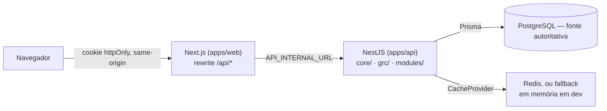

Status: vigente — roteiro de entrada, verificado contra o código e contra `docs/guides/development.md` em
2026-09-14.

# Comece aqui

Este é o ponto de entrada para qualquer pessoa (ou agente) novo no PharosGRC. Ele não substitui os
documentos de assunto — cada seção aponta para a fonte de verdade e diz o que buscar lá.

---

## O que é o PharosGRC

PharosGRC é uma plataforma corporativa de Governança, Riscos e Compliance (GRC), construída
incrementalmente por módulo. Começou por Gestão de Riscos e hoje cobre onze módulos de negócio —
Riscos, Controles, Compliance, Auditoria/Achados, Ativos, Processos, Incidentes, Problemas,
Dashboard, Indicadores e Relatórios — sobre um núcleo de plataforma (identidade, sessões,
autorização, organizações, auditoria) e um núcleo GRC compartilhado (Evidência, Ação, Achado).
Interface em português do Brasil; identificadores técnicos em inglês (CLAUDE.md §11.1).

## Arquitetura em alto nível



- **Origem única** (ADR-014): o navegador só fala com `apps/web`; não há CORS, não há token
  visível ao cliente — o cookie de sessão httpOnly é sempre first-party.
- **Backend em três áreas**, com direção de dependência fixa e verificada por lint
  (`eslint-plugin-boundaries`, ADR-011): `core/**` (transversal de plataforma) nunca importa
  `modules/**` nem `grc/**`; `grc/**` (núcleo GRC compartilhado — Evidência/Ação/Achado, ADR-016)
  nunca importa `modules/**`; `modules/**` (os onze domínios de negócio) pode depender de `core/`
  e de `grc/`, nunca de outro `modules/*`.
  entre si.
- **PostgreSQL é sempre a fonte autoritativa**; Redis (ou o *fallback* em memória sem
  `REDIS_URL` em desenvolvimento) é cache de validação, nunca a fonte de verdade — de sessão,
  permissão ou escopo organizacional.
- **Todo endpoint tem contrato OpenAPI hand-authored antes da implementação**
  (`specs/<fase>/contracts/*.openapi.yaml`) — é a fonte de verdade de campo, não o documento
  refletido (`apps/api/openapi.json`, ADR-024).
- **Autorização é sempre server-side**, em duas camadas independentes: permissão
  (`resource:action`, nunca um booleano "é admin") e escopo organizacional (`ScopeFilter`,
  nunca opcional). O frontend só oculta/desabilita — nunca decide.
- **Relacionamento entre domínios GRC é sempre explícito**: tabela de ligação nomeada com seu
  próprio tipo de auditoria, ou registro de tipo fechado para uma capacidade transversal (CLAUDE.md
  §19.3) — nunca uma tabela genérica `related_entity(type, id)`.

Detalhe completo, com todos os pontos de extensão e um exemplo passo a passo de módulo novo:
[`docs/architecture.md`](./architecture.md).

## Como subir o ambiente, em 10 passos

Comandos copiados de [`docs/guides/development.md`](./guides/development.md) §2 (verificados contra
`package.json`). Esse documento tem o detalhe completo de cada variável de ambiente e das
armadilhas já pagas — leia-o antes de investigar um erro de boot.

```bash
# 1. Clonar e instalar
git clone <repository-url> pharos-grc && cd pharos-grc
corepack enable
pnpm install --frozen-lockfile

# 2. Arquivos de ambiente (um único .env.example na raiz)
cp .env.example .env
cp .env.example apps/api/.env
# defina SEED_ADMIN_PASSWORD nos dois arquivos — nunca versionado

# 3. Provisionar PostgreSQL — não é um comando único, é um pré-requisito:
#    duas bases (pharos_grc, pharos_grc_test), dois papéis cada (pharos_owner/pharos_app,
#    ADR-005), extensões pg_trgm e citext. Nativo (provisionar manualmente, espelhando
#    docker/postgres/init/01-roles.sql) ou via `docker compose up -d --build` (seção 3 de
#    docs/guides/development.md).

# 4. Cliente Prisma
pnpm --filter @pharos/api run db:generate

# 5. Migração — sempre deploy, nunca dev, contra um banco real
pnpm --filter @pharos/api exec prisma migrate deploy

# 6. Seed (cria permissões, papéis de sistema, unidade raiz, admin)
pnpm --filter @pharos/api run db:seed

# 7. Pacotes internos que apps/web consome já BUILDADOS
pnpm --filter @pharos/api-types run generate
pnpm --filter @pharos/api-types run build
pnpm --filter @pharos/design-system run build

# 8. Terminal 1 — API (NestJS em :3001)
pnpm --filter @pharos/api dev

# 9. Terminal 2 — Web (Next.js/Turbopack em :3000)
pnpm --filter @pharos/web dev

# 10. Confirmar e entrar
curl http://localhost:3001/api/v1/health/ready
# abrir http://localhost:3000, login com SEED_ADMIN_EMAIL / SEED_ADMIN_PASSWORD
```

## Ordem de leitura recomendada para o primeiro dia

Nem tudo abaixo é leitura de primeiro dia de verdade — a lista completa (10 documentos inteiros)
é mais do que qualquer pessoa lê antes de escrever a primeira linha. Dois grupos, deliberadamente
separados:

**Essencial antes de tocar em qualquer código** (viável num primeiro dia real):

1. **Este documento**, inteiro — visão geral, vocabulário mínimo, os 10 passos de ambiente, o mapa
   de módulos, as decisões que não podem ser desfeitas.
2. **[`docs/STATE.md`](./STATE.md)** — o que existe hoje de verdade, o que é parcial, o que está
   planejado, pendências conhecidas. Sem isso, é fácil assumir que algo funciona porque tem
   documento.
3. **[`docs/architecture.md`](./architecture.md)**, ao menos a visão geral e os limites
   core/grc/modules — o suficiente para não confundir "onde este código deveria morar" (o erro mais
   comum registrado neste projeto, §"Conceitos-chave" abaixo).

Isso já é suficiente para navegar o repositório, subir o ambiente e entender a forma do produto sem
travar em nenhuma das primeiras tarefas típicas (ler um módulo, rodar os testes, propor uma mudança
pequena).

**Referência — leia a seção relevante quando for de fato tocar naquele assunto, não antes:**

- **[`docs/architecture/security.md`](./architecture/security.md)** — antes de tocar em qualquer endpoint, guard, permissão ou
  escopo organizacional.
- **[`docs/architecture/database.md`](./architecture/database.md)** — antes de alterar `schema.prisma` ou criar uma migração.
- **[`docs/architecture/frontend.md`](./architecture/frontend.md)** — antes de criar ou alterar uma tela: shell autenticado,
  abstração de navegação obrigatória (`Link`/`useNavigate()`), Design System, catálogos pt-BR.
- **[`docs/modules/README.md`](./modules/README.md)** e o documento do módulo específico — antes de
  trabalhar dentro de um módulo de negócio; cada um tem status, caminhos de código e pendências
  próprias.
- **[`docs/guides/testing.md`](./guides/testing.md)** — antes de rodar ou escrever testes: as quatro camadas, o
  portão de cobertura de contrato (D-11), o mapeamento de jobs do CI.
- **[`docs/guides/development.md`](./guides/development.md)** §6 — antes de implementar uma funcionalidade nova
  ponta a ponta: o fluxo real observado em todas as fases já concluídas, com um exemplo concreto de
  endpoint só-leitura entre dois domínios.
- **[`CLAUDE.md`](../CLAUDE.md)** completo — §16-19 são as regras permanentes que qualquer trabalho
  de arquitetura, UI ou domínio GRC precisa respeitar, sem repetição a cada tarefa; vale a pena ler
  por completo antes de propor uma decisão arquitetural, mesmo que não no primeiro dia.

## Conceitos-chave que precisam ser entendidos antes de mudar qualquer coisa

- **`core/` vs `grc/` vs `modules/`** — três áreas do backend com uma única direção de dependência
  permitida cada (§ acima, detalhe em `docs/architecture.md`). Confundir "compartilhado entre
  módulos" com "deveria morar em `core/`" é o erro mais comum — a régua é o critério de admissão de
  CLAUDE.md §19.4 (pelo menos três domínios precisam, nenhum é dono exclusivo).
- **Escopo organizacional é argumento obrigatório, nunca filtro opcional** — `ScopeFilter` é uma
  união fechada sem terceiro caso "irrestrito por omissão"; `ScopedRepository.withScope` exige o
  parâmetro em compilação. Ver `docs/architecture/security.md`.
- **Catálogo de permissões `resource:action`** — nunca um booleano "é admin"; fusão de declaração
  TypeScript (`declare module`) mais um agregador estático (`combinePermissionDefinitions`). Ver
  `docs/architecture.md` §"Permissions".
- **Dois mecanismos de relacionamento, e só dois** (CLAUDE.md §19.3) — tabela de ligação explícita
  e nomeada, ou registro de tipo fechado (enum verificado em compilação). Nunca
  `related_entity(type, id)` genérico.
- **`Action` é a única capacidade de ação/tarefa da plataforma** — o "Plano de Ação" do produto
  (CLAUDE.md §17 item 15) não é módulo, é `grc/action`, consumido por tratamento de risco, achado,
  incidente e remediação de conformidade. Nunca criar uma segunda tabela de tarefa dentro de um
  módulo novo.
- **Estado derivado tem um único calculador** (CLAUDE.md §19.7) — nível de risco, estado de
  conformidade, indicador: sempre calculado, nunca armazenado como campo editável em paralelo.
- **Auditoria é append-only, imposta no banco** — não só por disciplina de aplicação:
  `pharos_app` não tem `UPDATE`/`DELETE` em `audit_event`, e um gatilho recusa qualquer papel que
  tente. Ver `docs/architecture/security.md`/`docs/architecture/database.md`.
- **A abstração de navegação do frontend é obrigatória** — `Link`
  (`@/components/navigation/link`) e `useNavigate()` (`@/components/shell/navigation-pending`),
  nunca `next/link`/`useRouter` diretamente; bloqueado por regra de lint (ADR-023). Existe para que
  o loader institucional cubra toda navegação sem que cada tela precise lembrar disso.
- **Catálogos pt-BR centralizados** — toda string de usuário nova em
  `apps/web/src/lib/messages/<área>.ts` ou `apps/api/src/shared/messages/user-messages.ts`, nunca
  embutida em componente/controller (CLAUDE.md §11.1). `packages/design-system` não tem nenhuma
  string própria — tudo chega por prop.
- **O Design System é a camada de implementação autoritativa da UI** (CLAUDE.md §18.3) — estender
  `packages/design-system`, nunca criar estilo isolado por página nem divergência visual entre
  módulos sem justificativa registrada.
- **Processo dirigido por especificação** (CLAUDE.md §16) — Requisito → Especificação →
  Arquitetura → Plano → Tarefas → Implementação → Testes → Revisão. Nenhuma implementação de negócio
  começa a partir de uma ideia informal; toda fase vive em `specs/NNN-<slug>/`.
- **Verificação renderizada é parte da definição de pronto** (CLAUDE.md §18.1/§18.11) — uma
  mudança visual não está concluída porque compila; precisa ser inspecionada na aplicação
  renderizada com `apps/web/scripts/ui-capture.mjs` e passar pelo portão de aceitação visual.

## Principais comandos

Verificados contra `package.json` de cada pacote. Detalhe completo em `docs/guides/development.md` §4.

| Comando | Onde | O que faz |
|---|---|---|
| `pnpm install` | raiz | Instala o monorepo inteiro |
| `pnpm build` / `pnpm lint` / `pnpm typecheck` | raiz | `pnpm -r --if-present run <script>` — todo pacote |
| `pnpm test:unit` / `test:integration` / `test:contract` / `test:e2e` | raiz | Delega ao script de mesmo nome em cada pacote |
| `pnpm --filter @pharos/api dev` | API | `nest start --watch`, porta 3001 |
| `pnpm --filter @pharos/web dev` | Web | `next dev --turbopack`, porta 3000 |
| `pnpm --filter @pharos/api exec prisma migrate deploy` | API | Aplica migrações já commitadas — único comando seguro contra um banco compartilhado |
| `pnpm --filter @pharos/api run db:seed` | API | `prisma db seed` — permissões, papéis, unidade raiz, admin |
| `pnpm --filter @pharos/web run test:e2e` | Web | Playwright — requer `SEED_ADMIN_EMAIL`/`SEED_ADMIN_PASSWORD` no shell |
| `node apps/web/scripts/ui-capture.mjs <dir> [--theme=light\|dark]` | Web | Captura renderizada com Playwright (CLAUDE.md §18.13) |

## Mapa de módulos

| Módulo | Status | Doc | Caminho API | Caminho Web |
|---|---|---|---|---|
| Plataforma (Core) | IMPLEMENTADO (2 exceções — `docs/STATE.md` §3) | [`platform.md`](./modules/platform.md) | `apps/api/src/core/**` | `apps/web/src/app/(app)/admin/**`, `/profile` |
| Núcleo GRC compartilhado | IMPLEMENTADO | [`grc-core.md`](./modules/grc-core.md) | `apps/api/src/grc/**` | `features/{actions,evidence,findings}/`, `/actions` |
| Gestão de Riscos | IMPLEMENTADO | [`risks.md`](./modules/risks.md) | `apps/api/src/modules/risk/` | `.../risks/`, `features/risks/` |
| Controles e Compliance | IMPLEMENTADO | [`controls-compliance.md`](./modules/controls-compliance.md) | `apps/api/src/modules/{controls,compliance}/` | `.../controls/`, `.../compliance/` |
| Auditoria e Achados | IMPLEMENTADO | [`audit-engagements.md`](./modules/audit-engagements.md) | `apps/api/src/modules/audit-engagements/`, `grc/finding/` | `.../audits/` |
| Ativos e Processos | IMPLEMENTADO | [`assets-processes.md`](./modules/assets-processes.md) | `apps/api/src/modules/{assets,processes}/` | `.../assets/`, `.../processes/` |
| Incidentes e Problemas | IMPLEMENTADO | [`incidents-problems.md`](./modules/incidents-problems.md) | `apps/api/src/modules/{incidents,problems}/` | `.../incidents/`, `.../problems/` |
| Indicadores e Relatórios | IMPLEMENTADO no núcleo, PARCIAL em UI (`docs/STATE.md` §3) | [`indicators-reports.md`](./modules/indicators-reports.md) | `apps/api/src/modules/{indicators,reports}/` | `.../indicators/`, `.../reports/` |
| Dashboard GRC | IMPLEMENTADO (agregação) | [`dashboard.md`](./modules/dashboard.md) | `apps/api/src/modules/dashboard/` | `.../dashboard/` |

## Decisões arquiteturais críticas que não podem ser desfeitas

Cada uma tem uma razão concreta registrada — não são preferências de estilo:

- **Sessão opaca server-side, nunca JWT** — ADR-002. Sem segredo de assinatura para gerenciar; a
  revogação é imediata porque o servidor é a fonte de verdade.
- **Escopo organizacional obrigatório em todo repositório com dado sensível** — ADR-004, reforçado
  em AGENTS.md. Duas fases (`specs/006`, `specs/008`) já corrigiram vazamento real por ignorar isso.
- **Auditoria append-only imposta no banco** — ADR-005, dois mecanismos redundantes (privilégio
  revogado + gatilho).
- **Módulo de negócio nunca importa outro módulo de negócio** — ADR-011, imposto por lint, não por
  revisão.
- **`grc/` nunca importa `modules/`** — ADR-016. É o que mantém Evidência/Ação/Achado reutilizáveis.
- **Requisito de Compliance pertence a uma versão de framework; Controle não pertence a framework
  algum** — ADR-017. Nunca duplicar controle por norma.
- **Origem única, sem CORS** — ADR-014. Todo o modelo de CSRF e de cookie first-party depende disso.
- **`packages/api-types` gera dos contratos hand-authored, nunca do documento refletido** —
  ADR-024/D-14.
- **Seis primitivos shadcn modificados deliberadamente por acessibilidade** — D-15
  (`docs/local-environment.md`): `dialog.tsx`, `select.tsx`, `avatar.tsx`, `sheet.tsx`,
  `checkbox.tsx`, `table.tsx`. Nunca regenerar às cegas.
- **Navegação passa pela abstração própria, nunca pela API nativa do Next.js** — ADR-023, imposto
  por lint.

## Estado atual e pendências

Onze módulos de negócio implementados, roteiro planejado (Fases 0–7) concluído; cinco fases
adicionais de correção/refinamento entregues desde então, a última (`specs/015`, Superfície de
Papéis e Permissões) **fechada em 2026-09-14** com regressão final verde e zero bloqueadores — ver
**[`docs/STATE.md`](./STATE.md)** §10. Pendências reais, técnicas e de produto, estão listadas com
evidência lá — não repetidas aqui.

## Onde investigar cada assunto

| Assunto | Documento | Caminho de código |
|---|---|---|
| Login, sessão, CSRF, RBAC, escopo, auditoria | `docs/architecture/security.md` | `apps/api/src/core/{identity,sessions,authorization,audit}/` |
| Modelo de dados, migrações, seed | `docs/architecture/database.md` | `apps/api/prisma/` |
| Limites de módulo, pontos de extensão | `docs/architecture.md` | `apps/api/src/{core,grc,modules}/`, `apps/api/eslint.config.mjs` |
| Shell, navegação, Design System, i18n | `docs/architecture/frontend.md` | `apps/web/src/components/shell/`, `packages/design-system/` |
| Um módulo de negócio específico | `docs/modules/<módulo>.md` | ver tabela "Mapa de módulos" acima |
| Testes e CI | `docs/guides/testing.md` | `apps/api/test/`, `apps/web/e2e/`, `.github/workflows/ci.yml` |
| Setup, comandos, variáveis de ambiente | `docs/guides/development.md` | `.env.example`, `apps/api/src/infrastructure/config/env.schema.ts` |
| Sintoma conhecido → causa | `docs/guides/troubleshooting.md` | — |
| Decisão arquitetural específica | `docs/architecture/decisions.md` (ADR-016+) / `specs/001-.../research.md` (ADR-001–015) | — |
| Armadilha de ambiente já paga | `docs/local-environment.md` (D-1..D-23) | — |
| Defeito/débito conhecido | `docs/deferred-findings.md` (F-1..F-73) | — |
| Regras permanentes de produto/UX/domínio | `CLAUDE.md` §11.1, §18, §19 | — |

## Como a documentação está organizada

`docs/README.md` tem a tabela completa "fonte de verdade por assunto" e separa **Vigente**
(descreve o estado atual, mantido junto com o código) de **Histórico** (registro de um momento —
uma fase, uma revisão, um benchmark — nunca reescrito, sempre corrigido por adendo datado). Ao
mudar comportamento do produto, atualize o documento de assunto correspondente na mesma mudança;
`docs/guides/development.md` §6.9 descreve o fluxo completo de atualização de documentação ao fechar uma
fase.
