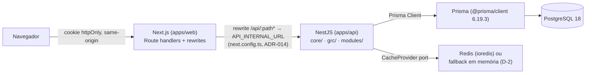

# PharosGRC — Module Boundaries and Extension Points

> **SC-011 status, 2026-09-06 — verified.** A second, independent probe run (T206a) built a real module,
> exercised every extension point through real HTTP against real PostgreSQL, and modified exactly **one**
> file outside its own tree: the permitted navigation-registry entry. Zero edits to `core/`, to
> `modules/risk/`, or to the shell beyond that entry.
>
> That was not true on the first attempt. Two extension points failed (finding **F-22**) and were rebuilt
> as genuine registries; before that, ADR-011 had claimed seven extension points were proven when three
> did not exist (finding **F-7**). The criterion is now evidence rather than assertion, and it took three
> attempts to get there.
>
> **Three residual costs a permanent module still pays** are recorded in **F-23** — read it before
> building module number two. The one that matters: the pt-BR message catalog has no per-module
> extension mechanism, so a real module must edit a shared file to comply with D-8.
>
> **2026-09-11 addendum (007-implementation-remediation, Front G) — supersedes counts and framing
> below, never erases them.** This document was written when Risk was the only business module.
> Six now exist (`assets`, `audit-engagements`, `compliance`, `controls`, `processes`, `risk` —
> `ls apps/api/src/modules/`, verified directly). Every place below that says "risk is the only
> module that exists" or frames adding a module as "module number two" describes the state as of
> 2026-09-06, not today; a real second module (Controls) was already added the same week this
> document was written, and four more since. The mechanisms and boundary rules described below are
> still accurate — they are what those five later modules actually used — only the module-count
> claims and the "number two" framing are stale.
>
> **2026-09-14 addendum — supersedes the count above, never erases it.** Eleven modules exist today
> (`ls apps/api/src/modules/`, verified directly): `assets`, `audit-engagements`, `compliance`,
> `controls`, `dashboard`, `incidents`, `indicators`, `problems`, `processes`, `reports`, `risk` —
> five more since 2026-09-11 (`dashboard`, `incidents`, `indicators`, `problems`, `reports`), closing
> out every module CLAUDE.md §17 planned through Fase 7 of `docs/architecture/grc-roadmap.md`. The
> [Navigation](#2-navigation) section below is also stale in the same way it was on 2026-09-11: it
> still describes ten of eleven navigation entries as `status: 'planned'`, which was true then and is
> not true now — every business-module entry in `apps/web/src/components/shell/navigation-registry.ts`
> is `status: 'implemented'` today, confirmed by direct grep. See the [Visão geral](#visão-geral-2026-09-14)
> block below for current stack versions and the monorepo map.


This document explains how PharosGRC's backend and frontend are partitioned, which dependency
directions are legal, how those rules are enforced, and — the part a developer building module
number two actually needs — every point in the codebase where a new GRC module plugs into the
platform without editing platform code. It is written for an engineer who knows TypeScript and
NestJS but has never seen this repository.

Everything here is verified against the code as it stands on `main` at the time of writing. Where
a mechanism is described as an extension point, it has already been exercised at least once, by
Risk Management, unless explicitly marked **planned**. Where the codebase falls short of what an
ADR or the plan promises, that is called out rather than smoothed over — see
[Known gaps and honest limits](#known-gaps-and-honest-limits).

This is developer documentation and is written in English, matching the rest of `docs/` and
`specs/`. That is a deliberate choice, not an oversight of CLAUDE.md §11.1: the pt-BR rule governs
the product's *user interface* — what a Brazilian GRC practitioner reads on screen — not the prose
engineers use to reason about the system. §11.1 itself draws this line by naming "code comments"
as a technical-identifier category that stays in English; this document is the same category of
text, at a larger grain.

## Contents

- [Visão geral (2026-09-14)](#visão-geral-2026-09-14)
- [The core/modules split](#the-coremodules-split)
- [Why this is enforced by lint, not review](#why-this-is-enforced-by-lint-not-review)
- [The grc/ shared kernel (ADR-016)](#the-grc-shared-kernel-adr-016)
- [Extension points, one by one](#extension-points-one-by-one)
  1. [Permissions](#1-permissions)
  2. [Navigation](#2-navigation)
  3. [Audit](#3-audit)
  4. [Organizational scope](#4-organizational-scope)
  5. [The pt-BR message catalogs](#5-the-pt-br-message-catalogs)
  6. [Comments and attachments (entity-type registries)](#6-comments-and-attachments-entity-type-registries)
  7. [The dashboard](#7-the-dashboard)
  8. [Cross-module relationships](#8-cross-module-relationships)
- [Rules that are not obvious from reading the code](#rules-that-are-not-obvious-from-reading-the-code)
- [Known gaps and honest limits](#known-gaps-and-honest-limits)
- [Worked example: adding module number two](#worked-example-adding-module-number-two)

---

## Visão geral (2026-09-14)

> Escrito em pt-BR, deliberadamente: é o único bloco deste documento em inglês técnico que ganha uma
> introdução em português, porque este parágrafo é o ponto de entrada que um novo desenvolvedor lê
> primeiro. O resto do documento segue em inglês, como o cabeçalho acima já justifica.

PharosGRC é uma plataforma corporativa de GRC (Governança, Riscos e Compliance), com um backend
NestJS modular-monolítico, um frontend Next.js, PostgreSQL como armazenamento autoritativo e Redis
(com fallback em memória em desenvolvimento) como cache não-autoritativo. Onze módulos de negócio
existem hoje sobre um núcleo de plataforma e um núcleo GRC compartilhado — ver
[§ The core/modules split](#the-coremodules-split) para os limites exatos.

**Stack — versões reais** (verificadas em `package.json`, 2026-09-14):

| Camada | Tecnologia | Versão |
|---|---|---|
| Backend | NestJS (`@nestjs/core`/`common`/`platform-express`) | 11.2.3 |
| Backend | Prisma (`@prisma/client`/`prisma`) | 6.19.3 |
| Backend | PostgreSQL | 18 (`docs/local-environment.md`) |
| Backend | Redis (`ioredis`) | 6.0.0 — opcional em dev, obrigatório em produção (D-2) |
| Backend | `argon2` (hash de senha) | ^0.45.1 |
| Frontend | Next.js | 15.5.25 (App Router) |
| Frontend | React | 19.0.8 |
| Frontend | Tailwind CSS | 4.3.3 |
| Frontend | Playwright | 1.63.0 |
| Transversal | TypeScript | 5.9.3 |
| Transversal | pnpm | 10.34.5 (`packageManager`, `engines.node >=22`) |
| Transversal | `eslint-plugin-boundaries` | 7.2.0 |

**Mapa do monorepo** — quatro pacotes hoje, nenhum outro existe em `packages/`:

| Pacote | Caminho | Responsabilidade |
|---|---|---|
| API | `apps/api` | Backend NestJS — `core/`, `grc/`, `modules/`, `infrastructure/`, `shared/` (ver seções abaixo) |
| Web | `apps/web` | Frontend Next.js App Router — interface pt-BR (CLAUDE.md §11.1), consome a API via proxy same-origin (abaixo) |
| `@pharos/design-system` | `packages/design-system` | Tokens Tailwind CSS 4 e componentes compostos (`PageHeader`, `EmptyState`, `ConfirmDialog`, `StatusBadge`, `RiskLevelBadge`, ...) sobre primitivos Radix; **zero string voltada ao usuário embutida** — todo texto chega por prop (CLAUDE.md §18.3) |
| `@pharos/api-types` | `packages/api-types` | Tipos TypeScript gerados por `openapi-typescript` a partir dos contratos hand-authored (`specs/*/contracts/*.openapi.yaml`) — nunca de `apps/api/openapi.json` (ver "Contratos e tipos" abaixo, D-14) |

`apps/web/src/components/ui/` guarda primitivos gerados pelo `shadcn` — não é um pacote do
monorepo, e seis desses arquivos estão deliberadamente modificados por acessibilidade e não podem
ser regenerados às cegas (D-15, `docs/local-environment.md`).

**Fluxo de requisição**:



**Como o Web chama a API (ADR-014, "single origin")**: o navegador nunca fala com a API
diretamente — não existe `NEXT_PUBLIC_API_URL`, não há CORS configurado, e uma busca por
`NEXT_PUBLIC_` em `apps/web/src` não retorna nada. `apps/web/next.config.ts` declara um
`rewrites()` que encaminha `/api/:path*` para `API_INTERNAL_URL` (variável server-side, validada por
`apps/web/src/lib/env.ts`, nunca exposta ao bundle do navegador). `apps/web/src/lib/api-client.ts` é
um wrapper `fetch` tipado à mão (não um SDK gerado) que só chama caminhos relativos
(`API_BASE_PATH = '/api/v1'`) com `credentials: 'include'` — o cookie de sessão httpOnly permanece
first-party porque o rewrite mantém tudo na mesma origem; não existe cabeçalho `Authorization` nem
token visível ao cliente. Um 401 aciona um seam plugável (`setUnauthorizedHandler`) que reabre um
diálogo de reautenticação no lugar, em vez de redirecionar — consistente com ADR-002 (revogação de
sessão só é descoberta na próxima requisição). Não existem route handlers próprios sob
`apps/web/src/app/api/**` nem `middleware.ts` — o proxy inteiro é o `rewrites()` do
`next.config.ts`.

**Tratamento de erro — RFC 9457 Problem Details**: confirmado.
`apps/api/src/infrastructure/http/problem-details.filter.ts` (`ProblemDetailsFilter`, filtro de
exceção global) responde `application/problem+json` com `type` no formato
`https://pharosgrc.dev/problems/<slug>` (`/unauthorized`, `/forbidden`, `/not-found`,
`/version-conflict`, `/validation`, `/rate-limited`, ...), mais `title`, `status`, `detail`,
`instance` (a URL da requisição) e `correlationId` — nunca stack trace, identificador interno ou
mensagem crua de banco; o detalhe completo vai só para o log do servidor. Ver
[`docs/architecture/security.md`](./architecture/security.md) para o tratamento de erro como superfície de segurança.

**Contratos e tipos (D-14)**: os contratos hand-authored em `specs/<fase>/contracts/*.openapi.yaml`
(14 arquivos, um por área de fase) são a fonte de verdade de campo — não `apps/api/openapi.json`.
`apps/api/openapi.json` é gerado refletindo decoradores `@nestjs/swagger`, e como nenhum DTO deste
código carrega `@ApiProperty`, seus 80 esquemas de componente são todos
`{"type":"object","properties":{}}` — o gerador descreve rotas, não campos. `openapi:check`
(`apps/api/scripts/check-openapi.ts`) continua útil como detector de deriva **de rota** (rota
adicionada/removida/renomeada), mas não pode ver um campo de DTO renomeado ou retipado — não deve
ser lido como prova de mais do que isso. `packages/api-types` é gerado por
`pnpm --filter @pharos/api-types run generate` (`openapi-typescript` 7.13.0) a partir dos 14
contratos hand-authored, um namespace por documento — nunca do documento refletido. Ver
[`docs/architecture/decisions.md`](./architecture/decisions.md) para a ADR que formaliza esta decisão
e sua relação com ADR-009.

Para além desta visão geral: [`docs/architecture/security.md`](./architecture/security.md) (segurança e tratamento de erro),
[`docs/architecture/database.md`](./architecture/database.md) (modelo de dados, migrações, seed),
[`docs/architecture/frontend.md`](./architecture/frontend.md) (estrutura do Next.js, Design System, i18n) e
[`docs/modules/README.md`](./modules/README.md) (um módulo de negócio por documento) cobrem cada área
em profundidade — este bloco não as duplica.

---

## The core/modules split

The backend (`apps/api`) is one NestJS process — a modular monolith, not microservices (ADR-011,
plan.md). Its `src/` tree is partitioned into five top-level areas:

| Area | Path | Contains |
|---|---|---|
| Shared kernel | `src/shared/**` | Error types, the pt-BR message catalog, pagination, the scoped-repository base, id helpers — leaf dependencies with no imports of their own |
| Infrastructure | `src/infrastructure/**` | Framework-facing plumbing with no business rules: `PrismaService`, Redis/cache adapters, logging, env-schema validation, the exception filter, health checks |
| Core | `src/core/<capability>/**` | Transversal platform capabilities: `identity`, `sessions`, `authorization`, `organizations`, `audit`, `comments`, `dashboard`, `files`, `notifications` today (2026-09-11 addendum: this row originally said only the first five existed; `comments`/`dashboard`/`files`/`notifications` were added since, matching what [Known gaps](#known-gaps-and-honest-limits) already correctly says lower in this same document. Still missing: `users`, `configuration`). Note the name collision with `modules/dashboard` below — they are not the same thing; see that row. |
| Shared GRC kernel | `src/grc/<capability>/**` | Cross-domain GRC capabilities admitted by ADR-016's own three-domain criterion (see below): `evidence`, `action`, `finding` today |
| Modules | `src/modules/<module>/**` | Business domains. **Eleven exist today (2026-09-14 addendum, superseding the 2026-09-11 claim of six)**, verified directly against `ls apps/api/src/modules/`: `assets`, `audit-engagements`, `compliance`, `controls`, `dashboard`, `incidents`, `indicators`, `problems`, `processes`, `reports`, `risk`. `modules/dashboard` (`GET /dashboard/summary`) is distinct from `core/dashboard` (the planned-area registry, [§7](#7-the-dashboard)): it exists because the cross-domain dashboard aggregate cannot live inside `modules/risk` — `core/**` never imports `modules/**`, so a domain-agnostic summary spanning Risk/Incidents/Problems/Controls/Compliance/Audit needed its own module reading the platform's own `IndicatorCalculationPort` (`specs/011-dashboard-platform-view/STATE.md` §2.2-§2.3). `modules/reports`/`modules/indicators` are the Fase 7 (`specs/009-indicators-reports/`) catalogue and report definitions. |

Every core capability, every `grc/` capability and every business module is internally layered the
same way:

```
domain          → entities, value objects, pure business rules; no I/O, no framework import
application     → use cases, transactional orchestration; may depend on domain
infrastructure  → Prisma repositories, adapters implementing domain ports; may depend on domain + application
presentation    → controllers, DTOs, OpenAPI decorators; may depend on domain + application
```

Dependencies point inward only: `presentation`/`infrastructure` → `application` → `domain`, never
the reverse. `domain` imports nothing from its own module's other three layers.

The governing rules, stated precisely because "core vs grc vs modules" is easy to get half-right:

- **`core/**` never imports from `modules/**`.** Core has no idea Risk Management exists.
- **`core/**` never imports from `grc/**`.** The platform cannot depend on the GRC kernel
  (ADR-016) — `grc/` is optional cross-domain machinery, not a platform capability core needs.
- **`grc/**` never imports from `modules/**`.** The GRC kernel cannot depend on a business
  domain — that is exactly the coupling ADR-016 exists to prevent. A `grc/` capability that needs
  to resolve or verify a business-module record does it through a port the `grc/` capability
  itself publishes (e.g. `EvidenceSubjectResolverPort`, `ActionOriginResolverPort` — see
  [below](#the-grc-shared-kernel-adr-016)), never by importing `modules/risk` directly.
- **`grc/**` may depend on `core/**`**, the same directed edge business modules are allowed —
  `EvidenceModule`/`ActionModule`/`FindingModule` import `AuditModule`, `OrganizationsModule`,
  `AuthorizationModule` and the top-level `PrismaModule` directly, exactly like `RiskModule` does.
- **`modules/**` may depend on `grc/**`.** This is the direction that makes Evidence/Action/Finding
  reusable without any business module importing another business module: `modules/risk`'s own
  treatment-action use case calls into `grc/action` directly (see
  [below](#the-grc-shared-kernel-adr-016)).
- **`modules/a/**` never imports from `modules/b/**`.** There is currently only one module, so
  this rule is unexercised in practice, but it is enforced (see below) and will bind the moment a
  second module is added. A cross-module need must go through a port the owning module publishes.
- **`modules/**` may depend on `core/**`.** This is the one directed edge business code is allowed
  to draw straight to core — `RiskModule` imports `AuditModule`, `OrganizationsModule` and the
  top-level `PrismaModule` directly (`apps/api/src/modules/risk/risk.module.ts`).
- **`shared/**` imports nothing** from `core`, `grc`, `modules` or `infrastructure`; every layer of
  every capability and module may import `shared`.

## Why this is enforced by lint, not review

A boundary that lives only in a document erodes at the first deadline; ADR-011's own words are "a
lint rule fails the build." The enforcement is `eslint-plugin-boundaries`, configured in
`apps/api/eslint.config.mjs`. Read that file's own header comment in full before touching module
structure — it explains a real constraint of the plugin (capture matching needs one capturing
group per pattern, which is why there are ten separate element types instead of one "layer"
capture) that shapes how the whole ruleset is written.

The mechanics, concretely:

- Fourteen element types are derived from path patterns: `shared`, `infrastructure`, four
  `core-*` layer types (each capturing its capability name, e.g. `identity`, `audit`), four
  `grc-*` layer types (each capturing its `grc/` capability name, e.g. `evidence`, `action`), and
  four `module-*` layer types (each capturing its module name). This grew from ten to fourteen when
  `grc/` was added (ADR-016) — a fresh capture group per new top-level area, not a change to the
  plugin's own constraint this section describes.
- `default: 'disallow'` — every legitimate dependency direction is an explicit `allow` policy;
  anything not explicitly allowed is a build failure. This is why the "core never imports modules"
  rule barely needs to be written: it is already denied by default. It is written anyway, as an
  explicit `disallow` policy with its own message, "so it cannot be silently reopened by an
  earlier, broader policy" (the file's own comment) — a real defense against a future edit
  accidentally widening an `allow` rule enough to let it through.
- Module isolation (`modules/a` cannot import `modules/b`) works by templating the `module`
  capture back from the *importing* element: an `allow` policy for `module-application` only
  matches a target whose captured `module` equals `'{{from.element.captured.module}}'`. A
  cross-module import never matches that policy, falls through every other policy, and hits the
  `disallow` default.
- Composition-root files — `app.module.ts`, `main.ts`, `permission-catalogue.ts`, and every
  `*.module.ts` one level under `core/<capability>/`, `grc/<capability>/` or `modules/<module>/` —
  match their own `boundaries/files` category (`composition`), separate from the fourteen layer
  element types above, precisely because these files legitimately import across areas to wire the
  application together (`permission-catalogue.ts`'s own paragraph above is the concrete example).
  `boundaries/no-unknown-files: 'error'` is also enabled, so a file matching none of these
  categories fails lint outright — there is no silent fifteenth bucket.

Run it yourself: `pnpm --filter @pharos/api lint` (or the workspace-root `pnpm lint`) fails on any
violation. There is no separate "architecture lint" command — it is part of the same lint pass
every change already has to pass under CLAUDE.md §13.

The frontend has no equivalent tool-enforced boundary; its extension points ([Navigation](#2-navigation),
[Message catalogs](#5-the-pt-br-message-catalogs)) are enforced by TypeScript's structural typing
(a malformed navigation entry is a compile error) rather than a lint plugin, because there is only
one presentation-layer tree (`apps/web/src`), not a business-modules directory to police yet.

---

## The grc/ shared kernel (ADR-016)

**Status: implemented** — `evidence`, `action` and `finding`, added in the "Shared GRC Foundation"
phase. `Control` was evaluated against the same admission criterion and deliberately excluded (see
below); no `grc/control` tree exists.

### Why a third area, not a fourth business module

CLAUDE.md §19.4 sets the admission test for a shared GRC capability: **at least three domains need
it, and no one of them may be its exclusive owner.** Evidence, Action and Finding all pass — Risk
Management, and later Incidents/Compliance/Audits, all need to attach proof to a decision and track
remediation work, and none of them is a legitimate sole owner of "proof" or "work" as concepts.
Putting them inside `modules/risk` would have reproduced the exact defect this phase's own spec
names as its concrete motivation: a benchmark product whose `Evidence` is bolted to a single
subject type by a mandatory foreign key, so audit findings and incident remediation have nowhere to
register proof. Putting them inside `core/` was also rejected — core is genuinely domain-agnostic
platform machinery (sessions, permissions, audit, organizations); Evidence/Action/Finding carry real
GRC domain vocabulary (severity, treatment, remediation) that core has no business knowing about.
`grc/` is the third position: reusable across GRC domains, but never a dependency of the
domain-agnostic platform.

### The two registries a future module actually uses

Unlike [comments/attachments](#6-comments-and-attachments-entity-type-registries), which live in
`core/` because every module (GRC or not) might want them, these two registries live in
`grc/shared/domain/ports/` because only a GRC-domain module would ever call them — putting them in
`core/` would violate "`core/**` never imports from `grc/**`" for no reason, since nothing in `core/`
needs them.

- **`EvidenceSubjectResolverPort`** (`grc/shared/domain/ports/evidence-subject-resolver.port.ts`) —
  resolves whether a given `(EvidenceSubjectType, subjectId)` pair exists, is within the caller's
  scope, and what label to show for it, without `grc/evidence` ever importing the owning module.
  `registerEvidenceSubjectResolver(type, accessor)` is called from **four** different composition
  roots today: `modules/risk`'s (`RiskModule`, for `RISK` and `RISK_TREATMENT_DECISION`, via an
  adapter — the only one of the four that crosses the `grc → core`-only boundary, because the
  resolved module lives in `modules/**`) and `grc/action`'s and `grc/finding`'s own modules (for
  `ACTION` and `FINDING`, registered directly — no adapter needed, because both live in `grc/**`
  already). Adding a fifth subject type (e.g. `CONTROL`, once Controls exists) means adding the enum
  value by additive migration and calling this same function from the new module's own constructor —
  no edit to `grc/evidence` itself.
- **`ActionOriginResolverPort`** (`grc/shared/domain/ports/action-origin-resolver.port.ts`) — the
  identical shape for `ActionOriginType`, resolving `RISK_TREATMENT` (`modules/risk`, via an
  adapter) and `FINDING` (`grc/finding`, directly). A future `INCIDENT` or `COMPLIANCE_GAP` origin
  follows the same recipe.

Both registries are the concrete mechanism behind ADR-016's promise: a GRC capability that depends
on "does this other record exist, and can this caller see it" without ever importing the module
that owns that record.

### The one place `modules/** → grc/**` is actually exercised

`modules/risk`'s treatment-action use cases (`modules/risk/application/treatment-actions/
create-treatment-action.usecase.ts`, `update-treatment-action.usecase.ts`) call directly into
`grc/action` to create and mirror a real `Action` row alongside the legacy `RiskTreatmentAction`
row, via `RiskTreatmentAction.actionId` (data-model.md §7, R-003). This is the one live proof that
`modules/** may depend on grc/**` is not just an allowed lint direction but an exercised one. It is
also a deliberately temporary, imperfect bridge — see
[Known gaps and honest limits](#known-gaps-and-honest-limits) for the coexistence window this
creates and its planned closure ahead of the Incidents phase.

### What was deliberately not built here

Per CLAUDE.md §19.3 and this phase's own spec, `grc/` introduces no generic `related_entity(type,
id)` table, no workflow engine, no metadata engine, and no universal entity model. Every
cross-subject relationship is one of the two sanctioned mechanisms: a real, named join entity
(`EvidenceLink`, with its own `AuditEntityType`) or a closed, compile-time-checked enum
(`EvidenceSubjectType`, `ActionOriginType`) — never a free-text discriminator column.

---

## Extension points, one by one

Each of these is the mechanism a future module (Problems, Incidents, Controls, ...) uses to make
itself visible to the platform without editing platform code. For each, the account below is drawn
from how Risk Management concretely does it — not from what the ADR says it should do.

### 1. Permissions

**Status: implemented.**

Permission identifiers are `resource:action` strings (`risk:view`, `risk:approve`, ...), never a
boolean admin flag (ADR-003, Constitution III). The registry lives in
`apps/api/src/core/authorization/domain/permissions.ts` and exposes **two** extension mechanisms
that a future module uses together, because they solve different problems:

1. **Compile-time — TypeScript declaration merging.** `PermissionIdentifier` is
   `keyof PermissionRegistry`. A future module augments the `PermissionRegistry` interface from
   its own file:

   ```ts
   declare module '@pharos/api/core/authorization/domain/permissions' {
     interface PermissionRegistry {
       'problem:view': true;
       'problem:create': true;
     }
   }
   ```

   No edit to `permissions.ts` is needed. The moment that declaration is compiled anywhere in the
   program, `@RequirePermission('problem:view')` type-checks and a typo fails `tsc` — this is the
   mechanism ADR-003 promises when it says a typo in a decorator is caught by the type system, not
   by a runtime check that silently never matches.

2. **Static aggregation — `combinePermissionDefinitions`.** The type-level merge only proves a
   string is a *valid shape*; something still has to hand the
   `{ identifier, resource, action, description }` row to the seed script. Each module owns a
   static definitions file — `modules/risk/domain/risk-permissions.ts` exports
   `RISK_PERMISSION_DEFINITIONS` and carries the `declare module` augmentation above — and a
   single aggregator, `src/permission-catalogue.ts`, imports every module's set and merges them
   with `combinePermissionDefinitions(...)`, which throws on a duplicate identifier rather than
   silently overwriting one. `getAllPermissionDefinitions()` lives on that aggregator.

   Risk Management was this mechanism's first real caller, not its only one anymore: the same
   aggregator also imports `grc/evidence`'s, `grc/action`'s and `grc/finding`'s own
   `EVIDENCE_PERMISSION_DEFINITIONS`, `ACTION_PERMISSION_DEFINITIONS` and
   `FINDING_PERMISSION_DEFINITIONS`, added by the "Shared GRC Foundation" phase — one import and
   one argument each, exactly as this section describes for a future module, and no edit to
   `modules/risk/**` or to this file's own extension point.

   **This replaced an earlier runtime registry** (`registerPermissionDefinitions`, called from a
   module's constructor at bootstrap), which could not work for the consumer that matters most:
   `prisma/seed/index.ts` boots a standalone Nest context containing only `AppConfigModule` and
   `PrismaModule`, never `RiskModule`, so a constructor-time registration would have been
   invisible to the seed and any role holding `risk:view` would have failed to seed. Static
   aggregation has no mutable state and no import-order hazard, so the application, the seed
   script and the test fixtures all see the identical set. (`test/integration/support/authorization-fixtures.ts`
   had independently documented the same ordering hazard before it was found.)

   The aggregator sits at `src/` root, alongside `app.module.ts`, deliberately: it is a
   composition-root file, importing both `core/**` and `modules/**`, and
   `eslint-plugin-boundaries` classifies neither. Nothing under `core/**` imports it — verify with
   a grep before assuming otherwise, because a `core -> permission-catalogue` import would make
   core transitively depend on a business module.

The seed script, `apps/api/prisma/seed/platform.seed.ts`, upserts every permission from
`getAllPermissionDefinitions()` (never a hand-copied list), then reconciles each system role's
`RolePermission` rows to exactly match a declared set — insertions and deletions both, so a
changed role definition converges on every re-run, not just an unchanged one.

A permission is checked in exactly one place: `@RequirePermission('risk:edit')` plus the global
`PermissionGuard` (`apps/api/src/core/authorization/presentation/permission.guard.ts`). The guard
fails closed on every path — no `@RequirePermission` and no explicit `@NoPermissionRequired()` opt-in
is a refusal, not a pass-through:

```ts
if (noPermissionRequired !== true) {
  await this.deny({
    actorUserId: this.currentActor.getCurrentActorUserId(),
    requiredPermission: undefined,
    reason: 'MISSING_PERMISSION_DECLARATION',
  });
  throw new ForbiddenDomainError();
}
```

The frontend has an advisory mirror, `apps/web/src/lib/permissions.ts`'s `usePermissions()` hook,
whose module doc comment states outright: **"THIS HOOK IS NOT A SECURITY BOUNDARY."** It exists
only to avoid showing a control whose click would 403; hiding a button with it must never be paired
with skipping the server check, because there is no client-side check to skip in the first place.

`PermissionAction.DELETE` exists in the enum but no `risk:delete` permission is seeded — FR-102
forbids ever hard-deleting a risk, so that identifier would govern an operation that does not
exist. `DELETE` is genuinely exercised by `attachment:delete` and `comment:delete` instead. A
future module should size its own permission set the same way: seed an action only if a real
operation uses it.

### 2. Navigation

**Status: implemented.**

`apps/web/src/components/shell/navigation-registry.ts` is the single list `Sidebar` and `Header`
render from — neither component hard-codes a module name, route or icon. Every one of PharosGRC's
eleven planned modules already has an entry:

```ts
export interface ImplementedNavigationEntry extends NavigationEntryBase {
  readonly status: 'implemented';
  readonly href: string;
}

export interface PlannedNavigationEntry extends NavigationEntryBase {
  readonly status: 'planned';
}

export type NavigationEntry = ImplementedNavigationEntry | PlannedNavigationEntry;
```

Because the union is checked with `satisfies readonly NavigationEntry[]`, giving a `'planned'`
entry an `href` or omitting `href` on an `'implemented'` one is a compile error — a malformed entry
cannot reach the shell.

**Stale as of 2026-09-11, corrected 2026-09-14 (verified directly by grep against
`navigation-registry.ts`): there are no `status: 'planned'` module entries left.** Every one of the
eleven business-module entries (Dashboard, Risks, Problems, Incidents, Controls, Assets, Processes,
Compliance, Audits, Indicators, Reports) is `status: 'implemented'`, each gated by its own
`requiredPermission`. `my-actions` (gated by `requiredPermission: 'action:view'`) is also
`status: 'implemented'` — added by the "Shared GRC Foundation" phase as the one cross-origin work
queue the shared `Action` capability motivates (spec 002's own "Assumptions": Evidence, Action and
Finding get no navigation entry of their own except this single one). The `PlannedNavigationEntry`
type and the `status: 'planned'` branch of the union remain in the code — the mechanism is still
real and still the one a genuinely new, unbuilt module would use on day one — there is simply
nothing occupying that state right now, because CLAUDE.md §17's planned roadmap (Fases 0-7) is
complete. The paragraph below still describes the real mechanism: flipping an entry from planned to
implemented is still exactly a two-edit change, proven eleven times over rather than the one time
this section originally described.

Turning a module from planned to implemented in the shell is exactly two edits to this one file:
flip `status` and add `href`. No change to `Sidebar`, `Header`, `(app)/layout.tsx`, or any existing
module — this is the concrete demonstration of Constitution I's "adding a new GRC module MUST NOT
require changes to the platform core, to the navigation architecture, or to any unrelated business
module" and of SC-011.

`requiredPermission` is advisory only, same caveat as [Permissions](#1-permissions) above: the
comment on the field says so directly ("Meaningless on a `'planned'` entry"), and the server
enforces the real route independently of what this list says.

### 3. Audit

**Status: implemented.**

There is exactly one way to write to `audit_event`: `AuditRecorder.record(...)`
(`apps/api/src/core/audit/application/audit-recorder.service.ts`). A future module depends on it
and nothing else — there is no per-module audit table or code path (FR-038).

Two things a module must do, both proven by Risk Management's own composition root:

**Register a field allow-list per entity type it audits.** `previousValues`/`newValues` can
*only* ever contain fields the entity type has explicitly allow-listed — an unregistered entity
type throws (`AuditFieldAllowlistNotRegisteredError`), and any field shaped like a secret
(`*Hash`, `*Secret`, `*Token`, `*Credential`, or a bare `password`/`token`/`secret`/`hash`) is
rejected by the registration call itself, before it can ever reach the registry:

```ts
const NEVER_ELIGIBLE_FIELD_NAME_SUFFIX_PATTERN = /(?:hash|secret|token|credential)$/i;
```

Core registers its own entity types once, in `core/audit/domain/core-entity-audit-allowlists.ts`.
Risk Management registers its own from its own file,
`apps/api/src/modules/risk/domain/risk-audit-allowlist.ts`, called from `RiskModule`'s constructor:

```ts
export class RiskModule {
  constructor() {
    // T089/T090: register this module's own AuditEntityType.RISK field
    // allow-list from its own file, without editing `core/audit/**`
    // (ADR-011) — the exact extension point
    // `core-entity-audit-allowlists.ts` describes.
    registerRiskAuditAllowlists();
  }
}
```

`core/audit/**` was never edited to onboard `RISK`, `RISK_ASSESSMENT`,
`RISK_TREATMENT_DECISION` and the rest — this composition-root call is the whole integration.

The same mechanism now has a second, independent proof: `grc/shared/domain/grc-audit-allowlist.ts`'s
`registerGrcAuditAllowlists()` registers `EVIDENCE`, `EVIDENCE_LINK`, `ACTION` and `FINDING` the
identical way, called idempotently from `EvidenceModule`'s, `ActionModule`'s and `FindingModule`'s
own constructors — none of which owns the file exclusively, none of which edits `core/audit/**`.

**Add the entity type's enum value by migration.** `AuditEntityType` is a closed PostgreSQL enum
(ADR-008: platform-defined closed sets are enums, not open strings). A future module's entities are
added by an additive, reviewed `ALTER TYPE ... ADD VALUE` migration — `schema.prisma`'s own comment
on the enum documents three such migrations already landed for Risk Management's entity types, and
the specific PostgreSQL restriction each one had to respect (a value added by `ALTER TYPE` cannot
be used in the same transaction that adds it — safe here only because each migration adds labels
and writes no row using them).

`AuditRecorder.record(...)` must be called inside the same `PrismaService.runInTransaction(...)`
scope as the business write it describes — this is what makes the guarantee "a rolled-back change
leaves no audit row" real rather than aspirational. The transactional coupling is enforced one
layer below `AuditRecorder` itself, because `core-application` (where `AuditRecorder` lives) is not
allowed by the boundary rules to import `PrismaService`: `PrismaAuditEventWriter`
(`core/audit/infrastructure/prisma-audit-event-writer.ts`) throws
`AuditNotInTransactionError` synchronously, before issuing any SQL, whenever
`prismaService.isInTransaction` is false. Calling `record(...)` outside a transaction always
throws — it can never silently write a standalone, unaudited-by-rollback row.

`PrismaService.runInTransaction` (`apps/api/src/infrastructure/prisma/prisma.service.ts`) is what
makes sharing a transaction implicit rather than something every use case threads through method
signatures:

```ts
async runInTransaction<T>(fn: (tx: PrismaTransactionClient) => Promise<T>): Promise<T> {
  const existing = PrismaService.transactionStorage.getStore();
  if (existing) {
    return fn(existing);
  }
  return this.$transaction(async (tx) => {
    return PrismaService.transactionStorage.run(tx, () => fn(tx));
  });
}
```

An application service calls `this.prisma.runInTransaction(async () => { ...write...;
await this.auditRecorder.record({...}); })`; both statements see the same transaction client via
`AsyncLocalStorage`, without either one being handed a `tx` parameter explicitly. Nested calls
(one service calling another, both inside the same request) reuse the existing transaction rather
than attempting to nest Prisma interactive transactions, which Prisma does not support.

Append-only is enforced at the database, not merely by application discipline: the application
role (`pharos_app`) is granted `INSERT`/`SELECT` only on `audit_event`, and a `BEFORE UPDATE OR
DELETE` trigger raises on any attempt regardless of role — see
`docs/local-environment.md`'s Database provisioning section for how the two-role split
(`pharos_owner` vs `pharos_app`) is provisioned, and note its own warning: **"the application must
never connect with the owner role, or the append-only guarantee is only a convention."** This is
enforced by which connection string the application is configured with
(`DATABASE_URL`, never `DATABASE_MIGRATION_URL`), not by any application-level check — a
misconfigured deployment could silently lose the guarantee, which is exactly why `PrismaService`'s
own header comment states `DATABASE_URL` is "always the restricted `pharos_app` role."

### 4. Organizational scope

**Status: implemented.**

Every risk read and write is filtered by the acting user's organizational scope (FR-025,
ADR-004). The mechanism a future module reuses is `ScopedRepository`
(`apps/api/src/shared/persistence/scoped-repository.ts`):

```ts
export abstract class ScopedRepository<TWhereInput extends Record<string, unknown>> {
  protected applyScope(scope: ScopeFilter, where: TWhereInput): TWhereInput {
    return applyScopeToWhere(scope, this.scopeField, where);
  }

  protected withScope<TResult>(
    scope: ScopeFilter,
    where: TWhereInput,
    query: (scopedWhere: TWhereInput) => Promise<TResult>,
  ): Promise<TResult> {
    return query(this.applyScope(scope, where));
  }
}
```

`scope: ScopeFilter` is a required, undefaulted, non-optional parameter of both methods. A
subclass method that omits it fails `tsc` with "Expected N arguments, but got N-1" — a genuine
compile error, not a review discipline. `RiskRepository extends ScopedRepository<Prisma.RiskWhereInput>`
and every one of its query methods goes through `withScope`; there is no method on it that queries
`risk` directly. A future module's own repository extends the same base the same way — and three
already do: `ActionScopedRepository`, `EvidenceScopedRepository` and `FindingScopedRepository`
(`grc/action`, `grc/evidence`, `grc/finding`) each extend `ScopedRepository` over their own
`Prisma...WhereInput`, the identical pattern `RiskRepository` established, not a Risk-only
convention.

`ScopeFilter` itself (`apps/api/src/shared/persistence/scope-filter.ts`) is a closed union with
**no third "unset" arm** — `{ kind: 'GLOBAL' }` or `{ kind: 'UNIT', unitIds: ReadonlySet<string> }`
— deliberately, because the classic failure mode in a scope system is a missing filter read as "no
restriction" instead of "no access." A user with zero `OrgScopeGrant` rows resolves to `UNIT` with
an *empty* set, which `applyScopeToWhere` turns into `{ in: [] }` — matching nothing, not "no
filter":

```ts
export function applyScopeToWhere<TWhere extends Record<string, unknown>>(
  scope: ScopeFilter, scopeField: keyof TWhere & string, where: TWhere,
): TWhere {
  if (scope.kind === 'GLOBAL') return where;
  return { ...where, [scopeField]: { in: Array.from(scope.unitIds) } };
}
```

The set itself comes from `ScopeResolverService` (`core/organizations/application/scope-resolver.service.ts`),
which turns a user's `OrgScopeGrant` rows into either the `GLOBAL` sentinel or a concrete unit-id
set expanded to descendants via the org unit's materialized `path` column, cached in Redis (or the
in-memory fallback, see [D-2](#rules-that-are-not-obvious-from-reading-the-code)) keyed by
`userId:orgTreeVersion:grantsVersion`.

`ScopedRepository` deliberately lives in `shared/**`, not in `core/organizations` where the logic
that *produces* a `ScopeFilter` lives — `shared/**` may be imported by every layer, but
`core/organizations` may not be imported by `shared/**` (that would invert the dependency
direction). A future module's repository therefore depends only on the `ScopeFilter` *type*, not on
the Organizations capability, and receives an already-resolved `ScopeFilter` value from whatever
composed its use case.

What this does **not** guarantee, stated in the base class's own doc comment: nothing stops a
subclass from adding a second method that calls `this.prisma.client.risk.findMany(...)` directly,
bypassing the base entirely. That is a code-review discipline, not a type-system one — no base
class in a language without an effect system can prevent a subclass from simply not calling it.

### 5. The pt-BR message catalogs

**Status: implemented, and binding (Constitution X, D-8, D-10).**

CLAUDE.md §11.1 states the rule; here is the mechanism that makes it more than a convention. Two
catalogs, one per application:

- `apps/api/src/shared/messages/user-messages.ts` — every string that can reach a human through a
  `problem+json` body or a `class-validator` field error.
- `apps/web/src/lib/messages/*.ts` — one file per screen/feature area (`auth.ts`, `dashboard.ts`,
  `risks.ts`, `shell.ts`, `profile.ts`, `validation.ts`, `errors.ts`, `common.ts`).

Both are plain `as const` object literals with **zero imports of their own** on the API side (the
comment on `user-messages.ts` states this explicitly), which is exactly what qualifies them as
`shared/**` — every layer of every capability and module may depend on them without creating a
boundary violation, because a leaf dependency with no imports cannot introduce a cycle.

The `as const` typing is the actual enforcement mechanism, not a style preference: consumers always
write the full dotted path (`USER_MESSAGES.auth.invalidCredentials`), never a dynamically-built
key, so a typo'd key is a `tsc` compile error rather than a silently-`undefined` string reaching a
response body.

A related, narrower rule (D-10): a shared design-system component's user-facing strings must
arrive by prop, never be hardcoded inside the component. `DataTable` was built this way from the
start via a `DataTableLabels` prop; `RiskLevelBadge` was retrofitted onto the same pattern after a
review found it hardcoding pt-BR strings directly. The rule for a future module's own design-system
component is: take every user-visible string as a prop, sourced by the call site from the message
catalog, never embed it in the component.

A real, previously-found gap in this mechanism, now fixed and worth knowing about because the same
mistake is easy to reintroduce: `docs/deferred-findings.md` F-1 recorded that
`apps/web/src/lib/messages/risks.ts` originally typed its enum-mirroring label maps as
`Record<string, string>` with a `?? level` fallback — which defeats the "missing key is a compile
error" guarantee for exactly the case (an enum grows a new value) where it matters most. The file
today types `RISK_LEVEL_LABELS` as `Record<RiskLevel, string>` against the real union, which is the
correct pattern: a future module's own enum-mirroring label map must be typed against the union,
not `string`, so an untranslated value fails the build instead of showing a raw identifier to a
Brazilian user.

### 6. Comments and attachments (entity-type registries)

**Status: implemented.**

ADR-008 and ADR-010 describe comments and attachments as the one deliberate, documented exception
to "no polymorphic references" (Constitution I): both are modeled as `(entityType, entityId)` with
`entityType` an enum, validated against a registry of participating entity types, so a future
module registers its own entity type the same way it registers an audit allow-list, without
editing `core/comments`/`core/files`.

Both exist as their own `core/` trees today — `apps/api/src/core/comments/` and
`apps/api/src/core/files/`, each carrying the full `domain → application → infrastructure →
presentation` layering — and Risk Management was the registry's first real caller:
`RiskModule`'s constructor calls `registerAttachableEntityType('RISK', riskParentRecordAccessor)`
and `registerCommentableEntityType('RISK', riskParentRecordAccessor)` (`risk.module.ts`), exactly
the shape ADR-008 describes. A future module planning to attach comments/files to its own entities
registers against `core/comments/domain/entity-registry.ts` from its own composition root, the
same way `RiskModule` does — no edit to `core/comments` or `core/files` required.

The two registries no longer have the same number of callers, and the distinction is worth keeping
accurate rather than rounding one up to match the other. `AttachableEntityType` now has **two**
real registrants: `EvidenceModule`'s constructor calls
`registerAttachableEntityType('EVIDENCE', evidenceParentRecordAccessor)` (`grc/evidence`), added by
the "Shared GRC Foundation" phase so a file can attach directly to a piece of evidence.
`CommentableEntityType` still has only **one** — `RISK` — because nothing in `grc/` registers a
commentable entity type today; Evidence, Action and Finding are commentable through no mechanism
of their own yet. A future module attaching files without also wanting comments (or the reverse)
is exactly what having two independent registries, rather than one combined one, is for.

### 7. The dashboard

**Status: implemented**, both the real aggregate data and the registry ADR-011 describes.

`apps/api/src/modules/risk/presentation/dashboard.controller.ts` (`GetDashboardUseCase`) now
serves real totals, by-level, by-unit, by-category, requiring-review, overdue-actions and
pending-approvals figures, and `apps/web/src/app/(app)/dashboard/page.tsx` renders them through
`DashboardMetricCard` rather than a placeholder. The "planned area" half of ADR-011's contribution
point is a genuine registry, not a literal array: `core/dashboard/domain/planned-area-registry.ts`
exposes `registerPlannedArea`/`getPlannedAreas`, mirroring the shape of the permission registry and
the audit allow-list registry above (plain, dependency-free, no NestJS decorator, no Prisma
import). `core/dashboard`'s own `DashboardModule` constructor calls `registerDefaultPlannedAreas()`
to seed today's three planned entries (Problems, Incidents, Controls) — a placeholder registration
that stands in for those modules until each has its own composition root, exactly the way
`core/audit`'s allow-list registrations work before a module exists to own them. Risk Management's
`GetDashboardUseCase` calls `getPlannedAreas()` and returns the result as `plannedAreas`, rendered
by the frontend through `DashboardAreaCard` so "not yet available" looks identical everywhere.

For a future module: once it has a real `modules/<name>/**` tree, it registers its own planned area
(or, once it has real data, contributes its own dashboard card) from its own composition root —
never by editing `core/dashboard` or Risk Management's use case.

### 8. Cross-module relationships

**Status: partially implemented — the pattern exists within Risk Management; no second module
exists yet to prove the cross-module case.**

CLAUDE.md §10 and Constitution I require relationships between GRC domains (Risk → Control, Risk →
Incident, ...) to be modeled explicitly, never through a generic `related_entity(type, id)` table.
The concrete pattern, proven by the three relationships Risk Management already has, is an explicit
join entity with its own meaning and its own audit entity type:

- `RiskControlLink`, `RiskProcessLink`, `RiskAssetLink` — three distinct tables, three distinct
  `AuditEntityType` values, not one generic `RISK_RELATIONSHIP`. `risk-audit-allowlist.ts`'s own
  comment states why: "an audit trail that cannot tell a control link from a process link apart
  would quietly undo that [explicit modeling] at the one place ... where the distinction matters
  most."
- Each has its own repository port (`RiskControlLinkRepositoryPort`, etc., in
  `domain/ports/risk-relationship-repository.port.ts`) and its own use case
  (`domain/../application/links/control-link.usecase.ts`, `process-link.usecase.ts`,
  `asset-link.usecase.ts`).

Because Control/Process/Asset do not yet exist as their own modules, these links currently point at
*reference-table* rows (`ControlRegistryPort`, `ProcessRegistryPort`, `AssetRegistryPort` —
configuration-style registries, not full business modules), not at another business module's
domain entities. The genuinely untested question — what a `Risk → Incident` link looks like once
Incidents is a real `modules/incidents/**` tree, given that `modules/a` may never import
`modules/b` — has no code answer yet. The likely shape, by extrapolation from ADR-011's own text
("cross-domain needs go through a port published by the owning module"), is that the *owning*
module (whichever side records the link) publishes a narrow port the other module's composition
root can satisfy — but this is inference from the architecture's stated rules, not something
verified against a second module's code, and should be treated as an open design question for
whoever builds it, not as a settled pattern.

---

## Rules that are not obvious from reading the code

These are decisions that are easy to violate by habit, because the code does not stop you from
violating them — no lint rule, no type. Each one exists for a reason worth carrying forward.

**pt-BR is the interface language; technical identifiers are not the interface (Constitution X,
D-8, D-10).** It would be easy to "fix" an English-looking string in, say, an audit action name
(`auth.login_failed`) or a database enum value (`UNDER_TREATMENT`) by translating it — don't. D-8
draws the line explicitly: variable/type names, file names, database identifiers (tables, columns,
enum values, seeded role names), API identifiers (routes, DTO fields, RFC 9457 `type` URIs), audit
action names, operational log messages, code comments and test names all stay in English, because
translating them would create drift between code, database and documentation — which Constitution
I ("one business concept, one name") separately prohibits. Only strings that actually reach a
human through the UI or an error body go in the pt-BR catalogs.

**Organizational scope is a mandatory argument, not an optional filter (ADR-004).** This is stated
as a type-system fact above, but it is worth restating as a *design stance*: the alternative — an
optional `scope?: ScopeFilter` that defaults to "no restriction" when omitted — is the exact
catastrophic inversion the whole mechanism exists to prevent. A future module's repository that
adds a convenience method bypassing `ScopedRepository` reintroduces this risk silently; there is no
lint rule that catches it, only code review.

**Append-only is enforced at the database, not in application code (ADR-005).** `AuditRecorder`
has no `update` or `delete` method — but that is a design choice in a TypeScript file, and
TypeScript files can be edited. The guarantee that actually holds under a bug or a bypass attempt
is the database-level one: `pharos_app` has no `UPDATE`/`DELETE` grant on `audit_event`, and a
`BEFORE UPDATE OR DELETE` trigger raises regardless of role. A future module cannot make its own
audited entity "more mutable" by writing different application code, because the enforcement does
not live in application code.

**Derived values are computed in exactly one place (ADR-006, Constitution VI).** `RiskScoringService`
is the only place a risk score or level is ever computed — consumed identically by assessment
creation, the register's level filter, and (once built) dashboard aggregates. The specific trap
this closes: it would be easy for a future module's own list endpoint to recompute a derived field
inline "just for sorting" or "just for display," and the moment two call sites compute the same
thing independently, they will eventually disagree. If a module needs a derived value in more than
one place, it belongs in a domain service, not duplicated at each call site.

**Every endpoint carries a contract test asserting its authorization rule — D-11, whether or not a
task sheet asks for one.** This was written into `docs/local-environment.md` after a very concrete
failure: on 2026-09-05, 10 of 21 implemented operations had no test of any kind, and two real
defects — `GET /risk-methodology` returning 403 to every caller, and both methodology GETs
returning the wrong response envelope — sat undetected in that blind spot while the suite reported
green. The root cause was structural, not accidental: `tasks.md` assigns test tasks per user-story
*feature*, and an endpoint that exists to *support* a feature (a reference-data read, a
methodology read) rather than being one itself gets no test task, and therefore got no test,
systematically. The rule this produced binds every future task regardless of what its own task
sheet lists: any task adding or changing an HTTP endpoint must add a contract test asserting (1)
the endpoint's stated authorization rule, including that a caller *without* the permission is
refused and that a "no additional permission" endpoint genuinely succeeds for a zero-permission
authenticated user; (2) an unauthenticated caller gets 401; (3) the success response matches the
contract's declared shape, with the `{data, meta}` envelope asserted explicitly for a paginated
endpoint. A task sheet that omits this is incomplete, not permissive — and "contract tests green"
is evidence only about what the suite actually calls, not about coverage of a specific endpoint no
test has ever invoked.

---

## Known gaps and honest limits

Mechanisms that exist but have a real, named limit. Full detail for every item below lives in
`docs/deferred-findings.md`; this section summarizes what a module-two builder needs to know, not
the full investigation.

**The risk lifecycle transition table and approvals (ADR-006) are implemented.** The full
declarative transition table (`DRAFT → IDENTIFIED → ASSESSED → ...`) with approval gates and a
`requester ≠ approver` rule lives in `modules/risk/domain/risk-lifecycle.ts` and
`domain/transition-preconditions.ts`, with `domain/approval.ts` modeling the approval itself; the
use cases that drive them are `application/approvals/request-approval.usecase.ts`,
`application/approvals/decide-approval.usecase.ts` and `application/perform-transition.usecase.ts`,
surfaced through `presentation/lifecycle.controller.ts`. Segregation of duties is enforced twice,
independently: the domain function `assertApproverDiffersFromRequester` refuses a self-decision in
the application layer, and the database itself carries the same rule as a CHECK constraint,
`approvals_decided_by_requester_check` — `CHECK (decided_by_user_id IS NULL OR decided_by_user_id
<> requested_by_user_id)` — so the guarantee holds even against a write that bypasses the
application layer. `risk.entity.ts`'s `assertBusinessContentEditable` and `assertCanLeaveDraft`,
mentioned in earlier drafts of this document as groundwork laid ahead of this phase, are now the
functions this lifecycle machinery actually calls.

**`openapi:check` (ADR-009) is a route-level drift detector, not a contract-level one (F-3) — and
this gap was resolved by decision, not left open (D-14, 2026-09-14 update).**
`apps/api/scripts/check-openapi.ts` regenerates the OpenAPI document in-process and compares it
byte-for-byte against the committed `openapi.json`, so it reliably catches an added, removed or
renamed *route*. It cannot catch a renamed, retyped or deleted *DTO field*, because no DTO in the
codebase carries `@ApiProperty` — the generator reflects decorators, and with none present, all
**80** component schemas in the generated document (grown from the 6 this section originally
measured) are `{"type":"object","properties":{}}`. `openapi:check` passing is real evidence that the
route surface matches the document; it is not evidence that a request or response shape matches
anything.

**This is no longer an open gap for `packages/api-types`.** `docs/local-environment.md` D-14 records
the decision taken instead of deferred: `packages/api-types` generates from the hand-authored
contracts (`specs/*/contracts/*.openapi.yaml`, 14 files, complete at field level and already
authoritative per D-5) via `openapi-typescript`, never from the reflected `apps/api/openapi.json`.
`apps/api/openapi.json`/`openapi:check` stay exactly as described above and are honestly scoped as a
route-level-only drift detector — not something this document treats as a promise it does not keep.
See [`docs/architecture/database.md` §12](./architecture/database.md#12-migrações) and
[`docs/architecture/decisions.md`](./architecture/decisions.md) for the formal record, which also
notes where this deviates from ADR-009's original text (`specs/001-grc-platform-foundation/
research.md`). What remains genuinely open: `apps/web/src/lib/api-client.ts` does not yet broadly
consume `@pharos/api-types` — most calls still use narrow, locally-declared types — so the generated
package exists and is correct, but is not yet the frontend's only source of request/response shapes.

**The Playwright suite declares three browsers and genuinely verifies two (F-4).**
`apps/web/playwright.config.ts` lists `chromium`, `firefox` and `webkit` as projects. On this
development machine, WebKit's `fill()` on the login form does not take at all — every WebKit spec
is blocked at sign-in — and Firefox flakes under parallel load (passes cleanly in isolation). "E2E
passing" should be read as "Chromium passing, Firefox passing outside of parallel-load flake,
WebKit not exercised," not as three-way cross-browser confidence.

**The test database is migrated but never seeded (F-5).** `apps/api/test/integration/support/global-setup.ts`
runs `prisma migrate deploy` but never `prisma db seed`, so `pharos_grc_test` has no
`risk_categories`/`risk_types`/`risk_origins` rows while `pharos_grc` (development) has the
release-seeded set. Existing specs work around this by inserting their own fixture rows. A future
module's integration tests should follow the same convention (own their reference data, don't
assume seeded rows exist in the test database) until this is resolved as a deliberate decision
rather than an accidental omission.

**`docker/web.Dockerfile` builds (F-6, resolved).** `apps/web/next.config.ts` sets
`output: process.env.DOCKER_BUILD === '1' ? 'standalone' : undefined`, so the runtime stage's
`.next/standalone` copy exists when the Dockerfile builds it. Standalone output is gated behind
`DOCKER_BUILD` rather than always on: producing it makes `next build` recreate pnpm's symlinked
`node_modules` tree inside `.next/standalone`, which needs a symlink privilege this native Windows
development machine does not have (turning it on unconditionally was verified to break
`pnpm --filter @pharos/web run build` outright), while the Linux container `docker/web.Dockerfile`
builds in has no such restriction and sets `DOCKER_BUILD=1` before invoking the same `build` script.
`next dev` and Playwright's `webServer` never read the flag and are unaffected either way.
`apps/web/public/` now exists too (brand SVGs referenced by the shell and the login screen); the
Dockerfile's own comment on this point predates that and has not been revisited here, since this
document does not cover Dockerfile internals.

**Not all of CLAUDE.md §4's Core capabilities exist as separate directories yet.** `core/` today
has `identity`, `sessions`, `authorization`, `organizations`, `audit`, `comments`, `dashboard`,
`files` and `notifications`. Still genuinely missing: `core/users` (user administration lives
partly inside `identity`, via `UserDirectoryPort`) and `core/configuration`, neither of which has
started. A future module should not assume `core/users` or `core/configuration` exists to depend
on; check the tree before writing an import.

**The Action coexistence window has a real, named cost (F-36).** For as long as
`RiskTreatmentAction` exists alongside the shared `Action` (data-model.md §7, R-003), risk
treatment's own status writes reach `Action` through an unchecked mirror, not through `Action`'s own
`transitionAction` legality gate — a state the mirror can reach that the gated endpoint would refuse
directly. This is a deliberate, accepted, and dated cost, not an oversight; the convergence
migration that removes it must land before the Incidents module starts, or the decision needs to be
revisited rather than silently carried forward.

**`Finding` has no relationship to `Risk` (F-37).** The feature's own spec describes a finding
appearing among a risk's links; the shipped data model gives `Finding` only `Action` and `Evidence`
relationships, and the risk detail screen's Findings panel is scoped by organizational unit instead
of by any persisted link. A genuine, unresolved gap between spec and implementation — not a
misunderstanding of either.

**A scope-based 404 is never audited as DENIED, anywhere in this codebase (F-38).** `FR-030`
(and the equivalent expectation implicit in every module) requires both permission- and
scope-based denials to be audited. Only the permission half is real: `OrgScopeEnforcerService
.assertAccessible`, the one component that would write a scope-denial `DENIED` row, is never called
by any production read/write path — in `grc/` or in `modules/risk` — because every scoped
repository resolves an out-of-scope record to `null` and raises `NotFoundDomainError` directly, with
no audit call in between. Pre-existing since Risk's own Phase 1, inherited rather than introduced by
`grc/`.

---

## Worked example: adding module number two

> **2026-09-11 addendum (007-implementation-remediation, Front G)**: five modules were added since
> this section was written (`controls`, `compliance`, `audit-engagements`, `assets`, `processes`)
> — Problems (CLAUDE.md §17's Fase 6) would be module **seven**, not two. Left as "number two"
> below because that is what this worked example was written against and each of those five real
> modules confirms the same recipe still holds; only the ordinal is stale.
>
> **2026-09-14 addendum**: Problems was in fact built (`specs/008-incidents-problems/`), alongside
> Incidents, Dashboard, Indicators and Reports — eleven business modules exist today (see the
> [Visão geral](#visão-geral-2026-09-14) block and the module table above). The recipe below is left
> unedited because every one of those later modules confirms it rather than revising it; only the
> ordinal ("module number two") is historical framing, not a claim about the current module count.

Concretely, using only mechanisms confirmed above, adding (say) Problems as PharosGRC's second
business module means:

1. **A new `modules/problems/**` tree**, layered `domain → application → infrastructure →
   presentation` exactly like `modules/risk/**`, wired by its own `ProblemsModule`
   composition root that imports `PrismaModule`/`AuditModule`/`OrganizationsModule` from `core/`
   and nothing from `modules/risk/**`.
2. **Permissions**: a `modules/problems/domain/problem-permissions.ts` exporting
   `PROBLEM_PERMISSION_DEFINITIONS` and carrying the `declare module` augmentation of
   `PermissionRegistry` for `problem:*` identifiers, plus one import and one argument added to
   `combinePermissionDefinitions(...)` in `src/permission-catalogue.ts`. No runtime registration,
   and nothing in `ProblemsModule`'s constructor.
3. **Audit**: a `problem-audit-allowlist.ts` calling `registerAuditFieldAllowlist` for each new
   `AuditEntityType` value, itself added by an additive `ALTER TYPE ... ADD VALUE` migration; the
   allow-list registration call goes in `ProblemsModule`'s own constructor, exactly where
   `registerRiskAuditAllowlists()` sits in `RiskModule`.
4. **Scope**: `ProblemRepository extends ScopedRepository<Prisma.ProblemWhereInput>`, every method
   going through `withScope`.
5. **Navigation**: flip the existing `problems` entry in `navigation-registry.ts` from `status:
   'planned'` to `status: 'implemented'` with a real `href`, plus a `requiredPermission`.
6. **Messages**: a `problems.ts` file under `apps/web/src/lib/messages/`, every enum-mirroring
   label map typed against the real union (learn from F-1, not around it), consumed via dotted
   paths.
7. **Relationships to Risk**: per [Cross-module relationships](#8-cross-module-relationships), this
   is the first real test of the `modules/a` cannot import `modules/b` rule — expect to design a
   port, not to reach into `modules/risk/domain` directly, and expect the lint config to fail loudly
   if that boundary is crossed by accident.
8. **Whatever the module needs from [comments/attachments](#6-comments-and-attachments-entity-type-registries)
   or the [dashboard](#7-the-dashboard)** registers against the real registries Risk Management
   already uses — `registerAttachableEntityType`/`registerCommentableEntityType` and
   `registerPlannedArea` — the same way it registers its own permissions and audit allow-list.

Nothing in this list touches `core/`, the shell, or `modules/risk/**` — which is the whole point,
and the concrete meaning of SC-011.
