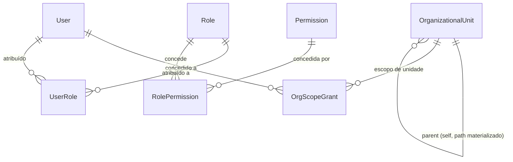
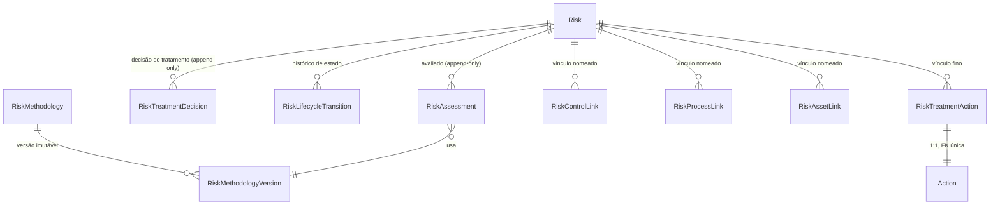
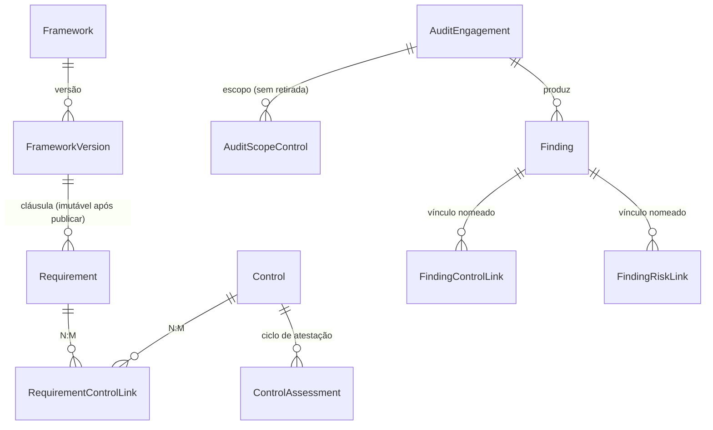

# PharosGRC — Banco de dados

> Escrito em 2026-09-14, contra `apps/api/prisma/schema.prisma` (3452 linhas, ~69 modelos, 53
> migrações) e `apps/api/prisma/seed/`. Este documento descreve o **modelo conceitual** — não é
> cópia do schema. Para a lista completa de campos de um modelo, leia `schema.prisma` diretamente;
> ele é comentado extensivamente, modelo por modelo, e é a fonte de verdade.
>
> Ver também: [`docs/architecture.md`](../architecture.md) (limites de módulo e pontos de extensão),
> [`docs/architecture/security.md`](./security.md), [`docs/architecture/decisions.md`](./decisions.md)
> (ADR-016 em diante) e `specs/001-grc-platform-foundation/research.md` (ADR-001 a ADR-015, incluindo
> ADR-004 — escopo organizacional — e ADR-005 — auditoria append-only — referenciadas extensivamente
> abaixo).

---

## 1. Visão geral

PostgreSQL 18, acessado via Prisma ORM (`@prisma/client`/`prisma` `6.19.3`). O schema vive inteiro em
`apps/api/prisma/schema.prisma`; as migrações em `apps/api/prisma/migrations/` (53 diretórios); o seed
em `apps/api/prisma/seed/`.

Dois papéis de banco, nunca um só (ADR-005): `pharos_owner` (dono do schema, roda migração) e
`pharos_app` (role restrito, é quem a aplicação usa em produção — `DATABASE_URL`). A separação existe
para que a garantia de auditoria append-only (§4) não dependa só de disciplina de aplicação: o role
restrito não tem `UPDATE`/`DELETE` em `audit_event`, ponto.

Convenção de nomenclatura: modelos Prisma em PascalCase, mapeados via `@@map`/`@map` para tabelas e
colunas em snake_case — decisão registrada no próprio cabeçalho do schema, já que a spec original só
nomeava uma tabela (`audit_event`) literalmente.

---

## 2. Organizações e escopo organizacional

`OrganizationalUnit` é uma árvore com **caminho materializado** (coluna `path`, mantida pela aplicação
na mesma transação de qualquer inserção ou reparentamento — ADR-004, sem trigger de banco). Índice
`@@index([path(ops: raw("text_pattern_ops"))])` viabiliza busca por prefixo (`LIKE 'prefix%'`), que o
opclass btree padrão não suporta sob collation não-C.

`OrgScopeGrant` concede a um usuário `{ kind: 'GLOBAL' }` ou `{ kind: 'UNIT', unitId }` — nunca um
terceiro estado "sem restrição". Um CHECK bruto (não expressável em Prisma) garante
`(scopeType = 'GLOBAL' AND orgUnitId IS NULL) OR (scopeType = 'UNIT' AND orgUnitId IS NOT NULL)`.
`OrgScopeCacheState` é um contador durável (linha única `id="singleton"`) que invalida o cache Redis/
memória do escopo resolvido sempre que a árvore ou uma concessão muda — ver
[`docs/architecture.md` §4](../architecture.md#4-organizational-scope) para o mecanismo de aplicação em
runtime (`ScopedRepository`).

Toda tabela de domínio com significado organizacional carrega `orgUnitId` diretamente — nunca
derivado só por junção — seguindo a regra registrada em `AGENTS.md`: "autorização nunca depende de
join". `Risk`, `Finding`, `AuditEngagement`, `Incident`, `Problem` exigem `orgUnitId` (`NOT NULL`);
`Control`, `Process`, `Asset` o têm nullable (linhas anteriores à existência de um módulo próprio para
esses registros).



---

## 3. Usuários, papéis, permissões, sessões

- **`User`** — identidade interna, independente do provedor de autenticação. `LocalCredential`
  (senha argon2id, `mustChangePassword`, `failedAttempts`, `lockedUntil`) e `ExternalIdentity`
  (LDAP/AD/OIDC/SAML, presente no schema mas sem lógica de autenticação implementada ainda) são
  tabelas separadas — um usuário federado não carrega um hash de senha nulo sem sentido.
- **`Permission`** — identificador `resource:action` (`risk:view`, `control:approve`, ...), nunca um
  booleano de administrador (ADR-003). Ver `apps/api/src/core/authorization/domain/permissions.ts` e
  `apps/api/src/permission-catalogue.ts` para o mecanismo de extensão por módulo — documentado em
  detalhe em [`docs/architecture.md`](../architecture.md#1-permissions).
- **`Role`** — seis campos apenas (`id`, `name`, `description`, `isSystem`, `createdAt`, `updatedAt`).
  **Não existe** `isPrivileged`/`isAdmin`/`level` — classificação de privilégio é regra de
  apresentação no cliente web, nunca persistida (ADR-021). Doze papéis de sistema são semeados (§7).
- **`RolePermission`**/**`UserRole`** — tabelas de ligação N:M puras; `grantedAt` é o timestamp
  semântico (sem `createdAt`/`updatedAt` próprios — D-7).
- **`PermissionCacheState`** — contador durável (`permissionsVersion`), mesmo padrão de
  `OrgScopeCacheState`: invalida o cache de permissão efetiva sem depender de o cache saber expirar
  sozinho.
- **`Session`** — PostgreSQL é autoritativo; Redis (ou o adaptador em memória, §"Cache", abaixo) é
  cache de validação, nunca fonte de verdade (ADR-002). Campos: identificação do usuário, criação,
  expiração, última atividade, IP, user agent, método de autenticação, revogação com motivo
  (`SessionRevocationReason`). `tokenHash` é único — o token em si nunca é persistido em claro.

**Cache (fora do PostgreSQL, mas parte deste mecanismo)**: `CacheProvider` é uma porta com dois
adaptadores — `RedisCacheProvider` (quando `REDIS_URL` está definido) e `InMemoryCacheProvider`
(fallback local, obrigatório em desenvolvimento nesta máquina, onde Redis não roda — D-2). Nada
autoritativo é armazenado nele: sessão, permissão efetiva e escopo organizacional são sempre
recalculáveis a partir do PostgreSQL numa falta de cache.

---

## 4. Trilha de auditoria — `audit_event`

A tabela mais estruturalmente incomum do schema. Cobre `AuditEntityType` (enum fechado, crescido por
migração aditiva a cada fase — hoje dezenas de valores, um por fato de negócio distinto; nunca um
valor genérico "RISK_RELATIONSHIP" cobrindo três vínculos diferentes) e `AuditOutcome`
(`SUCCESS`/`FAILURE`/`DENIED`).

**Por que o Prisma não descreve a tabela real**: `schema.prisma` só consegue expressar colunas e a
chave primária composta `(id, occurredAt)` — exigida porque PostgreSQL obriga a chave primária de uma
tabela particionada a incluir a coluna de particionamento. Três migrações manuscritas, aplicadas logo
após a baseline gerada pelo Prisma, fazem o resto:

1. **`20260905120100_audit_event_partitioning`** — recria `audit_event` como `PARTITION BY RANGE
   (occurred_at)`, mensal, com uma partição `DEFAULT` (para que um insert nunca falhe por cair fora
   da janela de partições existentes) e uma função `create_audit_event_partition(date)` chamável para
   criar partições futuras — sem agendador (ADR-015 proíbe infraestrutura assíncrona nesta versão), a
   manutenção é manual.
2. **`20260905120200_audit_event_append_only`** — revoga `UPDATE`/`DELETE` do role `pharos_app` na
   tabela-mãe e em cada partição existente (privilégio não é herdado por partições novas
   automaticamente — só o trigger é), e cria um trigger `BEFORE UPDATE OR DELETE` que rejeita a
   operação para **qualquer** role, inclusive o dono da tabela — dupla proteção, porque um `GRANT`
   ausente por engano não é a mesma coisa que um trigger que recusa sempre.
3. **`20260907100100_audit_event_prevent_truncate`** — fecha uma lacuna: gatilhos de `UPDATE`/`DELETE`
   clonam para partições novas automaticamente desde o PostgreSQL 11, mas `TRUNCATE` não é coberto
   pelo mesmo mecanismo e privilégios não propagam sozinhos — este migration adiciona o gatilho de
   `TRUNCATE` explicitamente em cada partição existente e ajusta
   `create_audit_event_partition()` para que toda partição futura já nasça protegida.

`AuditRecorder.record(...)` (`core/audit/application/audit-recorder.service.ts`) é o único ponto de
escrita, e só funciona dentro da mesma transação Prisma do write de negócio que descreve
(`PrismaAuditEventWriter` lança `AuditNotInTransactionError` se chamado fora de uma) — ver
[`docs/architecture.md` §3](../architecture.md#3-audit) para o mecanismo completo (allow-list de campos
por tipo de entidade, `AsyncLocalStorage` para transação implícita).

`sessionId` é deliberadamente **não** uma foreign key — sessões são limpas, auditoria não.

---

## 5. Colaboração transversal — anexo, comentário, notificação, aprovação

Quatro capacidades que qualquer entidade participante registra por **registro de tipo fechado**
(enum verificado em compilação + registro em tempo de composição), nunca por uma tabela genérica
`related_entity(type, id)` — ADR-008, reforçado por ADR-018 depois de o benchmark do Probo mostrar
quatro tentativas revertidas do mecanismo genérico.

| Tabela | Enum de participação | Padrão de retirada |
|---|---|---|
| `Attachment` | `AttachableEntityType` (RISK, EVIDENCE, INCIDENT, PROBLEM, ...) | soft-delete: `deletedAt`/`deletedByUserId`, bytes nunca apagados (chave content-addressed pode ser compartilhada) |
| `Comment` | `CommentableEntityType` (RISK, INCIDENT, PROBLEM, INDICATOR, ...) | soft-delete: `deletedAt`/`deletedByUserId` |
| `Notification` | reutiliza `CommentableEntityType` para o alvo do deep-link | `readAt` marca lida, nunca apaga |
| `Approval` | `ApprovableEntityType` (RISK, CONTROL_ASSESSMENT) | imutável após decisão — ver abaixo |

Nenhuma das quatro tem FK real para a entidade-alvo (`entityId` é só um UUID validado contra o
registro em tempo de execução) — é a exceção documentada de ADR-008 ao "sem referência genérica",
porque aqui o vínculo não tem significado de domínio próprio (ao contrário de, por exemplo,
`RiskControlLink`, que É o significado).

`Approval` merece nota à parte: é o mecanismo de sign-off **genérico** que qualquer domínio futuro
reutiliza (CLAUDE.md §19.4 — estender é acrescentar um valor de enum e um caso de uso, nunca um motor
de workflow). Um índice único parcial (`WHERE status='PENDING'`) garante no máximo uma aprovação
pendente por `(entityType, entityId)`; um CHECK bruto garante `decided_by_user_id <>
requested_by_user_id` (segregação de funções, backstop de banco além da checagem de aplicação); um
trigger `BEFORE UPDATE OR DELETE` permite exatamente a transição `PENDING → APPROVED/REJECTED` com os
dois campos de decisão preenchidos juntos, e recusa qualquer outra mutação, inclusive `DELETE`.

---

## 6. Riscos — avaliações e histórico (data-model.md §7-§11)

`Risk` é a tabela mais antiga e mais historiada do produto. Pontos que um mantenedor precisa
internalizar:

- **Nunca é excluído fisicamente.** `archivedAt` é o único estado terminal alcançável a partir de
  `CLOSED` (FR-102); `status` percorre `DRAFT → IDENTIFIED → ASSESSED → UNDER_TREATMENT →
  UNDER_REVIEW → ACCEPTED → CLOSED → ARCHIVED`, tabela de transição declarativa em
  `modules/risk/domain/risk-lifecycle.ts`.
- **Concorrência otimista** (ADR-013): `version Int`, todo `UPDATE` carrega `WHERE id=? AND
  version=?`; a versão trafega como `ETag`/`If-Match` HTTP, nunca no corpo.
- **`RiskAssessment`** é *append-only por convenção de aplicação apenas* — não por trigger nem
  privilégio revogado, porque o mesmo role restrito escreve `Risk` e `RiskAssessment` na mesma
  transação (exceção documentada no próprio schema). Cada avaliação referencia a
  `RiskMethodologyVersion` usada e guarda `controlsConsidered String[]` como **snapshot**, deliberadamente
  sem FK — precisa registrar o que era verdade no momento da avaliação, não o que é verdade hoje.
  Encadeamento histórico via auto-relação (`previousAssessmentId`/`supersededBy`).
- **`RiskMethodologyVersion`** — versão imutável de uma metodologia (`RiskMethodology`); "exatamente
  uma metodologia ativa por vez" é um índice único parcial, não expressável em Prisma. Nunca
  editada — uma correção é uma versão nova.
- **`RiskTreatmentDecision`** — append-only com **uma** mutação legítima (trigger permite só a
  "supersessão": `supersededAt`/`supersededById`); qualquer `DELETE` é recusado.
- **`RiskLifecycleTransition`** e **`Approval`** — histórico de transição de estado e de decisões de
  aprovação são entidades **separadas** (não um valor genérico "RISK_LIFECYCLE"): uma transição é uma
  mudança de estado aplicada; uma aprovação é um par pedido/decisão que pode nunca resultar em
  transição (ex.: `REJECTED`).
- **`RiskTreatmentAction`** — **convergiu** para ser uma linha de vínculo fina sobre a capacidade
  compartilhada `Action` (§8), não mais a tabela de trabalho em si (migração
  `20260911000000_action_convergence_risk_treatment_actions`, "Action convergence", CLAUDE.md §17 item
  15). Hoje carrega só `id`, `riskId`, `treatmentDecisionId?`, `actionId` (FK 1:1 única para `Action`),
  `createdAt`, `updatedAt` — título, responsável, prazo, status e conclusão pertencem a `Action`. Os
  `id`s antigos foram preservados para que `audit_event` com `entityType='RISK_TREATMENT_ACTION'`
  continue resolvível.
- **`RiskControlLink`/`RiskProcessLink`/`RiskAssetLink`** — três tabelas nomeadas, três
  `AuditEntityType` distintos (ADR-020 parte 1), nunca uma tabela `RISK_RELATIONSHIP` genérica.
  Retirada é sempre soft (`unlinkedAt`/`unlinkedByUserId`), nunca `DELETE`; um índice único parcial
  (`WHERE unlinkedAt IS NULL`) garante no máximo um vínculo ativo por par.



---

## 7. Núcleo GRC compartilhado — Evidência, Ação, Achado (ADR-016/018)

Três conceitos que nenhum módulo de negócio pode possuir com exclusividade (critério de admissão de
dois testes, ADR-016) — `Control` foi avaliado e **ficou de fora** deliberadamente, porque tem dono
único natural.

- **`Evidence`** — `EvidenceLink` (não `Evidence.fileId`, que foi **removido** por correção de
  design: um `Attachment` só pode ser criado depois que seu pai já existe, então um FK direto nunca
  poderia ser preenchido no momento da criação — migração `20260907091100_evidence_file_fk_correction`).
  Uma evidência anexa arquivo via o mesmo registro `AttachableEntityType` que Risco usa
  (`entityType: 'EVIDENCE'`), não por coluna própria. `EvidenceLink.subjectId` é polimórfico sobre
  `EvidenceSubjectType` (RISK, RISK_TREATMENT_DECISION, FINDING, ACTION, CONTROL, INCIDENT, PROBLEM),
  **sem FK** — `grc/` nunca importa `modules/` (ADR-016), então não há como uma FK apontar para lá.
- **`Action`** — a unidade de trabalho rastreável única da plataforma. `originType` (`ActionOriginType`:
  RISK_TREATMENT, FINDING, CONTROL_ASSESSMENT, INCIDENT, PROBLEM, INDICATOR) + `originId`, sem FK, pelo
  mesmo motivo. Cada valor de `originType` é acrescentado **atomicamente** com seu próprio acessor
  (`test/unit/action-model-convergence-guard.spec.ts` falha se um existir sem o outro — ver D-19 para
  um incidente real causado por essa disciplina sendo pulada uma vez).
- **`Finding`** — produzido sobretudo por Auditoria mas sobrevive ao engajamento que o produziu
  (`auditEngagementId` nullable — null para achado manual). Fechamento exige ao menos uma `Action`
  vinculada concluída OU justificativa, e segregação de funções (quem fecha ≠ quem completou a ação) —
  regra de domínio, não CHECK, porque atravessa duas tabelas.
- **`GrcCodeSequence`** — contador atômico compartilhado (`prefix`+`year`) por trás de todo código
  humano-legível deste núcleo (`EVD-2026-0001`, `ACT-2026-0001`, `FND-2026-0001`, e também
  `AUD-`/`INC-`/`PRB-`/`IND-`/`RPT-` de módulos posteriores) — mesmo padrão UPSERT atômico que
  `RiskCodeSequence` já usava para `RSK-`.

---

## 8. Controles, Compliance, Auditoria e Achados

### Controles (`specs/003-controls-management/`)

`Control` não pertence a framework nenhum (ADR-017) — tem dono, unidade organizacional, ciclo de vida
próprio (`ControlStatus`: DRAFT → ACTIVE → SUSPENDED → RETIRED, terminal). Dois sinais de "inativo"
coexistem por decisão: `status` (enum) e `isActive` (booleano mantido em sincronia por um único ponto
de escrita, `false` só quando `RETIRED`). `ControlAssessment` é o ciclo de atestação, reaproveitando o
`Approval` genérico (§5) em vez de um motor próprio; `orgUnitId` nela é **denormalizado** de
`Control.orgUnitId` — calculado por dois triggers de banco (`BEFORE INSERT`/`AFTER UPDATE`), nunca por
código de aplicação, para que exista um único calculador (CLAUDE.md §19.7).

### Compliance (`specs/004-compliance-management/`)

Requisito e Controle são entidades distintas (ADR-017): `Requirement` pertence a exatamente uma
`FrameworkVersion` e se torna **imutável** assim que essa versão publica (`requirements_immutable_
after_publish`, trigger `BEFORE UPDATE`). `RequirementControlLink` é a ligação N:M explícita, nomeada,
com retirada soft. `RequirementControlMappingMigration`/`...MigrationItem` registram a migração de
mapeamento entre versões de framework como operação de primeira classe, com snapshot dos requisitos de
origem (`sourceFrameworkVersionIds String[]`, não FK — o mesmo padrão de `controlsConsidered` em
`RiskAssessment`). O estado de conformidade de um requisito (`RequirementComplianceState` —
NOT_APPLICABLE/NOT_MET/NOT_PROVEN/PARTIALLY_MET/COMPLIANT) **nunca é uma coluna armazenada** — é sempre
recomputado por `RequirementComplianceService`, o calculador único; `RequirementComplianceAuditMark` é
só um watermark para saber quando emitir evento de auditoria por mudança, nunca a fonte da leitura.

### Auditoria e Achados (`specs/005-audit-findings/`)

`AuditEngagement` tem ciclo linear e irreversível
(`PLANNING → IN_PROGRESS → COMPLETED`, mais `CANCELLED` como saída de descarte a partir de
`PLANNING`/`IN_PROGRESS`). Três tabelas de escopo (`AuditScopeFrameworkVersion`,
`AuditScopeRequirement`, `AuditScopeControl`) são deliberadamente **sem retirada** — uma entrada
errada é corrigida acrescentando a certa, nunca removendo a errada (decisão registrada, não
descuido). `FindingControlLink`/`FindingRiskLink` são as duas relações de `Finding` que a Fase 1 do
núcleo GRC adiou — pertencem a `grc/finding` (lado que registra, ADR-020 parte 1), com retirada soft
como todo outro vínculo.



---

## 9. Ativos, Processos, Incidentes e Problemas

`Asset`/`Process` (`specs/006-assets-processes/`) têm o formato mínimo compartilhado: `code` único,
`name`, `orgUnitId?`, `isActive` — sem enum de ciclo de vida próprio, soft-delete só por flag.

`Incident`/`Problem` (`specs/008-incidents-problems/`) exigem `orgUnitId` **não-nulo** (diferente do
padrão nullable de Asset/Process/Control — não há linha legada anterior a esta fase). Cinco tabelas de
vínculo, todas com retirada soft: `IncidentRiskLink`, `IncidentAssetLink`, `IncidentProcessLink`,
`ProblemRiskLink`, `ProblemIncidentLink` (esta última N:M, escrita pelo lado de Problem, nunca
consultada por invariante de transição — é só informativa/auditável). Fechar um `Problem` exige uma
`Action` de origem `PROBLEM` **concluída** apontando para ele — invariante verificada na transição, não
cacheada — e segregação de funções entre quem fecha e quem concluiu essa ação.

---

## 10. Indicadores e Relatórios

`specs/009-indicators-reports/`. Catálogo fechado de onze chaves de métrica
(`IndicatorMetricKey`) atravessando Risco, Controle, Conformidade, Auditoria, Achado, Ativo, Processo,
Ação, Incidente e Problema. Nenhuma das três tabelas (`IndicatorDefinition`, `IndicatorMeasurement`,
`ReportDefinition`) tem `orgUnitId` — são organização-inteira por decisão, mesmo padrão de
`Framework`/`FrameworkVersion`. `IndicatorMeasurement` é **puramente append-only** (sem `updatedAt`,
sem caminho de edição em código) — cada medição grava `breached` computado contra o limiar que existia
naquele instante, nunca recalculado depois. Nenhuma tabela guarda um "valor atual" — é sempre computado
sob demanda por `IndicatorCalculationService`, o calculador único (CLAUDE.md §19.7), reafirmado por uma
guarda estrutural (SC-005) provando que nenhuma tabela desta fase duplica coluna de tarefa/arquivo/
aprovação em paralelo ao núcleo GRC.

---

## 11. Padrões de histórico, versionamento e exclusão

Nenhuma exclusão física acontece neste schema fora de tabelas de configuração pura. Três formas
coexistem, deliberadamente, cada uma para um caso diferente:

| Padrão | Onde | Semântica |
|---|---|---|
| `archivedAt`/`archivedByUserId` | Risk, Evidence, Finding | estado terminal, alcançável só de um estado específico anterior |
| `retiredAt`/`retiredByUserId`/`retirementReason` | Control | aposentadoria, com motivo obrigatório |
| `deletedAt`/`deletedByUserId` | Attachment, Comment | remoção do usuário, atribuição preservada |
| `unlinkedAt`/`unlinkedByUserId` | quase toda tabela de vínculo | retirada de relação, nunca `DELETE` — exceção deliberada: as três `AuditScope*` (§8), sem retirada nenhuma |
| `isActive` (booleano, sem histórico) | Control (junto com `status`), Process, Asset, RiskMethodology, IndicatorDefinition, ReportDefinition | des/reativação simples, sem necessidade de saber quando |
| `status` enum com estado terminal | RiskStatus, ControlStatus, FrameworkVersionStatus, FindingStatus, AuditEngagementStatus, IncidentStatus/ProblemStatus, ActionStatus | fechamento é uma transição de ciclo de vida, não uma flag separada |

`onDelete` é overwhelmingly `Restrict` em todo o schema — o padrão "qualquer coisa historicamente
relevante nunca perde a linha que a referencia". As únicas exceções encontradas: `RiskCause`/
`RiskConsequence` → `Cascade` a partir de `Risk` (não têm significado independente do risco) e
`Notification.recipientUser` → `Cascade` (notificação morre com o usuário).

Três mecanismos distintos de **append-only real** (não apenas "convenção de não editar"), cada um
documentado no próprio arquivo de migração:

1. **Privilégio revogado, sem trigger** — `RiskMethodologyVersion`, `RiskLifecycleTransition`:
   `UPDATE`/`DELETE` nunca concedidos ao role da aplicação.
2. **Trigger `BEFORE UPDATE OR DELETE` com uma exceção nomeada** — `RiskTreatmentDecision` (permite só
   a supersessão), `Approval` (permite só a decisão PENDING→APPROVED/REJECTED).
3. **Só na camada de aplicação, documentado como exceção deliberada** — `RiskAssessment`: o mesmo role
   restrito escreve `Risk` e `RiskAssessment` na mesma transação, então separação por privilégio de
   banco não é possível aqui.

`audit_event` (§4) é o caso mais forte — os três mecanismos de proteção somados (partição, revogação de
privilégio, trigger que recusa até o dono da tabela).

Um punhado de restrições **não é expressável em Prisma** (a versão em uso não tem `@@check` nem índice
parcial) e vive só em SQL manuscrito dentro da migração correspondente: índices únicos parciais do tipo
"no máximo um ativo/pendente por vez" (`risk_methodologies.is_active`, `approvals` uma PENDING por
entidade, `evidence_links`/toda tabela de vínculo com `WHERE unlinked_at IS NULL`,
`requirement_applicability_declarations` uma ativa por requisito), CHECKs de pareamento (seis
constraints em `evidence`/`evidence_links`/`actions`/`findings` garantindo que duas colunas sejam
preenchidas juntas ou nenhuma — migração `20260907100000_pairing_invariant_check_constraints`), o CHECK
de segregação de funções em `approvals`, e o índice GIN de busca por trigrama sobre
`risks.(code||title||description)`.

---

## 12. Migrações

**Local**: `apps/api/prisma/migrations/` — 53 diretórios em 2026-09-14, cada um com seu próprio
`migration.sql`. A maioria é saída padrão do Prisma (`CREATE TABLE`/`ALTER TABLE`/`ALTER TYPE ... ADD
VALUE`); um subconjunto é SQL manuscrito porque expressa algo que a linguagem de schema do Prisma não
alcança — partição, trigger, `GRANT`/`REVOKE`, CHECK, índice parcial (listados nas seções acima). Cada
migração manuscrita documenta, no próprio cabeçalho, por que é manuscrita.

**Comandos** (`apps/api/package.json`, delegados pela raiz `pnpm run db:*`):

```
db:generate            prisma generate
db:migrate              prisma migrate dev        # autoria local — nunca em CI/produção
db:seed                 prisma db seed             # → prisma/seed/index.ts, via prisma.config.ts
db:seed:performance     ts-node --transpile-only prisma/seed/performance.seed.ts
```

`prisma.config.ts` (não a chave `package.json#prisma`, obsoleta) configura o caminho do schema, das
migrações e o comando de seed — que roda com `ts-node --transpile-only`, deliberadamente não `tsx`:
o seed usa injeção de dependência do Nest (`emitDecoratorMetadata`), que o esbuild do `tsx` não
implementa.

**CI nunca usa `migrate dev`** — `.github/workflows/ci.yml` chama `prisma migrate deploy` diretamente
em cada job que precisa de schema, com o comentário "Never `migrate dev`" no próprio workflow,
referenciando este documento.

**Duas URLs, dois papéis, duas armadilhas documentadas** (`docs/local-environment.md`):

- `datasource db { url = env("DATABASE_URL")  directUrl = env("DATABASE_MIGRATION_URL") }` — a
  aplicação em runtime conecta por `DATABASE_URL` (role restrito `pharos_app`); todo comando
  `prisma migrate *`/`migrate diff`/`migrate status` conecta por `directUrl`
  (`DATABASE_MIGRATION_URL`, role `pharos_owner`) — **nunca** por `DATABASE_URL`. Sobrescrever só a
  primeira variável no shell não muda o banco que uma migração realmente atinge; o próprio banner
  "Datasource" impresso pela CLI **não é prova** de qual banco foi usado, porque resolve `url`, não
  `directUrl`, para exibição (D-18). A forma correta de mirar outro banco é sobrescrever as **duas**
  variáveis e confirmar depois por consulta direta (`psql`), nunca pela saída da própria ferramenta.
- **Ressalva de checksum** (D-17): `prisma migrate deploy` nunca revalida o checksum de uma migração
  já aplicada — só migrações pendentes são comparadas contra a pasta. Um arquivo editado in-place
  depois de já ter sido aplicado pode divergir do banco silenciosamente, para sempre, sem erro em
  nenhum comando (`deploy` e `status` reportam "tudo certo"). Regra permanente: nunca editar um
  arquivo de migração depois da primeira tentativa real de aplicação — rascunhar fora da pasta
  rastreada até estar genuinamente pronto.
- **Valores de enum inertes** (D-19): dois valores (`ActionOriginType.INCIDENT`/`PROBLEM`) ficaram
  fisicamente presentes em `pharos_grc`/`pharos_grc_test` por um período em que `schema.prisma` não os
  declarava mais (efeito colateral do D-18 acima) — PostgreSQL não tem `ALTER TYPE ... DROP VALUE`.
  Resolvido (os dois voltaram ao schema, numa migração própria, separada da que os introduziu por
  engano), mas o padrão geral persiste: `PROBE_RECORD`, de uma sonda de arquitetura já removida, está
  permanentemente preso em três enums (`AuditEntityType`, `AttachableEntityType`,
  `CommentableEntityType`) e é inofensivo por ser inatingível — nenhum caminho de código o escreve.

**Como criar uma migração com segurança**: nunca `migrate dev` contra um banco que outro processo
(CI, outro agente, outro desenvolvedor) possa atingir enquanto o arquivo ainda está em rascunho —
gerar/editar fora da pasta rastreada, mover para dentro só quando definitivo. Para qualquer alteração
em `audit_event`, nunca aceitar uma migração autogerada que tente recriar a tabela — o Prisma não
enxerga partição, trigger nem GRANT/REVOKE e vai propor "correções" que destruiriam a tabela real;
revisar e remover qualquer statement envolvendo `audit_event` de uma migração autogerada antes de
aplicar.

**Receita concreta** (o comando real, não só a regra) para adicionar um campo a um modelo existente
contra um banco de desenvolvimento **exclusivo desta máquina**, sem risco de atingir um banco
compartilhado em rascunho:

```bash
# 1. Editar apps/api/prisma/schema.prisma (adicionar o campo ao model).
# 2. Gerar o arquivo de migração SEM aplicar — revisável antes de qualquer efeito:
pnpm --filter @pharos/api exec prisma migrate dev --create-only --name <nome_da_migracao>
# 3. Revisar apps/api/prisma/migrations/<timestamp>_<nome_da_migracao>/migration.sql à mão —
#    especialmente se o modelo tocado for audit_event (ver acima) ou tiver trigger/partição/GRANT
#    manuscritos por perto.
# 4. Só então aplicar, contra o banco de desenvolvimento local:
pnpm --filter @pharos/api exec prisma migrate dev
# 5. pnpm --filter @pharos/api run db:generate — regenera o cliente Prisma com o campo novo.
```

`--create-only` é o que torna o passo 2 seguro mesmo em rascunho: gera o arquivo sem tocar em nenhum
banco. Contra um banco que outro processo possa atingir (CI, outro agente, outro desenvolvedor), pare
no passo 3 e só mova/aplique quando definitivo — nunca deixe o arquivo half-baked dentro da pasta
rastreada enquanto isso (D-17 acima é exatamente esse incidente).

**O que mais precisa mudar ao adicionar um campo a um modelo** — a migração é só o primeiro elo;
nenhum destes passos é automático a partir dela, e pular um deixa o campo inacessível ou inauditável
mesmo com a coluna já existindo no banco. Usando `Incident` como exemplo concreto (o modelo tem sua
migração de origem em `apps/api/prisma/migrations/20260911020000_incidents_problems_foundation_baseline/`):

1. **Schema + migração** — passos acima.
2. **DTO da API** — `apps/api/src/modules/incidents/presentation/dto/create-incident-request.dto.ts`
   e `update-incident-request.dto.ts` (validação de entrada) e `incident-response.mapper.ts`
   (serialização de saída) precisam do campo novo explicitamente; nenhum DTO deste projeto usa
   serialização automática de todas as colunas do modelo.
3. **Lista de permissão de auditoria** — `apps/api/src/modules/incidents/domain/incident-audit-allowlist.ts`
   (`registerIncidentAuditAllowlists`) é uma lista fechada de campos por `AuditEntityType.INCIDENT`. Um
   campo fora dessa lista nunca aparece em `oldValues`/`newValues` do evento de auditoria — é
   inacessível para auditoria mesmo gravando corretamente no banco, silenciosamente (CLAUDE.md §8/§13
   exigem auditabilidade; este é o ponto de código real que a garante por modelo). Cada módulo com
   auditoria por campo tem seu próprio allowlist equivalente — busque `AuditEntityType.<MODELO>` no
   módulo correspondente quando o modelo não for `Incident`.
4. **Contrato OpenAPI** — o esquema do campo entra em
   `specs/<fase-de-origem-do-módulo>/contracts/*.openapi.yaml` **antes** da implementação (CLAUDE.md
   §16/ADR-024: o contrato hand-authored é a fonte de verdade, não o `apps/api/openapi.json` refletido).
   Para `Incident`, isso é `specs/008-incidents-problems/contracts/incidents.openapi.yaml`.
5. **`packages/api-types`** — depois do contrato atualizado, `pnpm --filter @pharos/api-types run
   generate` (usa `openapi-typescript` sobre o contrato) e `pnpm --filter @pharos/api-types run build`
   regeneram os tipos TypeScript que `apps/web` consome. Sem isso, `apps/web` continua compilando
   contra o tipo antigo — nenhum erro imediato, só um campo que o frontend não sabe que existe.
6. **Frontend** — `apps/web/src/features/incidents/types.ts`/`api.ts`, formulário e colunas relevantes,
   e a mensagem pt-BR do rótulo do campo em `apps/web/src/lib/messages/` (nunca embutida no componente,
   CLAUDE.md §11.1).
7. **Testes** — unitário do DTO/mapper (API), unitário de componente (web) e, se o campo aparecer em
   filtro ou coluna de listagem, o contrato correspondente em `apps/api/test/contract/`.

**O que não vai numa migração**: dado de demonstração, segredo, e qualquer coisa dependente de
ambiente — isso é responsabilidade do seed (§13), nunca da migração. Nenhuma migração deste repositório
insere linha de negócio; todas as inserções de dado vêm de `prisma/seed/*.ts`. `AGENTS.md` ("Database")
não nomeia essa regra literalmente, mas é convenção de fato, seguida sem exceção nas 53 migrações
existentes, e reforçada pelo próprio D-17/D-18 (uma migração iterada como se fosse dado, contra um banco
compartilhado, é exatamente o incidente que motivou aquelas duas entradas).

---

## 13. Seed

**Local**: `apps/api/prisma/seed/`. Um único pipeline hoje — **não existe** separação entre "seed base"
e "seed de demonstração" (verificado: nenhum arquivo, script ou referência a "demo seed"/"base seed"
existe no repositório). Ponto de integração pendente para quem for construir essa separação no futuro.

| Arquivo | Papel |
|---|---|
| `index.ts` | ponto de entrada real de `prisma db seed`. Sobe um contexto Nest mínimo (só `AppConfigModule` + `PrismaModule`, não a `AppModule` inteira) e chama, em ordem, `seedPlatform` → `seedRiskReferenceData` → `seedDefaultMethodology`. |
| `platform.seed.ts` | o seed central. Semeia, sempre e idempotentemente: todas as permissões (a partir do catálogo, nunca uma lista copiada à mão), doze papéis de sistema com seus conjuntos de permissão reconciliados a cada execução (inserção **e** remoção), a unidade organizacional raiz, e um usuário `Platform Administrator` a partir de `SEED_ADMIN_EMAIL`/`SEED_ADMIN_PASSWORD` com `mustChangePassword=true`. Quando `SEED_DEV_FIXTURES=true` **e** não é produção, também semeia um usuário de exemplo por papel e uma pequena árvore organizacional — nunca em produção: se alguém definir `SEED_DEV_FIXTURES=true` com `NODE_ENV=production`, o seed inteiro falha alto, de propósito, em vez de silenciosamente ignorar a flag. |
| `admin.seed.ts` | **não** é um segundo seed — é um alias documentado que reexporta `seedPlatform` de `platform.seed.ts`, existindo só para que a tarefa que o motivou tivesse um artefato grepável; `index.ts` nunca o importa. |
| `methodology.seed.ts` | metodologia de risco 5×5 padrão (COSO ERM, pontuação 1-25, faixas LOW/MEDIUM/HIGH/CRITICAL) e sua primeira versão. Idempotente por checagem prévia (se já existe metodologia ativa, não faz nada). |
| `risk-reference.seed.ts` | `RiskCategory`/`RiskType`/`RiskOrigin` iniciais (5 categorias, 2 tipos, 4 origens). Idempotente por `upsert` na coluna `code`; nunca reativa uma linha que um administrador desativou. |
| `performance.seed.ts` | fixture de carga de 50 mil riscos — **não** faz parte de `db:seed`, só roda via `db:seed:performance` (flags `--count=N`, `--reset`). Toda linha criada é prefixada (`PERF-`, `perf-`) para ser encontrável e completamente reversível, isolada de dado real. |

**Variáveis de ambiente lidas pelo seed** (nomes apenas — nunca valores neste documento):
`SEED_ADMIN_EMAIL`, `SEED_ADMIN_PASSWORD`, `SEED_DEV_FIXTURES`, mais `NODE_ENV` indiretamente via
`AppConfigService.app.isProduction`.

**Idempotência**: cada script upserta por chave natural única (`Permission.identifier`, `Role.name`,
`OrganizationalUnit.code`, `RiskCategory/Type/Origin.code`) e é seguro rodar repetidamente. A única
exceção deliberada: a credencial local do administrador bootstrap é criada **apenas se nenhuma
existir** — uma reexecução nunca reverte uma senha já trocada pelo administrador real.

**Banco de teste**: `pharos_grc_test` (D-4). Migrado e truncado pela própria suíte de
integração/contrato (`apps/api/test/integration/support/global-setup.ts`), nunca à mão — mas **não é
semeado**: a suíte cria seus próprios fixtures em vez de depender de linha semeada existir. Confirmar
sempre por `psql` direto, nunca pela saída de um comando Prisma, qual banco de fato foi afetado (D-18).

---

## 14. Pontos de integração pendentes

- **Separação seed base / seed de demonstração não existe** — hoje há um único pipeline (§13); se o
  produto precisar de dado de demonstração representativo separado de dado essencial de plataforma,
  esse é o ponto onde a divisão entraria, sem tocar o seed de produção existente.
- **`core/users` e `core/configuration`** (CLAUDE.md §4) não existem como árvores próprias — não há
  tabela dedicada a configuração de plataforma ainda; ver
  [`docs/architecture.md` — Known gaps](../architecture.md#known-gaps-and-honest-limits).
