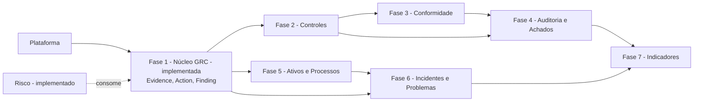

# PharosGRC — Roteiro Arquitetural dos Módulos GRC

> Sequenciamento por **dependência arquitetural**, não por ordem de menu.
> Não contém tarefas de implementação — cada fase vira especificação própria (CLAUDE.md §16).
>
> Informado por `docs/history/probo-benchmark.md`; o alvo está em `docs/history/grc-domain-blueprint.md`.

> **Roteiro concluído.** As Fases 0–7 descritas abaixo foram todas executadas — ver CLAUDE.md §17.
> Trabalho pós-roteiro continuou em `specs/011-dashboard-platform-view/` a
> `specs/015-roles-permissions-surface/`, nenhum deles um módulo de negócio novo deste roteiro.
> Fonte vigente do estado atual: [`docs/STATE.md`](../STATE.md).

---

## 1. Por que a ordem do CLAUDE.md §17 muda

A ordem conceitual original era: Riscos → Problemas → Incidentes → Controles → Ativos →
Processos → Planos de Ação → Compliance → Auditoria → Indicadores.

A análise de dependência mostra que ela produz retrabalho:

- **Controles vem tarde demais.** Controle é o conceito mais referenciado do domínio — Risco,
  Conformidade, Auditoria, Ativos e Processos todos apontam para ele. Isso não o torna
  compartilhado (ADR-016 o manteve como domínio, com dono próprio); torna-o **pré-requisito**. No Probo, a tabela de
  salvaguardas é o hub real do grafo, mais conectada que qualquer outra. Construir Incidentes e
  Problemas antes de Controles significa construir dois módulos que depois terão de ser ligados
  a ele.
- **Planos de Ação não é módulo, é capacidade compartilhada.** Se Incidentes e Auditoria vierem
  antes dele, cada um inventa o próprio conceito de tarefa — que é exatamente o estado do Probo,
  onde `Task` só se liga a `Measure` e achados registram remediação em campo de texto livre.
- **Evidência precisa existir junto com Controles.** Controle sem prova de efetividade é
  cadastro. E evidência criada dentro de Controles nasce soldada a Controles — o defeito do
  Probo, onde `evidences.measure_id` é NOT NULL e achado de auditoria não tem trilha de prova.

---

## 2. Fases recomendadas

### Fase 0 — Portão arquitetural (esta fase)

**Propósito**: decidir vocabulário, fronteiras e pontos de extensão antes que qualquer módulo os
consuma.

Entrega: este roteiro, o blueprint, o benchmark, a política permanente e os ADRs propostos.
Nenhum código de domínio.

---

### Fase 1 — Fundação GRC compartilhada — **concluída**

> **Concluída em 2026-09-07** — implementada por `specs/002-shared-grc-foundation`, commit
> `115bf2a`. `apps/api/src/grc/{evidence,action,finding}/**` e
> `apps/web/src/features/{evidence,actions,findings}/**` estão completos. CLAUDE.md §17 já lista
> esta fase em "Concluído" (item 8).

**Propósito**: criar as capacidades que três ou mais módulos futuros precisam, antes que o
primeiro deles as invente localmente.

**Depende de**: plataforma atual.

**Capacidades introduzidas**: `Evidence` e `Action`, ambas por registro de tipo fechado
(ADR-018), em `src/grc/`.

`Finding` também pertence ao núcleo (ADR-016), mas é **construído na Fase 4**, junto do seu
primeiro consumidor real. Admissão ao núcleo é decisão de **lugar**, não de ordem de construção —
criar uma entidade antes de existir quem a use é a abstração especulativa que o critério estreito
existe para evitar.

> **Correção, registrada no fechamento desta fase**: o parágrafo acima é o plano deste roteiro,
> mantido porque registra o raciocínio original — não porque ainda descreve o que foi construído.
> A especificação que implementou esta fase não seguiu esta recomendação: admitiu `Finding` junto
> com `Evidence` e `Action`, nesta mesma fase, em vez de adiá-lo para a Fase 4.
> `apps/api/src/grc/finding/**` existe hoje, completo, com o mesmo tratamento de registro de tipo
> fechado que `Evidence` e `Action`. CLAUDE.md §17 (item 8, "Núcleo GRC compartilhado — Evidência,
> Ação e Achado") já refletia essa decisão quando foi escrito; este documento é quem ficou
> desatualizado. A Fase 4, adiante, deve ser lida como **estendendo** `Finding` — não o criando.

`Control` **não** entra aqui: ADR-016 o avaliou e o manteve como domínio de negócio, porque um
módulo de Controles pode ser seu dono exclusivo. Ele é a Fase 2.

**Relacionamentos**: sujeito→Evidence e origem→Action, por enum fechado — `Finding` participa de
ambos os mecanismos (é um `EvidenceSubjectType` e um `ActionOriginType`), não é um terceiro
mecanismo à parte.

**Segurança**: escopo organizacional em Evidence, Action e Finding; permissões `evidence:*`,
`action:*` e `finding:*` declaradas pelo mecanismo de extensão fechado em A3.

**Auditoria**: tipo de entidade de auditoria próprio para cada uma das três; evidência e achado
**nunca** são excluídos fisicamente.

**Reuso esperado**: Controles, Conformidade, Auditoria, Incidentes e Problemas consomem as três.

**Decisão pendente para a especificação**: se `RiskTreatmentAction` migra para `Action` nesta
fase. Recomendação: **sim** — o código já declara ter sido moldado para isso, e o segundo
consumidor chega na fase seguinte. É migração de domínio e exige a sua especificação própria.

> **O que de fato aconteceu**: `RiskTreatmentAction` não migrou para `Action` — as duas convivem,
> com escrita espelhada de uma para a outra (`data-model.md` §7, R-003). A migração completa
> continua pendente, registrada como custo aceito em `docs/deferred-findings.md` F-36, com prazo:
> antes do início do módulo de Incidentes.

---

### Fase 2 — Módulo de Controles — **concluída**

> **2026-09-11 addendum (007-implementation-remediation, Front G)**: entregue,
> `specs/003-controls-management/`, commit `9912968`. O texto abaixo descrevia a fase como trabalho
> futuro — preservado como registro do que foi planejado, superado pela entrega real.

**Propósito**: criar Control como domínio completo — biblioteca de controles, dono, efetividade,
teste e evidência — e **publicar a porta** pela qual Risco, Conformidade e Auditoria o
referenciam (ADR-020).

**Depende de**: Fase 1.

**Capacidades**: catálogo de controles, ciclo de vida do controle, teste/verificação de
efetividade, vínculo a risco, processo e ativo.

**Relacionamentos**: Control↔Risk (já existe), Control→Evidence, Control→Action.

**Segurança**: quem pode declarar um controle efetivo não deve ser quem o opera — aplicar
segregação de funções por aprovação, reutilizando a infraestrutura existente.

**Auditoria**: mudança de efetividade é evento auditável com valores anterior e posterior.

---

### Fase 3 — Conformidade — **concluída**

> **2026-09-11 addendum (007-implementation-remediation, Front G)**: entregue,
> `specs/004-compliance-management/`, commit `8f0452d`. O texto abaixo descrevia a fase como
> trabalho futuro — preservado como registro do que foi planejado, superado pela entrega real.

**Propósito**: mapear normas a controles sem duplicar controles por norma.

**Depende de**: Fase 2.

**Entidades**: `Framework`, `FrameworkVersion`, `Requirement`, `RequirementControlLink`,
declaração de aplicabilidade.

**Relacionamentos**: Framework→FrameworkVersion→Requirement; Requirement↔Control N:M.

**Capacidade nova**: **cálculo** do estado de conformidade a partir do estado dos controles e da
evidência, com calculador único.

**Requisito de projeto não negociável**: versionamento de framework e migração de mapeamento
entre versões desde o início. Retrofitar isso depois de existirem mapeamentos é o beco sem saída
observado no Probo.

---

### Fase 4 — Auditoria e Achados — **concluída**

> **2026-09-11 addendum (007-implementation-remediation, Front G)**: entregue,
> `specs/005-audit-findings/`, backend `f9e5e5b`, interface e fechamento `99a2417`/`7096821`/
> `51de0e3`. O texto abaixo descrevia a fase como trabalho futuro — preservado como registro do
> que foi planejado, superado pela entrega real.

**Propósito**: fechar o ciclo requisito → controle → evidência → achado → ação.

**Depende de**: Fases 1–3.

**Entidades**: `Audit` (engajamento). `Finding` já existe desde a Fase 1 (ver correção na Fase
1, acima) — esta fase não o cria, estende suas relações e lhe dá o primeiro produtor automático.

**Relacionamentos**: Audit↔Requirement, Audit→Finding, Finding↔Control, Finding↔Risk,
Finding→Action (já existe), Finding→Evidence (já existe). `Finding↔Control` e `Finding↔Risk` são
as duas relações novas desta fase — `specs/002-shared-grc-foundation/spec.md`'s User Story 3,
Acceptance Scenario 4 assumiu `Finding↔Risk` prematuramente; a decisão de forma (join entity
dedicada ou outra) fica para aqui, quando `Control` e o primeiro produtor não-manual de achado
existirem e a pergunta puder ser respondida com a informação necessária.

**Segurança**: papel de auditor com leitura escopada; achado não pode ser fechado por quem o
remediou — segregação de funções pela infraestrutura existente.

**Auditoria**: um achado nunca é excluído; fechamento exige evidência.

---

### Fase 5 — Ativos e Processos como módulos — **concluída**

> **2026-09-11 addendum (007-implementation-remediation, Front G)**: entregue,
> `specs/006-assets-processes/`, commits `3252776`/`50f30f6`/`ee64cfb`/`9c1b048`. O texto abaixo
> descrevia a fase como trabalho futuro — preservado como registro do que foi planejado, superado
> pela entrega real.

**Propósito**: promover os registros de referência atuais a domínios, **sem criar um segundo
conceito paralelo** — o erro do Probo, que tem `Asset` e `Device` sem nenhuma ligação.

**Depende de**: Fase 1.

Pode ser antecipada e executada em paralelo às Fases 3–4, por não bloquear nem ser bloqueada.

---

### Fase 6 — Incidentes e Problemas — **concluída**

> **2026-09-11**: entregue, `specs/008-incidents-problems/`, commits principais `4b18978` (painel
> de Evidência/Comentário/Anexo nas telas), `2a39b52` (leitura reversa dos cinco vínculos a partir
> de Risco/Ativo/Processo, com os dois contratos entrando no portão `contract-coverage.spec.ts`) e
> `d1bc2cb` (contraste dos toasts). Continua aberto: não existe E2E de escopo organizacional em
> navegador para os cinco vínculos desta fase — `7674efb` entregou a prova apenas no nível de
> integração de API (`apps/api/test/integration/incident-problem-links-source-scope.spec.ts`), e
> `apps/web/e2e/` não tem nenhum spec de escopo de Incidente/Problema; a divisão do job
> cross-browser (`22021d2`) nunca foi verificada por um `workflow_dispatch` real; o commit
> `44e1e04` deixou em `.github/workflows/ci.yml` uma flag diagnóstica TEMPORÁRIA de worker único
> para WebKit, ainda não revertida; e F-56 (`docs/deferred-findings.md`) segue aberta. Registro
> operacional em `specs/008-incidents-problems/STATE.md` §2.

**Depende de**: Fases 1 e 5.

**Relacionamentos**: Incidente↔Risco, Incidente↔Ativo, Incidente↔Processo, Incidente→Action,
Problema↔Incidente.

Estes módulos consomem `Action` e `Evidence` já existentes. **Não** inventam conceito próprio de
tarefa.

> **Ratificado, 2026-09-11** (`specs/008-incidents-problems`): o vínculo Problema↔Incidente que esta
> linha já antecipava foi decidido pelo coordenador desta fase (não pelo usuário do produto) como
> N:M, tabela de ligação nomeada, propriedade do módulo de Problemas, informativo e auditável, sem
> nenhum acoplamento entre os dois ciclos de vida (`spec.md` "Decisões do coordenador";
> `research.md` D-13 a D-15). Uma auditoria anterior desta mesma noite leu esta linha contra
> CLAUDE.md §10 e registrou uma "tensão" entre os dois documentos — não havia contradição: §10
> introduz sua lista com "Exemplos:", ilustrativa, nunca exaustiva. Corrigido no lugar em que o erro
> de leitura foi cometido.

---

### Fase 7 — Indicadores e Relatórios — **concluída**

> **2026-09-12**: entregue, `specs/009-indicators-reports/`, commits principais `8135915` (onze
> provedores de métrica atrás de um único calculador), `6e66e2c` (valor atual de qualquer
> indicador do catálogo, servido por HTTP — o MVP), `5c24606` (guarda estrutural provando que
> nenhuma tabela desta fase duplica coluna de tarefa/arquivo/aprovação em paralelo ao núcleo GRC,
> SC-005), `311549c` (as cinco operações contratadas que faltavam, implementadas antes de os dois
> contratos entrarem em `contract-coverage.spec.ts`) e `d31e140` (telas saindo de
> `status: 'planned'`, com varredura de acessibilidade e captura renderizada sobre dado real).
> Catálogo fechado de onze métricas atravessando Risco, Controle, Conformidade, Auditoria,
> Achado, Ativo, Processo, Ação, Incidente e Problema; limiar e notificação de rompimento; série
> histórica organização-inteira; `Action` com origem `INDICATOR`; Relatório multi-domínio com
> exportação CSV — todo cálculo pelo mesmo `IndicatorCalculationService` (CLAUDE.md §19.7). 70 de
> 71 tarefas marcadas, 1 (T064) obsoleta por correção já entregue antes desta fase começar.
> Medição de fechamento, em série, no commit `d31e140`: contrato 55 arquivos/807 testes, unidade
> da API 57/569, integração 52/258, unidade da web 123/663 — nenhum teste removido; typecheck,
> lint, format:check, openapi:check e audit limpos; E2E Chromium 129 de 129, mas só com um único
> worker Playwright — com o padrão de quatro, o `ThrottlerGuard` global devolvia `429` até no
> login (F-59, atualizado com a evidência das três execuções que levaram a essa mitigação).
> Continua aberto: F-57 (aviso moderado, abaixo do limiar, em dependência de teste), F-59
> (limitador global sob concorrência) e uma exposição de contraste idêntica à corrigida no
> formulário de Processos, latente e deliberadamente não corrigida às cegas no formulário de
> Ativos. Registro operacional completo em `specs/009-indicators-reports/STATE.md` §14. **Esta
> foi a última fase deste roteiro** — ver o addendum de §6 abaixo.

> **2026-09-11 (histórico, superado pelo bloco de fechamento acima)**: especificação existe desde
> 2026-09-11, commit `cad9430` (`specs/009-indicators-reports/` — `spec.md`, `plan.md`,
> `tasks.md`, `research.md`, `data-model.md` e `contracts/`, 71 tarefas). Implementação não
> começou.

**Depende de**: todas as anteriores.

Somente leitura, atravessando os domínios. A razão de vir por último não é prioridade, e sim que
o valor depende de existir grafo para atravessar.

> **Pergunta de política registrada, 2026-09-11** (decisão do coordenador em
> `specs/008-incidents-problems`, research.md D-15): o vínculo Problema↔Incidente da Fase 6 é
> deliberadamente informativo — fechar um problema nunca verifica o estado de um incidente
> vinculado, e resolver um incidente nunca verifica nem cria um problema. Se uma organização quiser
> **condicionar** um fechamento ao outro (por exemplo, impedir o fechamento de um problema enquanto
> um incidente vinculado seguir aberto), isso é política organizacional e relatório — não uma
> restrição de banco de dados. Razão do coordenador: as duas máquinas de estado respondem perguntas
> diferentes (ocorrência sendo tratada versus causa estrutural sendo removida), e qualquer uma pode
> legitimamente terminar primeiro; acoplar os dois deixaria um domínio preso ao estado do outro
> permanentemente, a mesma forma de defeito que este projeto já sofreu uma vez, num ciclo de vida
> que podia prender um registro sem saída legal. Quando esta fase for desenhada, "o fechamento de um
> problema deveria poder ser condicionado, por política, aos seus incidentes" é a pergunta a decidir
> — como um relatório/regra configurável, não como uma reabertura da decisão de schema da Fase 6.

---

## 3. Grafo de dependências

---

## 4. Portão arquitetural

Classificação exigida pela §52 do pedido de benchmark.

### A — Resolver **antes** do próximo módulo

Cada item abaixo produz retrabalho estrutural se o próximo módulo começar sem ele.

| # | Item | Por que bloqueia |
|---|---|---|
| A1 | **Vocabulário Requisito × Controle decidido e registrado** — FECHADO em ADR-017 | O próximo módulo cria tabelas e rotas. Renomear conceito depois de existirem dados, contratos REST e catálogos pt-BR é migração cara e evitável. |
| A2 | **Fronteira do núcleo GRC compartilhado decidida** — FECHADO em ADR-016, aplicada por lint — onde Control, Evidence, Action e Finding vivem em relação a `core/` e `modules/` | ADR-011 é aplicado por lint. Colocar Control dentro de `modules/controls` e depois descobrir que Conformidade precisa importá-lo esbarra na regra de que módulo não importa módulo. A decisão precisa preceder o código. |
| A3 | **`registerPermissionDefinitions` provado ou substituído** — FECHADO | Mecanismo existe e tem **zero call sites**. O próximo módulo é o primeiro usuário real. Se não funcionar, descobre-se com o módulo meio construído. É a mesma classe de defeito que este projeto já pagou sete vezes: algo que parecia coberto porque existia, e nunca havia sido executado. |
| A4 | **Mecanismo de catálogo pt-BR por módulo** (F-23 #3) — FECHADO | Hoje o catálogo é um arquivo único. Um segundo módulo ou edita o arquivo compartilhado ou viola §11.1 no primeiro dia. |
| A5 | **Forma do vínculo entre dois módulos de negócio definida** — FECHADO em ADR-020 | `docs/architecture.md` admite que a resposta para `modules/a` → `modules/b` é inferência, não código. O primeiro par de módulos vai decidir isso de fato; melhor decidir de propósito. |

### B — Estabelecer **com** o primeiro módulo dependente

Evidence e Action como entidades; migração de `RiskTreatmentAction`; projeção de permissão por
registro; escopo desnormalizado nas tabelas novas; isolamento E2E por fixture nova.

### C — Pode entrar depois

Versionamento de framework (com a Fase 3); cálculo de conformidade (com a Fase 3); aprovação de
artefato publicado; achado integrado (com a Fase 4); trigger de banco para as cadeias
append-only de risco.

### D — Capacidade futura opcional

Evidência de adulteração na trilha de auditoria e política de retenção e exportação; assinatura
eletrônica com carimbo de tempo; adaptador MCP; capacidades de IA; terceiros; privacidade/LGPD;
revisões de acesso; modelagem estruturada de ameaças.

### E — Explicitamente rejeitado

Migração para Go, GraphQL ou Relay; tabela genérica de relacionamento; subsistema genérico de
snapshot; portal público de conformidade; CMP/cookies; hard delete; auditoria apenas de ações
permitidas; tenancy plana; ferramenta administrativa que fale direto com o banco sem auditoria.

---

## 5. Dívida documental a corrigir

Descoberta durante o benchmark, em 2026-09-06; não bloqueia, mas induz erro em quem construir o
próximo módulo. Reverificado em 2026-09-07, ao corrigir este mesmo roteiro para refletir a Fase 1
concluída — dois dos quatro itens abaixo já foram corrigidos desde então:

- ~~`docs/architecture.md`, seção *Known gaps and honest limits*, está materialmente
  desatualizada~~ — **corrigido**. A seção hoje descreve o ciclo de vida e as aprovações do risco
  (ADR-006) como implementados, e lista `core/comments`, `core/files`, `core/notifications` e
  `core/dashboard` entre os que existem.
- ~~`docs/deferred-findings.md` não marca F-21, F-31 e F-33 como resolvidas~~ — **corrigido**. As
  três hoje têm o cabeçalho "RESOLVED" com data.
- `specs/001-grc-platform-foundation/spec.md` ainda diz *Status: Draft* com as 212 tarefas
  concluídas — **ainda aberto**; fora do escopo de arquivos que esta correção documental de
  2026-09-07 pôde tocar.
- F-24 (predicado de vencimento duplicado em quatro lugares) permanece aberta e contradiz a
  disciplina de calculador único que a Fase 3 vai exigir para conformidade — **ainda aberto**.

> **2026-09-11 addendum (007-implementation-remediation, Front G)**: reverificados os dois itens
> "ainda aberto" acima. `specs/001-grc-platform-foundation/spec.md` — **corrigido nesta mesma
> onda** (Status atualizado, ver §7/spec.md). F-24 — **corrigido** pela Frente A desta mesma fase
> (007-implementation-remediation): existe hoje exatamente uma implementação de "hoje, sem hora"
> e um único predicado de atraso de ação, consumidos por toda consulta que antes duplicava a
> regra — ver `docs/deferred-findings.md` F-24 para a evidência.

---

## 6. Próximo módulo recomendado

> **2026-09-19 addendum (rodada 023, saneamento de findings, Lote C) — pedido de capacidade de
> produto movido para cá, de `docs/deferred-findings.md` F-64, fechado lá apontando para este
> parágrafo.** F-64 registrava, como se fosse defeito, que um achado produzido por um engajamento de
> auditoria não tem caminho de gestão na interface quando a unidade organizacional do achado não tem
> nenhum risco: toda ação de gestão de achado (encerrar, mover para remediação, reabrir, arquivar,
> vincular controle/risco, evidência) hoje só existe em `FindingsPanel`, montado apenas no detalhe do
> Risco, que lista achados por coincidência de unidade organizacional
> (`GET /findings?orgUnitId=<unidade do risco>`) — nunca pelo vínculo `FindingRiskLink` que a Fase 4
> (Auditoria e Achados) de fato criou. `EngagementFindingsSection`, dentro do próprio engajamento que
> produziu o achado, só lista e cria; não gerencia. O servidor suporta a gestão completa — é a
> interface que não tem onde montá-la para esse caso.
>
> **Por que isto não é defeito**: o sistema faz hoje exatamente o que foi especificado — nenhuma
> fase prometeu gestão de achado a partir do engajamento, só a partir do risco. CLAUDE.md §16 proíbe
> construir sem requisito → especificação → arquitetura → plano; inventar o caminho de gestão dentro
> de uma correção de saneamento seria exatamente essa violação. É pedido de capacidade — a mesma
> classe do item 15 do CLAUDE.md §17 (a superfície de Plano de Ação que a Fase 1 entregou completa
> no servidor e sem uso na interface por quatro fases) — não um bug a corrigir às cegas.
>
> **O que fica registrado aqui, para quando isto virar especificação**: a rota reversa que faltaria
> (`GET /risks/{id}/findings`/`GET /controls/{id}/findings` não existem no contrato hoje — listar por
> vínculo `FindingRiskLink`/`FindingControlLink` em vez de coincidência de unidade), e o molde
> recomendado — reutilizar os diálogos de achado já existentes, no padrão de
> `specs/010-action-plan-surface/`, não construir um segundo conjunto de telas. Decidir ONDE a
> gestão vive (dentro do engajamento? uma vista própria de achado?) é decisão de produto, não desta
> rodada.

> **2026-09-12 addendum (tarde) — corrige o addendum imediatamente abaixo, sem apagá-lo.** O
> addendum seguinte está correto sobre as **fases**: a lista de §2 vai da Fase 0 à Fase 7, a Fase 7
> está concluída, e não existe Fase 8 especificada. Ele está incompleto sobre o **produto**.
>
> Horas depois de ele ser escrito, uma verificação da capacidade `Action` — o Plano de Ação do
> PharosGRC, entregue pela Fase 1 como capacidade compartilhada — encontrou-a completa no servidor
> e **inutilizável na interface**: nenhuma página de detalhe, nenhuma edição, nenhuma trilha por
> ação, um marcador de "ainda não disponível" na aba do risco que leva o nome do recurso, e uma
> contagem de ações abertas no painel de achados sem caminho até elas. Dois métodos do cliente HTTP
> (`getAction`, `updateAction`) existiam desde a Fase 1 **sem nenhum chamador**. Nada disso reprovou
> teste algum, porque método de cliente sem chamador não quebra nada.
>
> A correção está em `specs/010-action-plan-surface/` (commits `940c5e3` e `3b8c90a`). Ela **não é
> uma fase nova** e não altera a lista de §2: é dívida de superfície de uma capacidade que a Fase 1
> já havia entregue, paga depois. O que ela muda neste documento é a leitura da palavra
> "concluída": aqui ela sempre significou "as tarefas da fase foram feitas", nunca "o usuário
> consegue usar a capacidade". As duas coisas divergiram por quatro fases sem que nada avisasse.
>
> **Consequência prática para quem for fechar a próxima fase**: antes de marcar qualquer coisa como
> concluída, abra a aplicação e verifique o que o usuário consegue fazer com a capacidade entregue.
> A contagem de tarefas não responde a essa pergunta.

> **2026-09-12 addendum — substitui o addendum abaixo, não o apaga.** A Fase 7 — Indicadores e
> Relatórios está **concluída** (`specs/009-indicators-reports/`, ver seção da Fase 7 acima, com
> commits, medição de fechamento e o que ficou aberto). **Esta era a última fase deste roteiro** —
> a lista de §2 vai da Fase 0 à Fase 7, e não há próxima fase pendente. Não existe "Fase 8"
> especificada, e este documento não inventa uma: `CLAUDE.md` §16 exige requisito → especificação
> → arquitetura → plano antes de qualquer implementação, e nenhum desses passos foi dado para um
> trabalho seguinte. **O que vem a seguir não é uma recomendação de módulo — é uma decisão de
> produto** sobre o que fazer depois do roteiro planejado (evoluir um módulo existente, construir
> uma integração, ou abrir um domínio GRC novo fora da lista de `CLAUDE.md` §1). Antes de decidir,
> ver `specs/009-indicators-reports/STATE.md` §14 e `docs/deferred-findings.md` F-57/F-59/F-60
> para o que ficou aberto e conhecido.

> **2026-09-11 addendum — substitui o addendum abaixo, não o apaga. Superado pelo addendum acima.**
> A Fase 6 — Incidentes e
> Problemas está **concluída** (`specs/008-incidents-problems/`, ver seção da Fase 6 acima, com
> commits e o que ficou aberto). A próxima fase é a **Fase 7 — Indicadores e Relatórios**,
> especificada em `specs/009-indicators-reports/` (spec, plano, tarefas, pesquisa, modelo de dados
> e contratos completos, 71 tarefas) e **ainda não implementada** — exatamente como `CLAUDE.md`
> §17 já registra.

> **2026-09-11 addendum (007-implementation-remediation, Front G) — substitui a recomendação
> abaixo, não a apaga. Superado pelo addendum acima.** As Fases 2–5 (Controles, Conformidade,
> Auditoria e Achados, Ativos e Processos) estão **concluídas** (ver cada seção acima, com
> commit). A próxima fase sem dependência pendente é a **Fase 6 — Incidentes e Problemas**,
> exatamente como `CLAUDE.md` §17 já registra. O texto original abaixo recomendava a Fase 2 porque
> foi escrito quando apenas a Fase 1 estava pronta — preservado como registro da decisão original,
> não como orientação vigente.

**Fase 2 — Módulo de Controles** *(recomendação original, 2026-09-06/07 — superada, ver addendum
acima).* A Fase 1 — Fundação GRC compartilhada está concluída (ver acima); Controles é a próxima
fase sem dependência pendente.

Justificativa em uma frase: Controle é o conceito que mais domínios futuros referenciam, e
Evidência e Ação são precisamente as capacidades que, no Probo, nasceram dentro de um módulo e
por isso ficaram indisponíveis para todos os outros.
