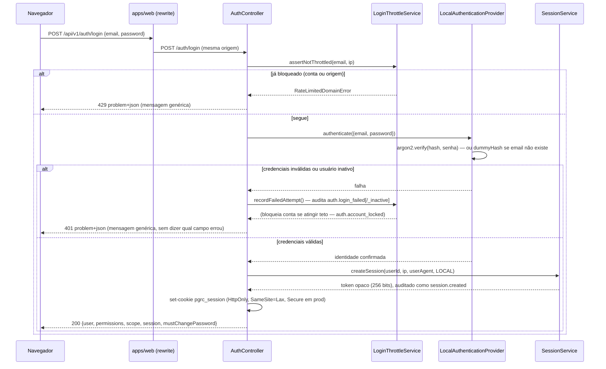

# Segurança — PharosGRC

> Fonte da verdade sobre autenticação, sessões, autorização e postura geral de segurança da
> plataforma, verificada diretamente no código em `apps/api` e `apps/web`, não em especificação.
> Todo caminho citado existe no repositório no momento da escrita. Onde o código diverge do que
> CLAUDE.md descreve como visão de produto (por exemplo, LDAP/AD/OIDC/SAML), isso é dito
> explicitamente como **PLANEJADO**, nunca apresentado como implementado.
>
> Identificadores técnicos (nomes de arquivo, variáveis de ambiente, rotas, nomes de decorator,
> valores de enum, ações de auditoria) permanecem em inglês, como já convencionado em CLAUDE.md
> §11.1.

## Contents

- [Visão geral](#visão-geral)
- [Autenticação](#autenticação)
- [Sessões](#sessões)
- [CSRF](#csrf)
- [Autorização](#autorização)
- [Tratamento de acesso negado](#tratamento-de-acesso-negado)
- [Auditoria de ações](#auditoria-de-ações)
- [Arquivos e anexos](#arquivos-e-anexos)
- [Outras proteções de plataforma](#outras-proteções-de-plataforma)
- [Checklist prático: autorização em uma funcionalidade nova](#checklist-prático-autorização-em-uma-funcionalidade-nova)
- [Erros comuns que introduzem vulnerabilidade](#erros-comuns-que-introduzem-vulnerabilidade)
- [Lacunas conhecidas e não corrigidas](#lacunas-conhecidas-e-não-corrigidas)

---

## Visão geral

A superfície pública é **um único domínio** (ADR-014): o navegador só fala com o próprio
`apps/web`, que faz *rewrite* server-side de `/api/*` para a API NestJS
(`API_INTERNAL_URL`). Isso é a razão de existir de várias decisões abaixo — não há CORS porque
não há segunda origem, o cookie de sessão continua *first-party*, e a defesa de CSRF pode se
apoiar em comparar `Origin`/`Referer` contra um único valor (`APP_ORIGIN`).

A cadeia de guardas globais em `apps/api/src/app.module.ts` (ordem é significativa, todas como
`APP_GUARD`, AND lógico):

```
ThrottlerGuard → SessionGuard → MandatoryPasswordChangeGuard → PermissionGuard
```

e, antes de qualquer guard, dois middlewares Express aplicados a `'*'`:
`RequestContextMiddleware` (correlação, IP, user agent) e `CsrfMiddleware`
(`apps/api/src/app.module.ts:206-216`).

## Autenticação

### Fluxo de login local



- Controller: `apps/api/src/core/identity/presentation/auth.controller.ts` (`@Controller('auth')`,
  `POST /auth/login` marcado `@Public()`).
- Orquestração: `apps/api/src/core/identity/infrastructure/auth-orchestrator.ts`
  (`AuthOrchestrator`, implementa `AuthUseCasesPort`).
- Provedor local: `apps/api/src/core/identity/infrastructure/providers/local/local-authentication.provider.ts`.

### Hashing de senha — argon2id

Parâmetros lidos de variáveis de ambiente (`ARGON2_MEMORY_COST`, `ARGON2_TIME_COST`,
`ARGON2_PARALLELISM`, validadas em `apps/api/src/infrastructure/config/env.schema.ts`), com
defaults em `.env.example`:

```
ARGON2_MEMORY_COST=19456   # KiB
ARGON2_TIME_COST=2         # iterações
ARGON2_PARALLELISM=1       # lanes
```

`local-authentication.provider.ts` chama `argon2.hash(..., { type: argon2.argon2id, memoryCost,
timeCost, parallelism })` e `argon2.verify(...)`. **Defesa contra enumeração por tempo**: quando o
e-mail não existe, o provedor ainda executa um hash argon2 real contra uma senha-isca
(`getDummyHash()`), para que a latência de "usuário não existe" seja indistinguível da de "senha
errada" — mitigação deliberada de canal lateral, não apenas resposta idêntica.

Política de senha (`apps/api/src/core/identity/domain/password-policy.ts`):
`PASSWORD_MIN_LENGTH=12`, `PASSWORD_REQUIRE_COMPLEXITY=true` (mistura de classes de caractere).

### Abstração de provedor de identidade

`apps/api/src/core/identity/domain/authentication-provider.ts` define a interface
`AuthenticationProvider` (`method`, `supports(method)`, `authenticate(credentials)`) e um token
multi-provider (`AUTHENTICATION_PROVIDERS`). **Apenas um provedor existe hoje**:

```
apps/api/src/core/identity/infrastructure/providers/
└── local/
```

`identity.module.ts` monta o array de provedores como `[local]` — LDAP, Active Directory, OIDC e
SAML são **PLANEJADO** (CLAUDE.md §5): a única preparação real no schema é o modelo
`ExternalIdentity` (`apps/api/prisma/schema.prisma:651-664`, comentário do próprio schema: "unused
in this release — no authentication logic implemented here") e o enum `AuthenticationMethod` que
`Session`/`ExternalIdentity` já referenciam. Um futuro provedor se registra implementando a mesma
interface e adicionando-se ao array — sem tocar em módulo de negócio (a abstração de identidade que
CLAUDE.md §5 pede já existe como ponto de extensão, mas **ainda não foi exercitada** por nenhum
provedor além do local — CLAUDE.md §19.10 se aplica: um ponto de extensão nunca chamado por código
de produção real não conta como capacidade provada).

### Rate limiting e bloqueio de conta

`apps/api/src/core/identity/application/login-throttle.service.ts` implementa **dois mecanismos
independentes** (D-6, `docs/local-environment.md`):

| Mecanismo | Chave | Variável de ambiente | Default | Efeito |
|---|---|---|---|---|
| Por conta | e-mail | `AUTH_RATE_LIMIT_ACCOUNT_ATTEMPTS` | `5` | bloqueia a conta por `AUTH_LOCKOUT_MINUTES` (`LocalCredential.lockedUntil`) |
| Por origem | IP do chamador | `AUTH_RATE_LIMIT_ORIGIN_ATTEMPTS` | `20` | rejeita novas tentativas daquele IP, qualquer conta |
| — | janela | `AUTH_RATE_LIMIT_WINDOW_SECONDS` | `300` | janela deslizante para ambos |
| — | duração do bloqueio | `AUTH_LOCKOUT_MINUTES` | `15` | tempo de bloqueio por conta |

O limite por origem é deliberadamente maior que o por conta — uma rede corporativa
compartilhada (NAT/VPN) não pode ser bloqueada por alguns e-mails digitados errado (D-6). Estado
de bloqueio por conta vive em `LocalCredential.failedAttempts`/`lockedUntil`
(`apps/api/prisma/schema.prisma:633-647`); o contador por origem vive em cache
(`RateLimitCachePort`, Redis em produção, adaptador em memória em desenvolvimento sem `REDIS_URL`).
Ambos os ramos lançam `RateLimitedDomainError` (HTTP 429) com a **mesma** mensagem genérica —
nunca revelam se foi a conta ou a origem que disparou (não-divulgação, FR-007).

Isto é **distinto** do `ThrottlerGuard` global (`THROTTLE_TTL_SECONDS`/`THROTTLE_LIMIT`, ver
[Outras proteções](#outras-proteções-de-plataforma)), que se aplica a toda rota, não só ao login.

### Eventos de auditoria de login

Ações registradas (strings livres passadas a `AuditRecorder.record({action: '...'})`, não um enum
fechado — ver [Auditoria de ações](#auditoria-de-ações)):

- `session.created` — sucesso (não existe uma ação dedicada `auth.login_succeeded`; o sucesso é
  auditado como criação de sessão).
- `auth.login_failed` / `auth.login_failed_inactive` — falha de credencial / conta inativa.
- `auth.account_locked` — a conta acabou de cruzar o teto de tentativas (`outcome: DENIED`).
- `auth.login_refused_locked` — tentativa contra conta já bloqueada.
- `auth.logout`, `session.expired` — fim de sessão (ver mapa de motivos abaixo).
- `auth.password_changed`, `user.deactivated`.

## Sessões

### Armazenamento

**PostgreSQL é a fonte autoritativa; Redis é cache de validação, nunca autoritativo** (ADR-002,
comentário do próprio `schema.prisma:670-672`). Modelo `Session`
(`apps/api/prisma/schema.prisma:673-691`):

```prisma
model Session {
  id                   String                   @id @default(uuid(7))
  tokenHash            String                   @unique @map("token_hash")
  userId               String                   @map("user_id")
  authenticationMethod AuthenticationMethod     @map("authentication_method")
  createdAt            DateTime                 @default(now())
  expiresAt            DateTime                 @map("expires_at")
  lastActivityAt       DateTime                 @map("last_activity_at")
  ipAddress            String?                  @db.Inet
  userAgent            String?
  revokedAt            DateTime?
  revokedReason        SessionRevocationReason?
}
```

Apenas o **hash** do token é persistido: `apps/api/src/core/sessions/domain/session-cookie.ts`
gera 256 bits aleatórios (`randomBytes(32)`), guarda `sha256(token)` e devolve o token bruto uma
única vez, na resposta do login — nunca logado, nunca auditado em texto puro.

### Cookie de sessão

Emitido em `AuthController.login` via `buildSessionCookieDescriptor`
(`apps/api/src/core/sessions/domain/session-cookie.ts:77-88`):

| Atributo | Valor | Origem |
|---|---|---|
| Nome | `pgrc_session` (configurável) | `SESSION_COOKIE_NAME` |
| `HttpOnly` | sempre `true` | fixo no código, não configurável |
| `Secure` | `SESSION_COOKIE_SECURE` | `false` em dev HTTP local; **obrigatório `true`** fora de dev — validação Zod recusa subir com `NODE_ENV=production` e `SESSION_COOKIE_SECURE=false` (`env.schema.ts`) |
| `SameSite` | `SESSION_COOKIE_SAMESITE` (`lax` por padrão) | enum `lax\|strict\|none` |
| `Path` | `/` | fixo |
| `Max-Age` | `SESSION_ABSOLUTE_LIFETIME_HOURS * 3600 * 1000` | atrelado ao tempo de vida absoluto, não um valor separado |

`docker-compose.yml` sobrescreve `SESSION_COOKIE_SECURE=true` para o container `api`
(`NODE_ENV=production` ali dentro) — mas nada no Compose termina TLS, então o cookie `Secure` só é
utilizável de fato atrás de um proxy HTTPS real (ver D-13/F-13 em `docs/local-environment.md`).

### Expiração idle e absoluta

```
SESSION_IDLE_TIMEOUT_MINUTES=30       # expira por inatividade (janela deslizante)
SESSION_ABSOLUTE_LIFETIME_HOURS=12    # expira sempre, mesmo com atividade contínua
```

Verificado em `SessionService.checkExpiry()`
(`apps/api/src/core/sessions/application/session.service.ts`): `now >= expiresAt` OU
`now - lastActivityAt >= idleTimeoutMinutes` → sessão tratada como `EXPIRED`.

### Última atividade

`SessionGuard` (rodando em toda requisição não-`@Public()`) chama
`SessionService.validateSession()`, que atualiza `lastActivityAt` no máximo uma vez por minuto
(`TOUCH_INTERVAL_MS = 60_000`) — evita um `UPDATE` a cada requisição, mantendo a janela deslizante
utilizável.

### Revogação

| Gatilho | Caminho | Motivo (`SessionRevocationReason`) |
|---|---|---|
| Logout do próprio usuário | `POST /auth/logout` → `AuthOrchestrator.logout()` | `LOGOUT` |
| Troca de senha | `POST /auth/me/password` | `PASSWORD_CHANGED` — **revoga TODAS as sessões do usuário**, inclusive a que fez a troca |
| Desativação de usuário | `AuthOrchestrator.deactivateUser()` | `USER_DEACTIVATED` |
| Ação administrativa | `DELETE /admin/users/{userId}/sessions` → `RevokeUserSessionsUseCase` | `ADMIN_REVOKED` |

`SessionService.revokeSession`/`revokeAllForUser` marcam a linha revogada, escrevem um evento de
auditoria e **apagam a entrada de cache sincronamente** — é essa exclusão, não a expiração por TTL
do cache, que faz a revogação valer imediatamente na próxima requisição.

### UI de sessões

- **Autoatendimento (listar/revogar as próprias sessões em outros dispositivos): não existe.**
  CLAUDE.md §6 descreve isso como algo que "a plataforma deverá **futuramente** permitir" — o
  código confirma que ainda é **PLANEJADO**. A tela de Perfil (`apps/web/src/app/(app)/profile/`)
  mostra apenas o perfil e `lastLoginAt`, sem lista de sessões ativas.
- **Administrativo: implementado, mas só "revogar tudo".**
  `apps/web/src/features/admin/components/users/user-sessions-dialog.tsx` chama
  `DELETE /admin/users/{userId}/sessions` — um botão de "encerrar todas as sessões" de um usuário
  alvo, não uma lista sessão-a-sessão com IP/user agent por linha.

## CSRF

Mecanismo: verificação de `Origin` (com *fallback* para `Referer`) contra `APP_ORIGIN`, em
**todo** método que não seja `GET`/`HEAD`/`OPTIONS`, aplicada globalmente por um middleware Express
— **não** é o padrão *double-submit cookie*, e não depende só de `SameSite`.

`apps/api/src/infrastructure/http/csrf.middleware.ts`:

```ts
const SAFE_METHODS = new Set(['GET', 'HEAD', 'OPTIONS']);
// ...
if (SAFE_METHODS.has(req.method)) { next(); return; }
const candidateOrigin = originOf(req.get('origin')) ?? originOf(req.get('referer'));
const expectedOrigin = originOf(this.appConfig.app.appOrigin);
if (!candidateOrigin || candidateOrigin !== expectedOrigin) {
  throw new ForbiddenDomainError(USER_MESSAGES.auth.crossOriginRejected); // 403
}
```

Pontos relevantes:

- **Falha fechado**: requisição sem `Origin` **e** sem `Referer` é recusada, não deixada passar.
- Aplica-se mesmo a rotas `@Public()`, **inclusive `POST /auth/login`** — fecha "login CSRF"
  (logar a vítima silenciosamente na conta do atacante). `auth.openapi.yaml` não documenta esse
  403 para login; é um desvio aditivo deliberado e comentado no próprio arquivo.
- Funciona em conjunto com `SESSION_COOKIE_SAMESITE=lax` como defesa em profundidade — o próprio
  comentário do arquivo explica por que `SameSite=Lax` sozinho não cobre toda navegação top-level
  nem todo POST fora de `<form>`.
- Nenhum token CSRF dedicado (nenhum *double-submit cookie*) existe além desta checagem de
  origem.

## Autorização

### Catálogo de permissões

Identificadores no formato `resource:action` (nunca um booleano "é admin"), ex.: `risk:view`,
`risk:approve`, `role:administer`. Tipo compile-time `PermissionIdentifier = keyof
PermissionRegistry`, construído por **fusão de declaração TypeScript**
(`declare module` por módulo) — um identificador digitado errado falha `tsc`, não passa em
silêncio no runtime (ADR-003). Registro central:
`apps/api/src/core/authorization/domain/permissions.ts`.

**Agregador único**: `apps/api/src/permission-catalogue.ts` importa o conjunto estático de cada
módulo e combina com `combinePermissionDefinitions(...)` (lança em identificador duplicado). É o
que tanto a aplicação NestJS quanto o script de seed (`apps/api/prisma/seed/platform.seed.ts`, um
contexto Nest autônomo que **não** carrega os módulos de negócio) consultam — garantindo que os
dois vejam exatamente o mesmo conjunto sem depender de ordem de import.

Permissões centrais (core), sem pertencer a nenhum módulo de negócio: `audit:view`,
`user:administer`, `role:administer`, `org_unit:administer`, `methodology:administer`,
`attachment:create`, `attachment:delete`, `comment:create`, `comment:delete`.

### Papéis, atribuições e papéis de sistema

Modelos `Role`/`Permission`/`RolePermission`/`UserRole`
(`apps/api/prisma/schema.prisma:697-752`). `Role` tem **seis campos** apenas — `id`, `name`,
`description`, `isSystem`, `createdAt`, `updatedAt` — **sem** coluna de "nível" ou "privilégio"
(ver ADR-021 abaixo).

Doze papéis semeados por `apps/api/prisma/seed/platform.seed.ts` (`SYSTEM_ROLE_DEFINITIONS`):
Platform Administrator, Risk Manager, Risk Analyst, Risk Approver, Control Owner, Control
Approver, Compliance Manager, Auditor, Read Only, Audit Lead, Incident Manager, Problem Manager.
"Platform Administrator" **não** é um superusuário hard-coded — é um papel comum que, por
composição, detém todas as permissões (ADR-021).

**Papel de sistema é imutável por inteiro** (commit `b1632bd`) —
`apps/api/src/core/authorization/application/role-admin.service.ts`:

- `update()`: se `role.isSystem` e o chamador envia `name`, `description` ou
  `permissionIdentifiers` — mesmo que idênticos ao valor já salvo — lança
  `ValidationDomainError`. A regra é sobre **quem pode escrever**, não sobre se o valor mudou
  (corrige F-68: antes, `description` sozinha escapava, era auditada como `role.updated` e depois
  revertida silenciosamente pelo seed seguinte, sem evento de auditoria).
- `delete()`: `role.isSystem` → recusado.

### Guards e decorators

Um único caminho de decisão, `apps/api/src/core/authorization/presentation/permission.guard.ts`:

- `@RequirePermission(identifier: PermissionIdentifier)` — exige a permissão no conjunto efetivo
  do ator.
- `@NoPermissionRequired()` — opt-in explícito e auditável para "qualquer autenticado pode".
  Ainda exige um ator resolvido (não contorna `SessionGuard`).
- `@Public()` — **única** forma de pular tanto `PermissionGuard` quanto `SessionGuard` (login,
  health check).
- **Nenhuma das três** → recusado. `PermissionGuard` nega por padrão deliberadamente:

  ```ts
  if (noPermissionRequired !== true) {
    await this.deny({ ..., reason: 'MISSING_PERMISSION_DECLARATION' });
    throw new ForbiddenDomainError();
  }
  ```

  Um endpoint sem decorator nenhum é um defeito nesse endpoint, nunca uma passagem livre.

`PermissionGuard` responde só "este papel tem esta permissão, em algum lugar" — nunca "para quais
registros". Isso é responsabilidade separada do escopo organizacional, abaixo. Uma rota correta
combina as duas: `@RequirePermission('risk:edit')` no controller **e** um `ScopeFilter` passado ao
repositório.

Toda recusa que gera um evento de auditoria `DENIED` passa por um `PermissionDenialRecorderPort`
(`@Optional()`, ligado por `AuthorizationModule` a `AuditPermissionDenialRecorder`) — ver
[Auditoria de ações](#auditoria-de-ações).

### Escopo organizacional

Base comum: `apps/api/src/shared/persistence/scoped-repository.ts` e
`apps/api/src/shared/persistence/scope-filter.ts`.

`ScopeFilter` é uma união fechada, **sem** terceiro caso "irrestrito por omissão":

```ts
type ScopeFilter = { kind: 'GLOBAL' } | { kind: 'UNIT'; unitIds: ReadonlySet<string> };
```

Um usuário sem nenhum `OrgScopeGrant` resolve para `UNIT` com conjunto **vazio**, que
`applyScopeToWhere` transforma em `{ in: [] }` — não filtra nada, mas também não retorna nada
(nega tudo, nunca "sem filtro"). `ScopedRepository.applyScope`/`withScope` recebem `scope:
ScopeFilter` como parâmetro **obrigatório, sem default** — omiti-lo é erro de compilação, não
disciplina de revisão. Toda subclasse (`RiskRepository`, `ActionScopedRepository`,
`EvidenceScopedRepository`, `FindingScopedRepository`, e as dos módulos posteriores) estende essa
base; nada consulta a tabela diretamente por fora dela — exceto por convenção de revisão, já que
nenhuma linguagem sem sistema de efeitos impede uma subclasse de adicionar um método que
contorne a base (o comentário da própria classe admite isso).

O conjunto de unidades vem de `ScopeResolverService`
(`apps/api/src/core/organizations/application/scope-resolver.service.ts`), expandido por
descendência via a coluna materializada `path` de `OrganizationalUnit`, cacheado (Redis ou
fallback em memória) por `userId:orgTreeVersion:grantsVersion`.

**Correções de vazamento de escopo já registradas** (não são "lacunas abertas" — já corrigidas,
citadas aqui como histórico relevante de segurança):

- `specs/006-assets-processes`: antes, `GET /assets`/`GET /processes` eram servidos por um
  `RegistryController` genérico gated só por `risk:view`, **sem nenhum filtro de escopo** — todo
  autenticado com `risk:view` via o inventário inteiro da organização. A escrita de vínculo
  (asset-link/process-link) não checava o escopo do alvo (0 checagens, contra 5 já existentes em
  `control-link.usecase.ts`). Corrigido: leitura exige `asset:view`/`process:view` com
  `ScopeFilter` aplicado; escrita ganhou checagem de escopo do alvo nos dois lados.
- `specs/008-incidents-problems`: os cinco vínculos Incidente/Problema (Incident→Risk,
  Incident→Asset, Incident→Process, Problem→Risk, Problem→Incident) resolvem o registro de
  **origem** contra o escopo do ator antes de tocar o alvo — provado em
  `apps/api/test/integration/incident-problem-links-source-scope.spec.ts`. Registrado em
  CLAUDE.md §17 item 13: essa prova existe só no nível de integração de API; **não há E2E de
  navegador** cobrindo esse escopo para estes cinco vínculos.

### Segregação de funções (SoD)

Aplicada em duas camadas independentes, deliberadamente redundantes (risco não fica dependente de
uma só):

1. **Aplicação**: `apps/api/src/modules/risk/domain/approval.ts`,
   `assertApproverDiffersFromRequester(requestedByUserId, actorUserId)`, chamada em
   `DecideApprovalUseCase.execute()`
   (`apps/api/src/modules/risk/application/approvals/decide-approval.usecase.ts`) **antes** de
   qualquer escrita.
2. **Banco de dados**: `CHECK` constraint `approvals_decided_by_requester_check` —
   `CHECK (decided_by_user_id IS NULL OR decided_by_user_id <> requested_by_user_id)` — vale
   mesmo contra uma escrita que contorne a camada de aplicação.

Reforçado por permissão: `risk:approve` (decidir) e `risk:transition` (solicitar) são
identificadores distintos, e os papéis semeados "Risk Analyst"/"Risk Approver" são disjuntos
nessas duas permissões.

O mecanismo genérico que torna isso reutilizável por outro domínio é o enum fechado
`ApprovableEntityType` (`apps/api/prisma/schema.prisma:428-435`: hoje `RISK` e
`CONTROL_ASSESSMENT`) sobre a tabela única `Approval` (`schema.prisma:1870-1902`) — estender
sign-off a um domínio novo é acrescentar um valor de enum e um caso de uso, nunca um motor de
workflow (CLAUDE.md §19.4). Não existe um diretório `core/approvals/**`: hoje é um modelo/enum
compartilhado, consumido pelos próprios módulos de negócio (`modules/risk`,
`modules/controls`) através de suas próprias rotas (ex.:
`apps/api/src/modules/risk/presentation/lifecycle.controller.ts`), não um controller central.

### ADR-021 — classificação de privilégio é apresentação, nunca autorização

`docs/architecture/decisions.md`, ADR-021 (aceita, 2026-09-13). O servidor **não tem** nenhum
conceito de "papel privilegiado" — nem coluna, nem verificação. `isPrivilegedRole` é uma **função
pura no cliente web** sobre a lista de permissões que `GET /admin/roles` já devolve, verdadeira
quando o papel concede `role:administer`, `user:administer` ou `org_unit:administer`. É
explicitamente **proibida** de ser consultada por `PermissionGuard`, resolução de permissão, SoD,
filtro de escopo ou qualquer decisão de negócio — a regra existe para impedir que a autorização
ganhe um segundo eixo paralelo, sem trilha de auditoria e sem contrato, correndo apenas no
cliente. Guardada por dois testes: uma varredura estrutural no servidor (o predicado não pode
aparecer em código de autorização) e um teste comportamental no cliente (um papel classificado
como privilegiado e um papel comum com o mesmo conjunto efetivo de permissões recebem exatamente
a mesma resposta do servidor).

A própria ADR registra, sem ambiguidade, que isto **não é** uma verificação
anti-escalação de privilégio — essa verificação **não existe** hoje (ver D-13 a seguir).

### D-13 — administrador pode conceder permissão que ele mesmo não possui

`docs/local-environment.md`, D-13. `RoleAdminService`/`ScopeGrantService` não checam se o
administrador que concede já possui a permissão/escopo concedido — o contrato gateia só por
`role:administer`/`user:administer`. Decisão registrada: **manter assim**, porque uma regra "só
pode conceder o que possui" seria teatro de segurança aqui — quem tem `role:administer` pode
editar qualquer papel, inclusive o próprio, e simplesmente se concederia a permissão primeiro. O
controle real é operacional (`role:administer`/`user:administer` seedados **só** em "Platform
Administrator") mais **detecção**: toda concessão/revogação é auditada em trilha imutável.

## Tratamento de acesso negado

### 401 vs 403 vs 404

`apps/api/src/shared/errors/domain-error.ts` define `UnauthorizedDomainError` (401, sem sessão
válida), `ForbiddenDomainError` (403, autenticado mas sem permissão — a existência do recurso não
é sensível) e `NotFoundDomainError` (404, o registro **realmente não existe OU existe mas está
fora do escopo do ator, e as duas situações devem ser indistinguíveis** — comentário do próprio
tipo cita ADR-009/FR-030).

**Regra confirmada em código**: um recurso existente porém fora do escopo organizacional do
chamador responde **404, não 403** — para não permitir que alguém descubra, por diferença de
status, que um registro existe em outra unidade. `PermissionGuard` nunca nomeia um registro
específico em sua negação (a decisão dele independe de registro); é a camada de
`ScopedRepository`/`OrgScopeEnforcerService` que garante essa não-divulgação por registro,
tipicamente resolvendo para `null` e lançando `NotFoundDomainError` — não um `ForbiddenDomainError`
disfarçado. Confirmado no padrão de `incident-problem-links-source-scope.spec.ts`: uma origem fora
de escopo e uma origem inexistente produzem a **mesma** mensagem de erro.

### RFC 9457 (`application/problem+json`)

Filtro global único, `apps/api/src/infrastructure/http/problem-details.filter.ts`
(`ProblemDetailsFilter`, `@Catch()` sem argumento — captura tudo, nunca deixa a página de erro
padrão do Nest aparecer). Regra rígida documentada no próprio arquivo: **nunca** stack trace,
identificador interno, mensagem crua de driver de banco ou segredo na resposta — tudo isso vai só
para o log, e o cliente recebe um `correlationId` para localizar o detalhe completo.

`type` base: `https://pharosgrc.dev/problems`. Exemplos:

| Status | `type` |
|---|---|
| 401 | `.../unauthorized` |
| 403 | `.../forbidden` |
| 403 (troca de senha obrigatória) | `.../password-change-required` |
| 404 | `.../not-found` |
| 409 | `.../conflict` (ou `.../version-conflict` para *optimistic lock*, com `ETag`/`currentVersion`) |
| 422 | `.../validation` (traz `errors: ValidationFieldError[]`) |
| 429 | `.../rate-limited` (traz cabeçalho `Retry-After`) |
| 500 | `.../internal-error` |
| `HttpException` genérica do Nest | `.../http-{status}` |

### Comportamento no web

- **Não existe `middleware.ts`** em `apps/web` (confirmado por busca no repositório inteiro).
  Proteção de rota é feita **por layout server-side**:
  `apps/web/src/app/(app)/layout.tsx` chama `fetchCurrentSession()` (encaminhando o cookie da
  requisição recebida) e `redirect('/login')` sem sessão — nenhum pixel de conteúdo protegido
  renderiza antes disso. Todo módulo novo herda essa proteção automaticamente ao entrar sob
  `(app)/`.
- **Sem tela genérica de "Acesso negado"** — apenas tratamento local de 403 em algumas telas (ex.
  `apps/web/src/app/(app)/indicators/[metricKey]/indicator-detail-view.tsx`), não um padrão
  compartilhado no Design System.
- `apps/web/src/lib/permissions.ts`'s `usePermissions()` é o único mecanismo de ocultar/desabilitar
  UI por permissão, e o próprio cabeçalho do arquivo é taxativo: **"THIS HOOK IS NOT A SECURITY
  BOUNDARY."** Usado para esconder botões/entradas de menu (ex.
  `apps/web/src/components/shell/sidebar.tsx`), nunca para decidir o que uma resposta de API
  contém — a checagem real está sempre no servidor.

## Auditoria de ações

Capacidade transversal, uma **única** forma de escrever: `AuditRecorder.record(...)`
(`apps/api/src/core/audit/application/audit-recorder.service.ts`). Não existe tabela de auditoria
por módulo (FR-038).

```ts
async record(input: RecordAuditEventInput): Promise<void>
```

Campos obrigatórios sem default (`action`, `entityType`, `actorLabel`) — esquecer um é erro de
compilação. Campos que o chamador **não pode** informar, porque são derivados automaticamente do
contexto de requisição: `actorUserId`, `ipAddress`, `userAgent`, `sessionId`, `correlationId`,
`id`, `occurredAt`.

Exemplo real (`apps/api/src/modules/risk/application/create-risk.usecase.ts`):

```ts
await this.auditRecorder.record({
  action: 'risk.created',
  entityType: AuditEntityType.RISK,
  entityId: record.id,
  actorLabel: actor.fullName,
  newValues: { title: input.title, description: input.description, /* ... */ },
});
```

**Acoplamento transacional (ADR-005)**: `record()` precisa rodar dentro do mesmo
`PrismaService.runInTransaction(...)` da escrita de negócio que descreve.
`PrismaAuditEventWriter` (`apps/api/src/core/audit/infrastructure/prisma-audit-event-writer.ts`)
lança `AuditNotInTransactionError` **antes de emitir qualquer SQL** se não houver transação
ambiente — impossível gravar uma linha de auditoria "solta", que sobreviveria a um rollback da
escrita que ela deveria descrever.

**Alow-list de campo por tipo de entidade**: `previousValues`/`newValues` só podem conter campos
explicitamente registrados por tipo de entidade; qualquer nome de campo que pareça um segredo
(`*Hash`, `*Secret`, `*Token`, `*Credential`, ou `password`/`token`/`secret`/`hash` isolado) é
rejeitado na própria chamada de registro do allow-list, antes de poder alcançar o registro
(`apps/api/src/core/audit/domain/audit-field-allowlist.ts`).

**Imutabilidade, aplicada em dois níveis redundantes no banco** (migração
`20260905120200_audit_event_append_only`):

1. `REVOKE UPDATE, DELETE` do papel de aplicação (`pharos_app`) sobre `audit_event` e cada
   partição.
2. Um gatilho `BEFORE UPDATE OR DELETE` (`audit_event_prevent_modification()`) que levanta erro
   para **qualquer** papel, inclusive o de migração (`pharos_owner`) rodando um `UPDATE` manual
   por engano.

A tabela é particionada por `occurredAt` (partições mensais); o gatilho se propaga
automaticamente para novas partições, o `REVOKE` não — por isso os dois mecanismos coexistem
deliberadamente, não são redundância acidental.

**Ações não são um enum fechado**: `AuditEvent.action` é `String` livre (ex.: `risk.created`,
`role.updated`, `auth.account_locked`, `attachment.uploaded`, `session.created`). O que **é** um
enum Postgres fechado é `AuditEvent.entityType` (`AuditEntityType`), estendido só por migração
aditiva (`ALTER TYPE ... ADD VALUE`), nunca por string livre (ADR-008).

**Leitura**: não existe um `AuditController` central em `core/audit/presentation` — a leitura é
exposta **por módulo de negócio**, cada um com seu próprio endpoint:
`GET /risks/{riskId}/audit-events` (`apps/api/src/modules/risk/presentation/audit.controller.ts`)
e `GET /actions/{actionId}/audit-events`
(`apps/api/src/grc/action/presentation/action-audit.controller.ts`), ambos exigindo a permissão
do domínio **e** `audit:view`. Não há uma tela de "trilha de auditoria da plataforma" — apenas
seções de auditoria embutidas nos detalhes de Risco e de Ação
(`apps/web/src/features/risks/components/risk-audit-section.tsx`,
`apps/web/src/features/actions/components/action-audit-section.tsx`).

## Arquivos e anexos

Módulo `apps/api/src/core/files/**`, controller único `@Controller('attachments')`
(`apps/api/src/core/files/presentation/attachment.controller.ts`).

**Limite de tamanho**: `ATTACHMENT_MAX_SIZE_BYTES` (default `26214400` = 25 MiB), aplicado pelo
`limits.fileSize` do multer (`files.module.ts`, `MulterModule.registerAsync`) — um upload maior é
recusado com 413 **antes** de qualquer código de aplicação rodar.

**Armazenamento**: apenas disco local nesta versão (`ATTACHMENT_STORAGE_DRIVER=local`,
`LocalDiskStorageProvider`). Chave de armazenamento derivada por conteúdo (SHA-256),
**nunca** do nome do arquivo enviado — elimina colisão de nome e *path traversal*, porque a chave
nunca é construída a partir de entrada do usuário. Um adaptador S3-compatível é planejado atrás
da mesma porta (`FileStorageProvider`), não implementado.

**Validação de content-type — duas camadas**:

1. Lista de permissão declarada: `ATTACHMENT_ALLOWED_MIME_TYPES`
   (default `application/pdf,image/png,image/jpeg,text/plain`).
2. **Farejamento por assinatura de bytes** (`apps/api/src/core/files/domain/magic-bytes.ts`):
   compara os bytes reais do arquivo (assinatura PDF/PNG/JPEG, heurística UTF-8 sem NUL para
   texto) contra o `Content-Type` declarado — os dois precisam concordar antes de qualquer
   gravação. Isso derrota um executável renomeado com `Content-Type` forjado, que passaria pela
   checagem 1 sozinha.

**Varredura de malware/antivírus: ausente.** Busca por `clamav`/`virus`/`scan` em
`apps/api/src/core/files` não encontra nada — confirmado ausente, não apenas não pesquisado.

**Controle de acesso ao download**: `GetAttachmentContentUseCase` delega inteiramente a
`assertAttachmentAccessible()` (`apps/api/src/core/files/application/attachment-access.ts`), que
consulta o *accessor* registrado do tipo de entidade pai (`entity-registry.ts`) para saber se o
ator pode ver o registro pai (permissão + escopo aplicados ali). Uma recusa é relançada como
`NotFoundDomainError` **usando o id do próprio anexo**, nunca o do pai — para que "este anexo não
existe" e "este anexo existe mas o pai não é acessível" produzam respostas byte-idênticas
(mesma técnica de não-divulgação de [401 vs 403 vs 404](#401-vs-403-vs-404)).

Withdrawal (exclusão) é sempre lógico (`deletedAt`/`deletedByUserId`) — nunca hard delete,
preservando atribuição (FR-102).

## Outras proteções de plataforma

- **Helmet**: `app.use(helmet())` em `apps/api/src/main.ts`, **sem configuração customizada** —
  usa só os defaults (HSTS, `X-Frame-Options`, `X-Content-Type-Options`, `Referrer-Policy`, etc).
  Nenhum CSP customizado foi definido explicitamente.
- **CORS**: **não existe** em `apps/api/src` (nenhum `enableCors`, nenhum middleware de CORS) —
  decisão deliberada de arquitetura de origem única (ADR-014): o navegador só fala com a própria
  origem de `apps/web`, que faz o *rewrite* server-side para a API via `API_INTERNAL_URL`. Sem
  segunda origem, sem necessidade de CORS.
- **`trust proxy`**: `apps/api/src/main.ts` fixa `app.set('trust proxy', 1)` — confia em
  exatamente um salto de proxy reverso para `X-Forwarded-For`/`X-Forwarded-Proto` (usado para IP
  de auditoria e de rate limiting). Um deployment com um salto adicional (ex. CDN) precisa ajustar
  esse número, ou um cliente pode forjar seu próprio IP pelo cabeçalho.
- **Throttler global**: `ThrottlerModule`/`ThrottlerGuard` (`apps/api/src/app.module.ts:55-65`,
  registrado como `APP_GUARD`), `THROTTLE_TTL_SECONDS=60`/`THROTTLE_LIMIT=100`, contado por IP,
  aplicado a **toda** rota (distinto do limitador específico de login descrito em
  [Autenticação](#autenticação)). **F-59** (`docs/deferred-findings.md`, RESOLVIDO 2026-09-19): sob
  concorrência real (múltiplos workers Playwright, mesma máquina), esse teto já foi medido
  derrubando jornadas E2E inteiras com 429 — inclusive em rotas de leitura fora de login. A decisão
  formal de configuração é rodar a suíte E2E local completa com `--workers=1` contra um banco de
  desenvolvimento volumoso (medido: 168/168 aprovados); o teto de produção **não foi enfraquecido**
  para fazer teste passar, por princípio (CLAUDE.md §12).
- **Segredos**: nenhum segredo real está commitado — `.env.example` (raiz do repositório, única
  fonte, D-5) documenta cada variável e afirma explicitamente que valores de produção vêm sempre
  do ambiente de deployment ou de um gerenciador de segredos. **Não existe variável de segredo de
  assinatura de sessão** (`JWT_SECRET` ou equivalente) — a sessão é um token opaco de 256 bits
  com hash SHA-256 guardado no banco, nada nela é assinado criptograficamente, então não há
  segredo de assinatura para gerenciar (D-5, `docs/local-environment.md`). Nenhum segredo
  hard-coded foi encontrado em `apps/api/src` nesta verificação.
- **XSS no web**: `dangerouslySetInnerHTML` não é usado em nenhum código de produção de
  `apps/web/src` (a única ocorrência é uma referência em comentário de teste do Design System,
  afirmando explicitamente que o componente **não** faz isso). `Comment.body` é armazenado e
  renderizado **só como texto puro**, nunca interpretado como marcação (comentário do próprio
  `schema.prisma`).
- **CSP no web: ausente.** `apps/web/next.config.ts` não define `headers()` nem qualquer
  Content-Security-Policy. O `helmet()` da API cobre respostas da API, não o HTML/JS servido pelo
  próprio `apps/web` — que é a superfície de fato exposta a XSS/clickjacking no navegador. Isto
  **não** está documentado como decisão deliberada em nenhuma ADR encontrada; ver
  [Lacunas conhecidas](#lacunas-conhecidas-e-não-corrigidas).

## Checklist prático: autorização em uma funcionalidade nova

Ao adicionar um endpoint ou uma tela nova, nesta ordem:

1. **Adicionar a permissão ao catálogo do próprio módulo.** Criar/estender
   `<module>-permissions.ts` com `declare module '.../permissions' { interface PermissionRegistry
   { 'meu_dominio:acao': true } } }` e exportar um array `MEU_DOMINIO_PERMISSION_DEFINITIONS`
   (modelo: `apps/api/src/modules/risk/domain/risk-permissions.ts`).
2. **Registrar no agregador.** Um import e um argumento em
   `apps/api/src/permission-catalogue.ts` — nada mais muda ali.
3. **Mapear em papel(is) no seed.** `apps/api/prisma/seed/platform.seed.ts`,
   `SYSTEM_ROLE_DEFINITIONS` — decidir quais dos doze papéis (ou um novo) recebem a permissão.
4. **Anotar o controller.** `@RequirePermission('meu_dominio:acao')` no handler (ou
   `@NoPermissionRequired()` se genuinamente só exigir estar autenticado — nunca deixar sem
   nenhum dos dois).
5. **Filtrar por escopo organizacional no repositório**, não no controller: o repositório do
   domínio estende `ScopedRepository<PrismaWhereInput>` (modelo:
   `apps/api/src/modules/risk/infrastructure/risk.repository.ts` ou equivalente em
   assets/processes) e todo método passa `scope: ScopeFilter` para `withScope(...)`. **Nunca**
   consultar a tabela Prisma diretamente por fora da base.
6. **Segregação de funções, se houver aprovação.** Reusar `ApprovableEntityType` (adicionar um
   valor de enum via migração aditiva, não uma tabela nova) e chamar
   `assertApproverDiffersFromRequester` **antes** de decidir — considerar também um `CHECK`
   constraint no banco, como o exemplo de `approvals_decided_by_requester_check`.
7. **Registrar auditoria.** Chamar `AuditRecorder.record({...})` **dentro** da mesma
   `runInTransaction(...)` da escrita, com `action` no padrão `dominio.evento` e um allow-list de
   campo registrado para o `entityType` (novo tipo de entidade audita apenas o que for
   explicitamente permitido — `core/audit/domain/core-entity-audit-allowlists.ts` como modelo).
8. **Teste de contrato para 401/403.** Todo endpoint precisa de um teste de contrato que prove (1)
   a regra de autorização declarada, incluindo que falta de permissão é recusada e que um
   endpoint "sem permissão adicional" genuinamente funciona para um autenticado sem permissões
   extras; (2) chamador não autenticado recebe 401; (3) a resposta de sucesso bate com o formato
   do contrato — regra obrigatória mesmo que a lista de tarefas não peça (D-11,
   `docs/local-environment.md`).
9. **Teste de integração para escopo.** Provar que um ator fora do escopo do registro recebe 404
   (não 403, não os dados) — modelo:
   `apps/api/test/integration/incident-problem-links-source-scope.spec.ts`.
10. **No web: ocultar/desabilitar, nunca confiar.** Usar `usePermissions()` só para não mostrar um
    botão cujo clique daria 403 — a checagem real já está garantida pelos passos 4-5 no servidor.
    Nunca pular a chamada real de API achando que "já está escondido".
11. **Entrada de navegação, se aplicável.** `navigation-registry.ts` aceita `requiredPermission`
    — lembrar que esse campo é só consultivo (mesmo aviso do item anterior).

## Erros comuns que introduzem vulnerabilidade

- **Default que concede.** Qualquer `if (!requerido) return true` (ou equivalente) num guard é
  uma falha de "negar por padrão" — o padrão correto deste projeto é sempre recusar quando a
  declaração de permissão está ausente (ver `PermissionGuard`).
- **`scope?: ScopeFilter` opcional.** Tornar o parâmetro de escopo opcional com default
  "irrestrito" é exatamente a inversão catastrófica que `ScopeFilter` foi desenhado para impedir
  em compilação — nunca dar um default a esse parâmetro.
- **Checar permissão no controller e esquecer escopo no repositório** (ou vice-versa). São dois
  mecanismos independentes; nenhum substitui o outro (ver especs 006/008 acima, que corrigiram
  exatamente essa lacuna em dois módulos diferentes).
- **Responder 403 para um recurso fora de escopo em vez de 404.** Revela a existência do
  registro a quem não deveria nem saber que ele existe — usar `NotFoundDomainError`.
- **Persistir um campo derivado de autorização** (ex. um `isPrivileged` no banco ou na resposta de
  API) — vira estado desatualizado no instante seguinte a uma mudança de permissão, e o exemplo
  proibido explicitamente é ADR-021.
- **Auditar fora da transação da escrita** — quebra a garantia "todo evento auditado corresponde
  a uma mudança que realmente aconteceu" (e nem é possível: `AuditNotInTransactionError` já
  impede isso em runtime).
- **Confiar em `usePermissions()` como controle de acesso.** O próprio hook documenta que não é
  fronteira de segurança — esconder um botão nunca substitui a checagem do servidor.
- **Adicionar um campo sensível a `previousValues`/`newValues` sem allow-list.** Um nome de campo
  parecido com segredo é rejeitado automaticamente, mas um campo genuinamente sensível sem esse
  padrão de nome não é pego pelo filtro — revisar manualmente o que um novo tipo de entidade
  expõe no allow-list de auditoria.

## Lacunas conhecidas e não corrigidas

Registradas para quem for revisitar segurança — nenhuma foi corrigida por este documento, que é
só descritivo:

- **CSP ausente no `apps/web`** (achado desta pesquisa, sem ADR ou finding anterior cobrindo-o
  explicitamente): `helmet()` protege as respostas da API; nada define
  `Content-Security-Policy`/`X-Frame-Options` para o HTML e JS servidos pelo Next.js, que é a
  superfície real de XSS/clickjacking no navegador. Vale investigar se `apps/web/next.config.ts`
  deveria ganhar uma seção `headers()`.
- **Sem verificação anti-escalação de privilégio** (ADR-021 §5, D-13): quem tem `role:administer`
  pode conceder qualquer permissão do catálogo a qualquer papel, inclusive ao seu próprio,
  incluindo o próprio `role:administer`/`user:administer`. Decisão registrada de manter assim,
  com detecção via auditoria como controle compensatório — não prevenção.
- ~~**F-38** (`docs/deferred-findings.md`): uma negativa de acesso por escopo organizacional nunca
  era auditada como `DENIED`.~~ **RESOLVIDO — não é mais uma lacuna, reconciliado 2026-09-19.**
  `OrgScopeEnforcerService.assertExistingRecordAccessible` grava `DENIED`
  (`organization.denied.out_of_scope`) sempre que um registro existe mas está fora de escopo, com
  chamadores hoje em oito módulos (Risco, Evidência, Achado, Ativos, Processos, Controles,
  Incidentes, Problemas, Engajamentos de Auditoria); um id genuinamente inexistente continua sem
  gravar auditoria, por design (evita virar oráculo de existência). Prova:
  `apps/api/test/contract/org-scope-denial-audit.spec.ts`, 15/15 passando. Este item permaneceu
  descrito como lacuna aqui bem depois de o mecanismo já estar completo em produção — a mesma
  classe de defeito de documentação paralela que F-59/F-65 abaixo tinham.
- **F-59** (`docs/deferred-findings.md`, RESOLVIDO 2026-09-19): o `ThrottlerGuard` global derrubava
  jornadas longas sob concorrência real — decisão formal é `--workers=1` para bateria E2E local
  completa contra banco de desenvolvimento volumoso (168/168 aprovados, medido). Ver
  [Outras proteções](#outras-proteções-de-plataforma).
- **F-65** (`docs/deferred-findings.md`, CORRIGIDO 2026-09-19): upload acima de 32 MB falhava
  lentamente pela origem web (o proxy do Next mantinha os bytes em `PassThrough` não lido,
  ocupando memória do servidor web por requisição, antes mesmo de autenticação).
  `apps/web/src/middleware.ts` agora recusa pelo `Content-Length` antes do clone do corpo, com
  `413` rápido.
- **Sem varredura de malware em upload** — ausência confirmada, não decisão registrada
  explicitamente em nenhuma ADR encontrada nesta pesquisa.
- **LDAP/AD/OIDC/SAML são apenas ponto de extensão nunca exercitado** — por CLAUDE.md §19.10, um
  mecanismo que compila mas nunca foi chamado por código de produção real não conta como
  capacidade provada; hoje só `local` está implementado.
