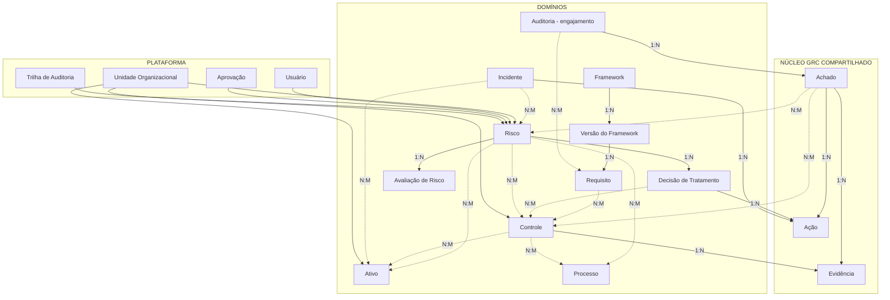

# PharosGRC — Blueprint do Domínio GRC Integrado

> Este documento descreve o **PharosGRC**, não o Probo. O benchmark
> (`probo-benchmark.md`) é evidência que informou estas decisões; a arquitetura aqui é nossa.
>
> **Estado**: alvo aprovado para revisão. **Atualizado em 2026-09-07**: a Seção B abaixo —
> `Evidence`, `Action` e `Finding` — foi implementada (`specs/002-shared-grc-foundation`, commit
> `115bf2a`); `Control` permanece não implementado, exatamente como esta seção sempre recomendou.
> Fora isso, nada neste documento foi implementado além do que já existia no módulo de Risco e nas
> capacidades de plataforma. Nenhuma mudança de schema, migração ou contrato REST decorre
> automaticamente daqui — ver CLAUDE.md §19.4.

> **Documento histórico — registro de fase (alvo proposto em 2026-09-07).** Não descreve
> necessariamente o estado atual do produto: o roteiro que este blueprint informou (Fases 0–7 de
> `docs/architecture/grc-roadmap.md`) está hoje concluído, incluindo `Control` (não implementado quando este
> documento foi escrito). Fonte vigente: [`docs/STATE.md`](../STATE.md) e
> [`docs/modules/README.md`](../modules/README.md).

---

## 1. Objetivo

Garantir que os módulos GRC futuros formem **um domínio integrado**, não um conjunto de
aplicações CRUD independentes.

O critério de sucesso é concreto: um auditor deve conseguir partir de um requisito normativo e
chegar, por relacionamentos explícitos, ao controle que o satisfaz, à evidência que comprova o
controle, ao achado que apontou sua falha, à ação que remediou o achado e ao risco que tudo isso
trata — sem que nenhum desses passos dependa de convenção de nomenclatura, campo de texto livre
ou tabela genérica.

---

## 2. As três camadas

```
┌─────────────────────────────────────────────────────────────────┐
│  A. PLATAFORMA (core/)                                          │
│  Transversal, agnóstica de domínio GRC                          │
├─────────────────────────────────────────────────────────────────┤
│  B. NÚCLEO GRC COMPARTILHADO (shared GRC)                       │
│  Conceitos GRC que mais de um domínio precisa e nenhum possui   │
├─────────────────────────────────────────────────────────────────┤
│  C. DOMÍNIOS DE NEGÓCIO (modules/)                              │
│  Risco, Controles, Conformidade, Auditoria, Ativos, Processos,  │
│  Incidentes, Problemas                                          │
└─────────────────────────────────────────────────────────────────┘
             ↑ dependências apontam sempre para cima ↑
```

Regra de dependência, herdada de ADR-011 e estendida: **C depende de B e de A. B depende de A.
A não depende de nada acima. Nenhum módulo de C importa outro módulo de C.**

---

### A. Plataforma — `core/`

Já implementado, salvo onde indicado.

| Capacidade | Estado |
|---|---|
| Identidade e autenticação (abstração de provedor) | implementado (só LOCAL) |
| Sessões | implementado |
| Autorização, RBAC, catálogo de permissões | implementado |
| Usuários, papéis | implementado |
| Unidades organizacionais e escopo | implementado |
| Auditoria | implementado |
| Arquivos e anexos | implementado |
| Comentários | implementado |
| Notificações | infraestrutura pronta, sem produtor |
| Dashboard | implementado |
| **Aprovações** | implementado, **já genérico** via `ApprovableEntityType` |
| Configuração | **ausente** (declarado em CLAUDE.md §4) |

**Aprovação já é capacidade de plataforma genérica.** `Approval.entityType` é enum fechado
(`ApprovableEntityType`) hoje contendo apenas `RISK`. Estender sign-off a documentos, achados ou
revisão de controle é adicionar valor de enum e caso de uso — **não** construir motor de
workflow. Ver CLAUDE.md §19.6.

---

### B. Núcleo GRC compartilhado

**Critério de admissão, deliberadamente estreito**: um conceito só entra se **pelo menos três
domínios de negócio precisarem dele** e **nenhum puder ser seu dono exclusivo**. Um conceito que
não passa nos dois testes permanece no domínio que o usa.

Este critério existe para impedir que o núcleo vire depósito de abstrações especulativas
(§50 do pedido de benchmark; Constitution: não criar abstrações prematuras).

Os dois testes precisam passar **juntos**. O segundo é o decisivo: ele separa "vários módulos
usam" de "não pertence a nenhum".

| Conceito | Teste de posse | Teste de ciclo de vida | Veredito | Estado |
|---|---|---|---|---|
| **Evidence** | nenhum domínio é dono — nasce de Controles, Auditoria, Conformidade e Risco | próprio: coletada, validada, vence, é substituída | **ENTRA** | **implementado** (`grc/evidence`) |
| **Action** | nenhum domínio é dono — nasce de tratamento, achado, incidente e remediação | próprio; sobrevive à origem | **ENTRA** | **implementado** (`grc/action`) |
| **Finding** | nasce sobretudo em Auditoria, mas também em teste de controle e conformidade | próprio, e **sobrevive à origem**: a auditoria encerra, o achado segue aberto | **ENTRA** | **implementado** (`grc/finding`) — adiantado da Fase 4 original; ver `docs/architecture/grc-roadmap.md`, Fase 1 |
| **Control** | um módulo de Controles **pode** ser dono exclusivo | governado por esse módulo | **NÃO ENTRA** | não se aplica — corretamente não implementado |

**`Control` foi avaliado e ficou de fora.** É domínio de negócio com dono natural único: o módulo
de Controles cria, testa, declara efetivo e aposenta. Risco, Conformidade e Auditoria o
**referenciam** — e referência não é posse. Esse é o caso que ADR-020 resolve por porta.
Admiti-lo aqui transformaria a camada em depósito de tudo que é muito referenciado, que é como um
núcleo compartilhado deixa de significar alguma coisa.

**Não entram agora**, e a razão importa:

- **Assessment** — hoje só o Risco possui. Generalizar com um único consumidor é abstração
  prematura. Reavaliar quando existir um segundo tipo real de avaliação (efetividade de
  controle, avaliação de fornecedor).
- **Workflow / motor de processo** — a infraestrutura de aprovação existente cobre as
  necessidades previsíveis. Um motor BPM é exatamente o que §50 proíbe.
- **Tag / Relationship genérico** — proibido por ADR-008, e o benchmark reforçou a proibição
  com quatro reversões observadas no Probo.

---

### C. Domínios de negócio — `modules/`

| Módulo | Estado | Depende de |
|---|---|---|
| Gestão de Riscos | **implementado** | plataforma, Action e Evidence (já consumidas via `grc/`, ver §6 abaixo); futuramente Control |
| Controles | não iniciado | plataforma, Evidence, Action — **publica porta** (ADR-020) |
| Conformidade | não iniciado | plataforma, Control, Evidence |
| Auditoria | não iniciado | plataforma, Finding, Evidence, Action, Control |
| Ativos | registro de referência | plataforma |
| Processos | registro de referência | plataforma |
| Incidentes | não iniciado | plataforma, Action, Risk |
| Problemas | não iniciado | plataforma, Action, Incidentes |
| Indicadores e Relatórios | não iniciado | leitura de todos |

---

## 3. Mapa integrado de entidades



Linhas cheias são posse ou composição; tracejadas são associação N:M por tabela de ligação
explícita e nomeada.

---

## 4. Requisito × Controle — a decisão de vocabulário

Adotamos **vocabulário GRC convencional**, e não a nomenclatura invertida do Probo.

| Conceito | Nome no PharosGRC | Definição |
|---|---|---|
| Cláusula normativa | **`Requirement`** | Exigência de uma versão de framework. Pertence a exatamente uma `FrameworkVersion`. Duplica-se entre frameworks — isso é correto e esperado. |
| Salvaguarda organizacional | **`Control`** | O que a organização de fato faz. **Não** pertence a framework algum. Reutilizável. |
| Ligação | `RequirementControlLink` | N:M. Um controle satisfaz muitos requisitos, de muitas normas. |

**Por que essa forma, e não uma só entidade**: um controle único ("exigir MFA no acesso
administrativo") satisfaz simultaneamente cláusulas da ISO 27001, do NIST e de norma interna. Com
uma entidade só, ele é duplicado por norma — e com ele duplicam-se evidência, ações, dono e
histórico. O Probo tentou a forma ingênua (campo texto `standards` na tabela de salvaguardas), a
abandonou e substituiu por tabela de ligação real. Adotamos o destino, não o caminho.

O que **duplica** é a metadado da cláusula (texto, aplicabilidade, justificativa por norma). Isso
é aceitável e correto: a mesma prática pode ser aplicável sob uma norma e excluída sob outra.

---

## 5. Versionamento de framework

`Framework` → `FrameworkVersion` → `Requirement`.

O requisito pertence à **versão**, nunca ao framework diretamente. Uma revisão de norma cria uma
`FrameworkVersion` nova, e a migração de mapeamentos `RequirementControlLink` entre versões é
**operação de primeira classe**, com trilha de auditoria própria — não trabalho manual de
recadastro.

Isto é resposta direta à maior lacuna encontrada no Probo (§11 do benchmark), e é decisão de
projeto **antes** da primeira linha do módulo de Conformidade, porque retrofitar versionamento
depois de existirem mapeamentos é exatamente o cenário que deixa uma organização sem caminho de
atualização.

---

## 6. Como Evidência e Ação se ligam a vários sujeitos

**Mecanismo: registro de tipo fechado — o padrão que este projeto já provou quatro vezes.**

`Attachment`/`AttachableEntityType`, `Comment`/`CommentableEntityType`,
`Notification` e `Approval`/`ApprovableEntityType` já usam exatamente esta forma: coluna de tipo
com **enum fechado**, jamais string livre, mais registro em tempo de composição que declara quais
tipos são válidos.

Evidence e Action seguem o mesmo padrão:

```
Evidence.subjectType : EvidenceSubjectType  -- CONTROL | REQUIREMENT | FINDING | RISK | ACTION | AUDIT
Action.originType    : ActionOriginType     -- RISK_TREATMENT | FINDING | INCIDENT | COMPLIANCE | CONTROL
```

**Por que isso não viola ADR-008.** ADR-008 proíbe modelar **relacionamento de domínio** por
estrutura genérica — Risco↔Controle não pode virar `related_entity(type, id)`, porque a
semântica do vínculo é o próprio dado, e a trilha de auditoria precisa distinguir vínculo de
controle de vínculo de processo. Evidence e Action não são relacionamento entre domínios: são
**capacidades transversais anexadas a um sujeito**, exatamente como comentário e anexo. O
discriminador é enum fechado, verificado em compilação, com tipo de entidade de auditoria
próprio — não uma string aberta.

A distinção que governa a escolha:

| Pergunta | Mecanismo |
|---|---|
| Dois domínios GRC se relacionam e o vínculo tem significado próprio? | **Tabela de ligação explícita e nomeada** (`RiskControlLink`) |
| Uma capacidade transversal se anexa a muitos tipos de sujeito? | **Registro de tipo fechado** (`Evidence`, `Action`, `Comment`) |
| Qualquer outra coisa? | Nenhuma das duas — reprojetar |

---

## 7. Estado de conformidade é calculado, não digitado

O estado de um requisito **deriva** do estado dos controles que o satisfazem e da evidência que
os sustenta. Não é campo editável.

Isto é decisão de mirar mais alto que o benchmark: no Probo, `measure.state`,
`control.maturity_level` e `obligation.status` são três enums independentes, editados à mão, sem
reconciliação — um controle pode declarar `DEFINED` enquanto sua única medida declara
`NOT_STARTED`, e nada no sistema percebe.

Disciplina a aplicar, já provada aqui: **um único calculador**, como o `RiskScoringService` é
hoje o único classificador de nível de risco. Nenhuma segunda regra de conformidade em outro
lugar do código. O contraexemplo interno também já é conhecido: o predicado de vencimento está
duplicado em quatro lugares (F-24), e é o que não se deve repetir.

---

## 8. Duas primitivas de aprovação

| Primitiva | Objeto | Estado |
|---|---|---|
| **Aprovação de registro** | uma transição de ciclo de vida de um registro | **existe**, com segregação de funções em dois níveis |
| **Aprovação de artefato publicado** | um retrato imutável e versionado de um registro inteiro | não existe |

A segunda é adaptação do padrão do Probo (§19 do benchmark): publicar o registro de riscos como
artefato imutável, versionado, com quórum de aprovadores nomeados, e aprovar **o artefato**.

Ela é valiosa aqui por uma razão específica de contexto institucional: sustenta a frase *"este é
o registro de riscos como aprovado em 15/03, assinado, inalterável"* diante de inspeção. É
complementar, não substituta — o Probo tem só a segunda, e por isso aceitação de risco
individual fica sem porta alguma.

---

## 9. Identidade e posse

O Probo separa `Identity` (login global, fora do escopo de tenant) de `MembershipProfile`
(pessoa dentro de uma organização), e toda posse aponta para o perfil.

**Decisão: REJECT, com ponto de extensão registrado.** Essa separação resolve multi-tenancy —
uma identidade participando de várias organizações — que o PharosGRC não tem e não planeja: somos
instalação institucional única com hierarquia interna de unidades.

Ponto de extensão, caso um dia se sirva mais de uma instituição na mesma instalação: a separação
identidade × vínculo organizacional é o padrão comprovado, e `User` seria dividido, não
estendido.

---

## 10. Preparação para automação e IA

**Regra arquitetural, sem implementação nesta fase.**

```
                     ┌────────────────────────┐
   Web UI ──────────►│                        │
   Integração ──────►│  Serviços de aplicação │──► autorização ──► domínio ──► auditoria
   Automação ───────►│      (REST hoje)       │
   Adaptador MCP ───►│                        │
   IA ──────────────►└────────────────────────┘
```

Toda superfície futura entra pelos **mesmos serviços de aplicação** e atravessa a **mesma
autorização e a mesma auditoria**. Nunca um caminho de dados paralelo.

O benchmark deu os dois lados da evidência: o MCP do Probo respeita essa fronteira (chama o mesmo
autorizador e o mesmo serviço que a mutação GraphQL), enquanto o `proboctl` a viola (fala direto
com o PostgreSQL, sem escopo, sem autenticação, sem auditoria).

Princípios para IA, quando houver:

1. IA chama serviços de aplicação — nunca o banco, nunca o modelo diretamente.
2. Identidade vem do contexto do servidor, **nunca** da saída do modelo.
3. Ação de IA é auditável e atribuível, com **tipo de ator distinto** de chamada humana ou de
   chave de API.
4. Escrita iniciada por IA passa por **portão de revisão humana construído e ligado**. O Probo
   construiu o portão e não o ligou; é o erro a não repetir.
5. Campo escrito por IA carrega **proveniência** — confiança e fonte — e nunca sobrescreve edição
   humana em silêncio.

---

## 11. O que este blueprint não autoriza

Não autoriza alterar schema, criar migração, alterar contrato REST, implementar Controles,
Evidência, Ação, Achado, Conformidade, Auditoria, Ativos, Incidentes, MCP ou IA, nem reescrever o
módulo de Risco.

É alvo arquitetural para revisão. A implementação de cada item depende de especificação própria,
pelo processo de CLAUDE.md §16.
