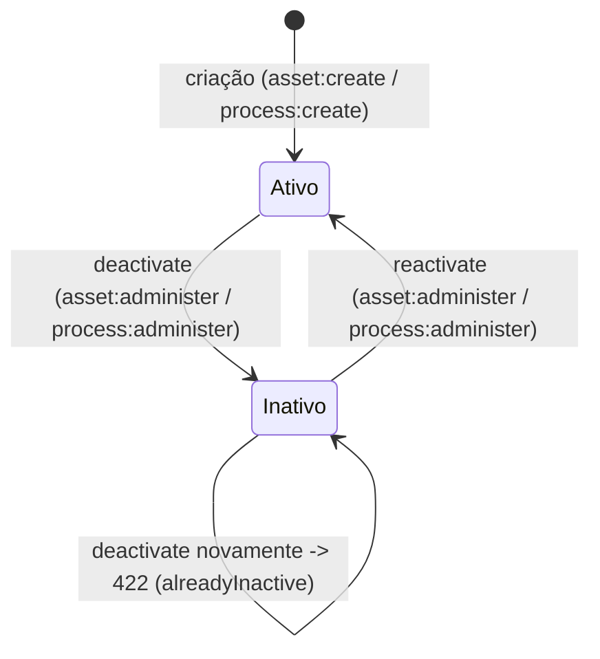

# Ativos e Processos

> Documento de transferência de conhecimento. Código é fonte da verdade; specs descrevem intenção
> e histórico. Toda afirmação abaixo tem evidência (arquivo/linha ou comando) verificada nesta
> sessão.

## Status

**IMPLEMENTADO** — os dois domínios (Ativo e Processo) estão promovidos a módulos de negócio
próprios, com API, autorização, escopo organizacional, auditoria e telas, conforme
`specs/006-assets-processes/` (61/61 tarefas, `STATE.md` §1). Fase posterior (`008-incidents-problems`,
commit `2a39b52`) estendeu os dois módulos com leitura reversa de vínculos de Incidente
(`GET /assets/{id}/incidents`, `GET /processes/{id}/incidents`), sem alterar o desenho original.

Itens em aberto conhecidos (nenhum bloqueia uso do módulo):

| Item | Referência | Situação |
|---|---|---|
| F-48 — orçamento local de login não cobre a suíte E2E completa | `docs/deferred-findings.md` | RESOLVIDO 2026-09-19, mitigação documentada (rodar specs isolados; perfis de rate limit da CI alinhados) |
| F-55 — Controles e Compliance não têm E2E/axe próprios (Ativos/Processos **têm**, então este módulo não é o afetado, mas é citado como contraste) | `docs/deferred-findings.md` | RESOLVIDO 2026-09-19, não afetava este módulo |
| F-56 — hipótese não confirmada de perda de valor digitado em formulário antes da hidratação, no padrão `Controller` compartilhado — listava explicitamente "Ativos e Processos" entre os formulários a auditar | `docs/deferred-findings.md` | RESOLVIDO 2026-09-19 — auditado campo a campo: `AssetForm`/`ProcessForm` desabilitam todo campo até `loadingReferenceData` resolver (pós-hidratação), então a janela do defeito nunca fica interativa neles. Não expostos; nenhuma mudança precisou nos dois formulários deste módulo. |
| Relação Processo↔Ativo direta | `research.md` D-10 | PLANEJADO — deliberadamente fora de escopo; candidata a um consumidor futuro (ex.: Incidentes) |
| `isActive` sem coluna `version`/`ETag`/`If-Match` | `research.md` D-4, decisão registrada | Decisão deliberada, não pendência |
| 2 advisories `moderate` (`pnpm audit`) | `STATE.md` §7 | Abaixo do limiar do portão, não bloqueante |

Nenhuma tarefa da fase 006 permanece aberta (`STATE.md`: "Nenhuma tarefa da fase permanece
aberta").

## Objetivo

Ativo e Processo eram, até a fase 006, registros de referência mínimos vivendo dentro de
`modules/risk` (sem tela própria, sem permissão própria, lidos por `RegistryController` sob
`risk:view`). A fase promoveu os dois a módulos de negócio completos — inventário navegável,
CRUD com dois estados (ativo/inativo), autoridade própria (`asset:*`/`process:*`) e escopo
organizacional — sem recriar os quatro vínculos que já existiam com Risco e Controle, e sem
inventar uma relação direta Ativo↔Processo que nenhum requisito pedia.

Os dois módulos são estruturalmente simétricos por decisão de projeto (FR-020): tudo que vale para
Ativo vale para Processo, salvo o prefixo de código (`AST` / `PRC`) e o nome.

## Entidades principais

| Modelo Prisma | Tabela | Campos-chave | Evidência |
|---|---|---|---|
| `Asset` | `assets` | `id`, `code` (único, gerado, prefixo `AST`), `name`, `description?`, `orgUnitId?` (FK `Restrict` a `organizational_units`), `isActive` (default `true`), `createdAt`, `updatedAt` | `apps/api/prisma/schema.prisma:1703-1720` |
| `Process` | `processes` | idem, prefixo `PRC` | `apps/api/prisma/schema.prisma:1681-1698` |

`orgUnitId` continua anulável **na coluna** (linhas pré-existentes à fase), mas é obrigatório no
DTO de criação (`@IsUUID`, não opcional) — mesmo precedente de `Control`
(`data-model.md` §4, Invariante A1).

Não há enum de estado dedicado: `isActive: boolean` é o único campo de situação (ver seção
seguinte). Um comentário de schema em `Asset`/`Process` ainda diz "no Asset/Process Management
module exists in this release (spec Out of Scope)" — texto **desatualizado**, sobrevivente da
fase em que os dois eram apenas registro de referência dentro de Risco; a fase 006 promoveu ambos
a módulo próprio sem atualizar esse comentário (`apps/api/prisma/schema.prisma:1678-1680`,
`1700-1702`). Divergência de documentação inofensiva, não funcional — sinalizada aqui como achado
menor, não corrigida (fora do escopo desta tarefa de documentação).

## Estados / ciclo de vida

Dois estados apenas — decisão deliberada D-3 (`research.md`), para não repetir "um terceiro estado
sem consequência", padrão que o projeto já quase enviou três vezes.

- Transição para Inativo: continua totalmente legível, continua visível nos vínculos já
  existentes, mas **recusa vínculo novo** (Invariante A5) — a checagem já existia em
  `control-asset-link.usecase.ts:57` e foi generalizada para o lado de Risco por esta fase.
- Não existe exclusão (`FR-012`) — sair de operação é desativar, nunca apagar linha. As FKs `Restrict`
  também impediriam fisicamente.
- Código de uso: `apps/api/src/modules/assets/application/deactivate-asset.usecase.ts` — recusa
  (`ValidationDomainError`, campo `isActive`) se já inativo; `reactivate-asset.usecase.ts` é o
  espelho.

## Regras de negócio relevantes

- **Código nunca vem do cliente** — gerado pelo servidor via `GrcCodeSequence`/`EntityCodeService`,
  forma `AST-2026-0001`/`PRC-2026-0001`; um `code` no corpo é rejeitado como propriedade
  desconhecida (Invariante A6). `apps/api/src/grc/shared/domain/entity-code.service.ts:79`.
- **Nome não é identidade** (Invariante A3) — sem restrição de unicidade sobre `name`; identidade é
  `id`, identificador legível é `code`.
- **Unidade organizacional obrigatória na criação e dentro do escopo do ator** (Invariantes A1/A2).
- **Sem `PATCH` vazio** — `assertUpdateBodyNotEmpty` em ambos os controllers recusa corpo sem
  nenhum campo definido (`asset.controller.ts:239-245`).
- **Sem optimistic locking** — nenhuma das duas tabelas tem coluna `version`; decisão explícita
  registrada no contrato OpenAPI e em `STATE.md` §4, não omissão.
- **Nenhum endpoint declara `Cache-Control: no-store`** — toda propriedade devolvida é coluna
  gravada ou leitura direta de tabela de vínculo, nunca estado derivado calculado no momento da
  leitura (`STATE.md` §11, comentário de cabeçalho em `asset.controller.ts:16-21`).
- **Leitura reversa de Incidente é somente leitura** — `GET /assets/{id}/incidents` e
  `GET /processes/{id}/incidents` leem `IncidentAssetLink`/`IncidentProcessLink`, tabelas que
  `modules/incidents` grava; nem Asset nem Process escrevem nelas
  (`asset.controller.ts:213-233`).

## Telas

Rotas reais sob `apps/web/src/app/(app)/`:

| Rota | Arquivo | Função |
|---|---|---|
| `/assets` | `assets/page.tsx` | Catálogo (busca, filtro por unidade, situação) |
| `/assets/new` | `assets/new/page.tsx` | Cadastro |
| `/assets/[id]` | `assets/[id]/page.tsx` + `asset-detail-view.tsx` | Detalhe, edição, desativar/reativar, abas de vínculo (Riscos, Controles, Incidentes) |
| `/processes` | `processes/page.tsx` | Catálogo |
| `/processes/new` | `processes/new/page.tsx` | Cadastro |
| `/processes/[id]` | `processes/[id]/page.tsx` + `process-detail-view.tsx` | Detalhe, edição, desativar/reativar, abas de vínculo |

Botão "Novo" no catálogo só aparece com `asset:create`/`process:create`
(`usePermissions().hasPermission`, `apps/web/src/app/(app)/assets/page.tsx:18-37`).

Componentes de feature em `apps/web/src/features/assets/` e `apps/web/src/features/processes/`
(estrutura simétrica): `*-form.tsx`, `*-lifecycle-actions.tsx` (desativar/reativar),
`*-linked-entities-section.tsx` (abas Riscos/Controles/Incidentes vinculados — a de Incidentes
é a única que faz fetch próprio, `GET .../incidents`, porque não vem embutida no
`GET /assets/{id}`; as demais vêm embutidas na mesma resposta), `*-catalog-view.tsx`,
`*-register-columns.tsx`, `*-register-filters.tsx`.

## Permissões

Oito chaves, quatro por domínio, reusando `PermissionAction` existente (nenhuma ação nova),
declaradas em `apps/api/src/modules/assets/domain/asset-permissions.ts` e
`apps/api/src/modules/processes/domain/process-permissions.ts`, agregadas em
`apps/api/src/permission-catalogue.ts`:

| Permissão | `PermissionAction` reusada | Governa |
|---|---|---|
| `asset:view` / `process:view` | `VIEW` | listar e ler |
| `asset:create` / `process:create` | `CREATE` | cadastrar |
| `asset:edit` / `process:edit` | `EDIT` | alterar nome, descrição, unidade |
| `asset:administer` / `process:administer` | `ADMINISTER` | desativar / reativar |

Não existe `asset:delete`/`process:delete` — não há operação de exclusão a governar (FR-012).

Todo papel semeado que antes enxergava o inventário via `risk:view` recebeu `asset:view`/
`process:view` explicitamente em `apps/api/prisma/seed/platform.seed.ts` (ocorrências em várias
definições de papel, ex. linhas 218-219, 278-279, 329-330, 454-455, 486-487, 560-561, 597-598) —
regra que a guarda `audit-engagement-write-implies-read.spec.ts` (estendida por esta fase) verifica
estruturalmente: todo papel que escreve um ativo consegue lê-lo.

## API

Controllers: `apps/api/src/modules/assets/presentation/asset.controller.ts` (`@Controller('assets')`)
e `apps/api/src/modules/processes/presentation/process.controller.ts` (`@Controller('processes')`).

| Operação | Método/rota | Permissão | Observação |
|---|---|---|---|
| `listAssetCatalog`/equivalente Processo | `GET /assets`, `GET /processes` | `asset:view`/`process:view` | Pagina, filtra por `q`/`orgUnitId`/`isActive`, aplica `ScopeFilter` |
| `createAsset`/`createProcess` | `POST /assets`, `POST /processes` | `asset:create`/`process:create` | `201`, header `Location` |
| `getAsset`/`getProcess` | `GET /assets/{id}`, `GET /processes/{id}` | `asset:view`/`process:view` | Inclui `risks`/`controls` vinculados embutidos |
| `updateAsset`/`updateProcess` | `PATCH /assets/{id}`, `PATCH /processes/{id}` | `asset:edit`/`process:edit` | Corpo não pode ser vazio |
| `deactivateAsset`/`deactivateProcess` | `POST /assets/{id}/deactivate`, idem processos | `asset:administer`/`process:administer` | `422` se já inativo |
| `reactivateAsset`/`reactivateProcess` | `POST /assets/{id}/reactivate`, idem processos | `asset:administer`/`process:administer` | — |
| leitura reversa de Incidente | `GET /assets/{id}/incidents`, `GET /processes/{id}/incidents` | `asset:view`/`process:view` | Somente leitura; query `includeWithdrawn` |

Nenhuma rota `DELETE` existe em nenhum dos dois controllers (confirmado por
`apps/api/test/unit/assets-processes-contract-no-deletion.spec.ts`, 12/12).

Contratos OpenAPI: `specs/006-assets-processes/contracts/assets.openapi.yaml` e
`.../processes.openapi.yaml` — já incluem o path `/incidents` (adicionado pela fase de leitura
reversa, commit `2a39b52`, sem spec própria dedicada — a extensão do contrato original).

O antigo `RegistryController` (`modules/risk`), que servia `GET /assets`/`GET /processes` sob
`risk:view` e **sem nenhum escopo organizacional**, foi retirado; a única evidência restante dele
são comentários explicativos nos arquivos que o substituíram (`list-assets.usecase.ts:8`,
`asset-permissions.ts:13`, `asset.controller.ts:98`, `control.controller.ts:11`).

## Relações com outros módulos

Segue o padrão oficial de dois mecanismos do CLAUDE.md §19.3 / ADR-020 (`docs/architecture/decisions.md:251-311`):
tabela de ligação explícita e nomeada, com FK `Restrict` real, porta em `shared/grc-ports/`,
verificação de escopo do alvo antes de gravar, e permissão dos dois lados.

| Tabela | Dono (quem grava) | Direção | FK | Evidência |
|---|---|---|---|---|
| `risk_asset_links` (`RiskAssetLink`) | `modules/risk` | Risco → Ativo | `Restrict` | `schema.prisma:1774-1790` |
| `risk_process_links` (`RiskProcessLink`) | `modules/risk` | Risco → Processo | `Restrict` | `schema.prisma:1753-1769` |
| `control_asset_links` (`ControlAssetLink`) | `modules/controls` | Controle → Ativo | `Restrict` | `schema.prisma:1660-1676` |
| `control_process_links` (`ControlProcessLink`) | `modules/controls` | Controle → Processo | `Restrict` | `schema.prisma:1640-1656` |
| `incident_asset_links` (`IncidentAssetLink`) | `modules/incidents` | Incidente → Ativo | `Restrict` | `schema.prisma:3164-3180` |
| `incident_process_links` (`IncidentProcessLink`) | `modules/incidents` | Incidente → Processo | `Restrict` | `schema.prisma:3184-3200` |

Nenhuma dessas seis tabelas foi criada ou alterada pela fase 006 (FR-013: "reusadas, nunca
recriadas") — as quatro primeiras já existiam; as duas de Incidente vieram depois, da fase 008.

**Portas expostas por este módulo** (ADR-020 parte 3), em `apps/api/src/shared/grc-ports/`:
`AssetDirectoryPort`/`ProcessDirectoryPort`, devolvendo apenas `id`, `code`, `name`, `orgUnitId`,
`isActive` — nunca o modelo de domínio inteiro. Consumidas por `modules/risk` e `modules/controls`
para resolver o alvo do vínculo e checar escopo antes de gravar (ADR-020 parte 4), substituindo as
duas leituras diretas que existiam antes
(`modules/controls/infrastructure/reference-registry-lookup.repository.ts` e
`modules/risk/infrastructure/prisma-registry.repository.ts` liam `prisma.asset`/`prisma.process`
diretamente — `data-model.md` §8).

**Leituras reversas embutidas** em `GET /assets/{id}`/`GET /processes/{id}`: listam os riscos e
controles vinculados, lendo `RiskAssetLink`/`ControlAssetLink` (e equivalentes de Processo) pelo
lado do dono, sem tabela nova (FR-008, `data-model.md` §9). A leitura reversa de Incidente
(`GET .../incidents`) é a única não embutida — endpoint próprio, porque não faz parte da resposta
original de `AssetDetail` (`asset-linked-entities-section.tsx:1-33`).

**F-46/F-49 — histórico relevante para este módulo**: até 2026-09-08, `Risco→Ativo` e
`Risco→Processo` não verificavam o escopo organizacional do alvo antes de gravar o vínculo
(diferente de `Risco→Controle`, corrigido no mesmo dia por F-46). F-49 (RESOLVIDO 2026-09-09,
`docs/deferred-findings.md`) registra que isso só pôde ser corrigido **depois** que este módulo
passou a existir e expor `AssetDirectoryPort`/`ProcessDirectoryPort` com `orgUnitId` — a correção
foi feita nesta mesma fase (T034/T035), e estendida na mesma mudança a
`Controle→Ativo`/`Controle→Processo` (que tinham a parte 4 do ADR-020 mas não a parte 5,
permissão do lado referenciado) para não repetir o padrão "corrige um irmão, deixa dois" que gerou
F-46/F-49 em primeiro lugar. Confirmado em código: `isOrgUnitWithinScope` aparece em
`modules/risk/application/links/asset-link.usecase.ts:125` e `process-link.usecase.ts:112`.

**Não existe** relação direta Ativo↔Processo — deliberadamente fora de escopo (`research.md` D-10),
candidata explícita para um módulo futuro (ex.: Incidentes) que precise dela.

## Eventos de auditoria

`AuditEntityType.ASSET` / `AuditEntityType.PROCESS` (um único tipo por domínio — sem split
registro/transição, ao contrário de `Control`/`AuditEngagement`, porque não há lifecycle
multi-estado a distinguir — `asset-audit-allowlist.ts:8-19`):

| Ação | Grep | Registra |
|---|---|---|
| `asset.created` | `create-asset.usecase.ts:85` | `code`, `name`, `description`, `orgUnitId` |
| `asset.updated` | `update-asset.usecase.ts:113` | valores anteriores e posteriores |
| `asset.deactivated` | `deactivate-asset.usecase.ts:80` | `isActive: true → false` |
| `asset.reactivated` | `reactivate-asset.usecase.ts:77` | `isActive: false → true` |
| `process.created` | `create-process.usecase.ts:70` | idem Asset |
| `process.updated` | `update-process.usecase.ts:107` | idem |
| `process.deactivated` | `deactivate-process.usecase.ts:75` | idem |
| `process.reactivated` | `reactivate-process.usecase.ts:75` | idem |

Field allow-list explícito (nunca "tudo o que houver no objeto"), registrado em
`asset-audit-allowlist.ts` / `process-audit-allowlist.ts`: `code`, `name`, `description`,
`orgUnitId`, `isActive`. Nota de desenho: `code` **é** incluído aqui (diferente de `Control`, que o
exclui), porque no momento em que este módulo nasceu não havia ainda endpoint de leitura separado
mostrando o código gerado — decisão documentada, não inconsistência (`asset-audit-allowlist.ts:21-36`).

## Testes importantes

| Camada | Caminho | Cobertura |
|---|---|---|
| Contrato | `apps/api/test/contract/assets.spec.ts`, `.../processes.spec.ts` | Payload real vs. OpenAPI |
| Unitário — não-vacuidade da ausência de exclusão | `apps/api/test/unit/assets-processes-contract-no-deletion.spec.ts` | 12/12; prova plantando `delete`/`deleteMany` |
| Unitário — escrita implica leitura | `apps/api/test/unit/asset-process-write-implies-read.spec.ts` | Todo papel que escreve, lê |
| Unitário — fronteira de acesso à tabela | `apps/api/test/unit/asset-process-table-access-boundary.spec.ts` | Nenhum módulo estranho lê `prisma.asset`/`prisma.process` diretamente |
| Unitário — escopo do alvo em todo `Link*UseCase` | `apps/api/test/unit/link-usecase-target-scope-guard.spec.ts` | Cobre `modules/risk` e `modules/controls`, partes 4 e 5 do ADR-020, estruturalmente |
| E2E — jornada completa | `apps/web/e2e/assets-processes.spec.ts` | Cadastrar → buscar → filtrar → abrir → editar → desativar → vínculo recusado → reativar → vínculo aceito (2/2, Ativo e Processo) |
| E2E — escopo organizacional | `apps/web/e2e/assets-processes-scope.spec.ts` | Listagem, leitura direta (404) e escrita de vínculo (422), nunca 403 (1/1) |
| E2E — acessibilidade | `apps/web/e2e/accessibility.spec.ts` (varreduras específicas deste módulo) | 18 varreduras (9+9), catálogo/formulário/detalhe/abas, dois temas |
| Contrato — cobertura de contrato-coverage | `apps/api/test/contract/contract-coverage.spec.ts` | Inclui os dois contratos deste módulo |
| Contrato — leitura reversa de Incidente | `apps/api/test/contract/incidents-problems-reverse-links.spec.ts` | Cobre `GET .../incidents` nos dois módulos |

Contagens de fechamento registradas em `STATE.md` §1 (2026-09-10): API unit 490, contrato 648,
integração 168, web unit 532, E2E Chromium `assets-processes` 2/2, `assets-processes-scope` 1/1,
`accessibility` 56/56 — nenhum pulado.

**Não confirmado nesta varredura**: não foi encontrado spec de integração dedicado a
`*asset*scope*`/`*process*scope*` sob `apps/api/test/integration/` (o padrão existe para outros
módulos, ex. `incident-problem-links-source-scope.spec.ts`, `control-assessment-scope.spec.ts`).
A prova de escopo organizacional para vínculo de Ativo/Processo parece residir apenas em
`link-usecase-target-scope-guard.spec.ts` (unitário, estrutural) e no E2E
`assets-processes-scope.spec.ts` — o que é a lacuna que a fase de Incidentes/Problemas (item 13 do
CLAUDE.md §17) registra como padrão geral não resolvido para escopo de vínculo em navegador.

## Onde vive o código

- **API**: `apps/api/src/modules/assets/` e `apps/api/src/modules/processes/` (domain/application/
  infrastructure/presentation, estrutura idêntica); portas compartilhadas em
  `apps/api/src/shared/grc-ports/asset-directory.port.ts` (e `process-directory.port.ts`,
  implícito pelo padrão idêntico).
- **Web**: `apps/web/src/features/assets/`, `apps/web/src/features/processes/`; rotas em
  `apps/web/src/app/(app)/assets/` e `.../processes/`; mensagens pt-BR em
  `apps/web/src/lib/messages/assets.ts` (referenciado pelos componentes; catálogo central por
  §11.1).
- **Prisma**: `apps/api/prisma/schema.prisma` — `model Asset` (linha 1703), `model Process`
  (linha 1681), `model RiskAssetLink` (1774), `model RiskProcessLink` (1753), `model
  ControlAssetLink` (1660), `model ControlProcessLink` (1640), `model IncidentAssetLink` (3164),
  `model IncidentProcessLink` (3184).
- **Spec de origem**: `specs/006-assets-processes/` (spec.md, plan.md, tasks.md, research.md,
  data-model.md, contracts/, `STATE.md`).

## Refinamento V2 do detalhe de Processos (2026-09-21)

O detalhe de Processo passou a compor o `DetailLayout` compartilhado, com breadcrumb, tabs compactas vinculáveis por `?section=`, leitura em cards semânticos e edição em painel lateral. Situação e transições continuam usando os mesmos endpoints e permissões; Riscos, Controles e Incidentes vinculados continuam em suas seções originais, sem mudança de regra ou de carregamento.
