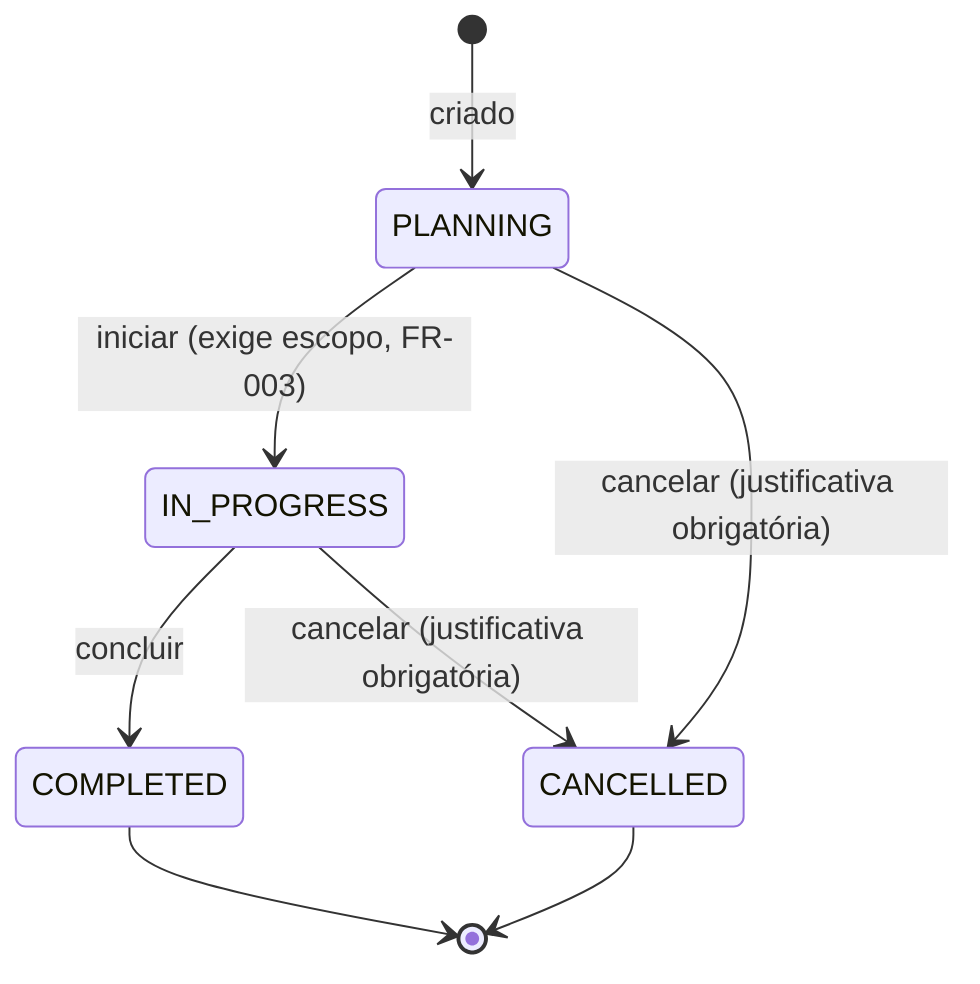
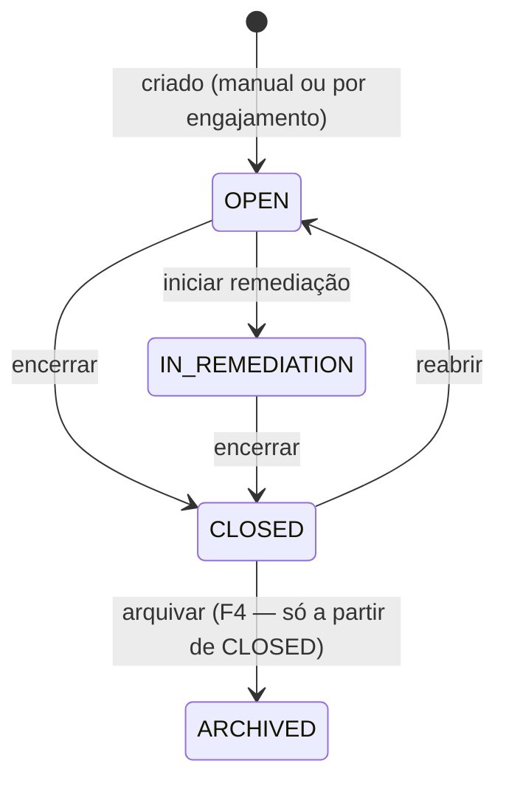

# Auditoria (Engajamentos) e Achados

## Status

**IMPLEMENTADO.** `specs/005-audit-findings/` — backend em `f9e5e5b`, interface e fechamento em
`99a2417`/`7096821`/`51de0e3` (CLAUDE.md §17 item 11). O módulo de engajamento de auditoria é novo
nesta fase; `Finding` (Achado) já existia desde o núcleo GRC (`specs/002-shared-grc-foundation`) —
esta fase deu a ele um produtor (o engajamento), as relações que faltavam e o fechamento com
evidência.

**Divergência de histórico corrigida, não mais presente no código**: uma versão anterior de
`specs/005-audit-findings/STATE.md` afirmava que "as 19 operações do contrato existem como rotas
HTTP reais" — falso em dois sentidos: o contrato declara 20 operações (não 19), e duas delas
(`GET`/`POST /audits/{auditId}/findings`) estavam marcadas concluídas sem use case, controller nem
DTO, porque `apps/api/test/contract/contract-coverage.spec.ts` nunca tinha esse contrato em
`CONTRACT_SOURCES`. Corrigido: as duas rotas existem, o contrato entrou no portão-espelho. Ver
`specs/005-audit-findings/STATE.md` §3. Documentado aqui como exemplo do padrão que este projeto já
nomeou várias vezes (F-42): um registro "concluído" não é verificação.

### Itens em aberto (com evidência)

| Item | Referência | Situação verificada |
|---|---|---|
| Achado de engajamento sem caminho de gestão quando a unidade não tem risco | F-64 (`docs/deferred-findings.md`) | RECLASSIFICADO E MOVIDO 2026-09-19 — não é mais um achado de defeito no ledger; é pedido de capacidade de produto, registrado em `docs/architecture/grc-roadmap.md` §6. A lacuna descrita continua tecnicamente real (gestão do achado só existe em `FindingsPanel`, montado no detalhe do **risco**, listando achados por coincidência de `orgUnitId`; `EngagementFindingsSection` só lista e cria; rotas reversas `GET /risks/{id}/findings`/`GET /controls/{id}/findings` não existem no contrato) — o que mudou é a classificação, não o comportamento do produto. |
| Controles/Compliance sem E2E/acessibilidade próprios | F-55 — RESOLVIDO 2026-09-19, não era deste módulo, mas contrasta: Auditoria e Achados **entregou** E2E e acessibilidade nos dois temas junto com o backend (`audit-engagement.spec.ts`, `audit-engagement-scope.spec.ts`, cobertura de `/audits`, `/audits/new`, `/audits/[auditId]` em `accessibility.spec.ts`). | Não era pendência deste módulo — citado para contexto. |
| Seed com papel de escrita sem leitura | Corrigido nesta mesma fase (STATE.md §5) | RESOLVIDO — "Audit Lead" tinha `audit-engagement:{create,edit,scope,transition}` e `finding:{create,close,remediate,link}` mas nenhuma permissão `*:view`; guarda geral `apps/api/test/unit/audit-engagement-write-implies-read.spec.ts` agora garante que todo papel semeado que escreve também lê. |
| Quatro defeitos só vistos em navegador renderizado | STATE.md §4 | RESOLVIDOS — data de período deslocada um dia (UTC vs. `toLocaleDateString`), botão "Iniciar engajamento" preso desabilitado por ETag desatualizado, data de identificação padrão em "amanhã" em três diálogos de criação (dois deles fora deste módulo, corrigidos por generalização). Guardas: `date-call-sites.test.ts`, `audit-engagement-lifecycle-actions.test.tsx` (afirma o estado do botão, não a contagem de fetches). |

## Objetivo

Registrar o trabalho de auditoria interna como **engajamentos**: um exame com objetivo, período e
escopo declarados, que produz **achados** (Finding) atribuíveis a si mesmo e os acompanha até a
remediação. `Finding` sobrevive ao encerramento do engajamento que o produziu — é o quarto
candidato validado por ADR-016 ("o engajamento encerra e o achado continua aberto até
remediação").

## Entidades principais

| Modelo (Prisma) | Papel | Campos-chave |
|---|---|---|
| `AuditEngagement` (`audit_engagements`) | O exame em si. Dono: `modules/audit-engagements/`. | `code` (`AUD-2026-0001`), `objective`, `periodStart`/`periodEnd`, `orgUnitId`, `leadAuditorUserId`, `status`, `version` (lock otimista) |
| `AuditScopeFrameworkVersion` / `AuditScopeRequirement` / `AuditScopeControl` | As **três variantes de escopo** — versão de framework, requisito específico, ou controle específico. Sem `unlinkedAt`: escopo não é removível (research.md D-12); um item errado é corrigido por adição, nunca por remoção. | `auditEngagementId`, alvo (`frameworkVersionId`/`requirementId`/`controlId`), `linkedAt`, `linkedByUserId` |
| `Finding` (`findings`) | Achado — entidade do núcleo GRC (`grc/finding`), não deste módulo. Ganha aqui `auditEngagementId` **nullable** (null para todo achado manual, fora de engajamento). | `code` (`FND-2026-0001`), `category`, `origin`, `severity`, `priority`, `ownerUserId`, `status`, `closedAt`/`closedByUserId`, `closureJustification` |
| `FindingControlLink` (`finding_control_links`) | Achado ↔ Controle. Soft-unlink, histórico preservado. | `findingId`, `controlId`, `unlinkedAt`/`unlinkedByUserId` |
| `FindingRiskLink` (`finding_risk_links`) | Achado ↔ Risco. Mesma forma. | `findingId`, `riskId`, `unlinkedAt`/`unlinkedByUserId` |

## Estados / ciclo de vida

### Engajamento — quatro estados

`CANCELLED` foi adicionado deliberadamente na análise (FR-004a): sem ele, um engajamento aberto por
engano ficaria preso em `PLANNING` para sempre (iniciar exige escopo; não existe exclusão) — o
mesmo tipo de estado inalcançável que `FindingStatus` e `ControlStatus.DRAFT` quase tiveram.

### Achado (Finding) — quatro estados

## Regras de negócio relevantes

- **Fechamento exige evidência, somando-se à regra anterior (FR-010)** — `CloseFindingUseCase`
  (`apps/api/src/grc/finding/application/close-finding.usecase.ts`) verifica, nesta ordem: (1)
  transição legal (`OPEN`/`IN_REMEDIATION` → `CLOSED`); (2) Invariante F1 — pelo menos uma `Action`
  vinculada concluída **ou** `closureJustification` não vazia; (3) Invariante F5 (nova, FR-010) —
  existe vínculo de evidência ativo para o achado (`EvidenceLink`, `subjectType = FINDING`), 422 se
  não; (4) Invariante F2, segregação de função — `closedByUserId` não pode ser responsável por
  nenhuma `Action` concluída vinculada ao achado, 403 se violar, e a recusa em si é auditada
  (`finding.close_denied`, `outcome: DENIED`) — uma exceção deliberada à regra geral de que negação
  de permissão não grava linha própria de auditoria.
- **Completar toda ação vinculada nunca fecha o achado sozinho (Invariante F3)** — só a operação
  explícita de fechamento transiciona `status`.
- **Só um achado `CLOSED` pode ser arquivado (Invariante F4).**
- **Escopo do engajamento não é removível** (research.md D-12) — a interface diz isso
  explicitamente em vez de oferecer um botão sem efeito.
- **`Finding` não pertence a este módulo** — é capacidade do núcleo GRC (`grc/finding`); o
  engajamento apenas a produz via `originType: FINDING` (para `Action`) e `auditEngagementId`
  (nullable, no próprio `Finding`). Ver `docs/modules/grc-core.md`.
- **Namespace de permissão `audit-engagement:*`, nunca `audit:*`** — `audit:view` já existe no
  núcleo com outro significado (leitura da trilha de auditoria da plataforma). Guarda:
  `apps/api/test/unit/audit-engagement-permission-namespace.spec.ts`.
- **ADR-020 nas cinco partes**, desde o primeiro vínculo (`FindingControlLink`/`FindingRiskLink`):
  tabela nomeada, FK real com `onDelete: Restrict`, porta em `shared/`/`grc/`, verificação de
  escopo antes de gravar, permissão dos dois lados e vinculação/desvinculação auditadas.

## Telas

| Rota | Componente | Fluxo |
|---|---|---|
| `/audits` | `apps/web/src/app/(app)/audits/page.tsx` | Catálogo de engajamentos |
| `/audits/new` | `.../audits/new/page.tsx` | Criação de engajamento |
| `/audits/[auditId]` | `.../audits/[auditId]/audit-engagement-detail-view.tsx` | Três seções: "Visão geral", "Escopo", "Achados" |

Não existe rota `/findings/[id]` própria. O achado aparece em dois lugares: dentro do engajamento
que o produziu (`engagement-findings-section.tsx`, só lista e cria — F-64) e dentro do detalhe do
risco (`FindingsPanel`, `features/findings/components/findings-panel.tsx`), que lista achados por
`orgUnitId` do risco, não pelo vínculo `FindingRiskLink`.

## Permissões

| Chave | Ação | Recurso |
|---|---|---|
| `audit-engagement:view` | VIEW | Ver engajamento e escopo |
| `audit-engagement:create` | CREATE | Criar engajamento |
| `audit-engagement:edit` | EDIT | Editar dados do engajamento |
| `audit-engagement:scope` | LINK | Adicionar item de escopo |
| `audit-engagement:transition` | TRANSITION | Iniciar/concluir/cancelar |
| `finding:view` / `create` / `edit` | VIEW/CREATE/EDIT | Achado |
| `finding:close` | CLOSE | Fechar e reabrir (mesma permissão para os dois) |
| `finding:administer` | ADMINISTER | Arquivar |
| `finding:remediate` | TRANSITION | Iniciar remediação |
| `finding:link` | LINK | Vincular/desvincular controle e risco |

Sem `finding:delete` — FR-027 proíbe exclusão física; remoção é só arquivamento.

## API

- **`apps/api/src/modules/audit-engagements/presentation/`**:
  `audit-engagement.controller.ts` (`GET/POST /audits`, `GET/PATCH /audits/:auditId`),
  `audit-engagement-lifecycle.controller.ts` (`POST /audits/:auditId/{start,complete,cancel}`),
  `audit-engagement-scope.controller.ts` (`GET /audits/:auditId/scope`,
  `POST .../{framework-versions,requirements,controls}`),
  `audit-engagement-finding.controller.ts` (`GET/POST /audits/:auditId/findings` — `POST` usa
  `@NoPermissionRequired()` porque precisa checar duas permissões com formas de recusa diferentes:
  `audit-engagement:view` dobra-se no 404 do engajamento, `finding:create` é 403 simples).
- **`apps/api/src/grc/finding/presentation/`**:
  `finding.controller.ts` (`GET/POST /findings`, `GET/PATCH /findings/:findingId`,
  `POST .../close`, `POST .../reopen`, `POST .../archive`, `POST .../start-remediation`),
  `finding-relationship.controller.ts` (`GET/POST/DELETE /findings/:findingId/{controls,risks}`).
- Contratos: `specs/005-audit-findings/contracts/audit.openapi.yaml` (engajamento);
  achado no contrato compartilhado `grc-foundation.openapi.yaml` (núcleo GRC), estendido nesta fase.

## Relações com outros módulos

- `AuditEngagement` → `FrameworkVersion`/`Requirement`/`Control` (escopo, três tabelas próprias,
  cada uma do lado do engajamento).
- `Finding` → `AuditEngagement` (FK nullable `auditEngagementId` em `Finding` — quem produziu, se
  algum).
- `Finding` → `Control` via `FindingControlLink` (tabela nomeada, achado é o lado que registra).
- `Finding` → `Risk` via `FindingRiskLink` (idem).
- `Finding` → `Action` (remediação, `originType: FINDING`, capacidade do núcleo GRC — ver
  `docs/modules/grc-core.md`).
- `Finding` → `Evidence` via `EvidenceLink` (`subjectType: FINDING`), exigida para fechamento.

Nenhuma dessas ligações importa o módulo alheio diretamente — todas atravessam porta em
`shared/`/`grc/`, por ADR-020.

## Eventos de auditoria (trilha da plataforma)

Engajamento: `audit_engagement.created`, `.started`, `.completed`, `.cancelled`, `.updated`,
`audit_scope_framework_version.linked`, `audit_scope_requirement.linked`,
`audit_scope_control.linked`.

Achado: `finding.created`, `.updated`, `.priority_changed`, `.remediation_started`, `.closed`,
`.close_denied` (outcome `DENIED`, negação de segregação de função), `.reopened`, `.archived`,
`finding_control_link.linked`/`.unlinked`, `finding_risk_link.linked`/`.unlinked`.

## Testes importantes

- **Contrato**: `apps/api/test/contract/audit-engagements.spec.ts`,
  `apps/api/test/contract/findings.spec.ts` (`contract-coverage.spec.ts` inclui
  `audit.openapi.yaml` desde a correção registrada em STATE.md §3).
- **Integração**: `apps/api/test/integration/audit-engagement-lifecycle.spec.ts`,
  `audit-engagement-scope-survives-revision.spec.ts`, `finding-control-link.spec.ts`,
  `finding-risk-link.spec.ts`.
- **Unidade**: `audit-engagement-permission-namespace.spec.ts`,
  `audit-engagement-write-implies-read.spec.ts`, `audit-engagements-module-boundary.spec.ts`,
  `finding-grc-ports-boundary.spec.ts`, `finding-link-permission-pairing.spec.ts`,
  `finding-no-delete.spec.ts`, `finding.entity.spec.ts`.
- **Web**: `audit-engagement-form.test.tsx`, `audit-engagement-lifecycle-actions.test.tsx` (afirma
  o estado habilitado do botão, não a contagem de fetches — a metade que o usuário sente),
  `audit-scope-section.test.tsx`, `engagement-findings-section.test.tsx`, `date-call-sites.test.ts`
  (guarda estrutural contra o padrão de data "amanhã"); `finding-close-dialog.test.tsx`,
  `finding-corrective-actions.test.tsx`, `finding-links-section.test.tsx`, `findings-panel.test.tsx`.
- **E2E**: `apps/web/e2e/audit-engagement.spec.ts`, `audit-engagement-scope.spec.ts` — fluxo
  "created → scoped → started → finding → remediation → closure → links". Acessibilidade cobre
  `/audits`, `/audits/new` e as três seções de `/audits/[auditId]` nos dois temas
  (`accessibility.spec.ts`).

## Onde vive o código

- API: `apps/api/src/modules/audit-engagements/` (módulo de negócio, dono de `AuditEngagement` e
  escopo); `apps/api/src/grc/finding/` (núcleo GRC, dono de `Finding`).
- Web: `apps/web/src/app/(app)/audits/`, `apps/web/src/features/audit-engagements/`,
  `apps/web/src/features/findings/`.
- Prisma: `apps/api/prisma/schema.prisma` — `AuditEngagement` (linha ~2808),
  `AuditScopeFrameworkVersion`/`AuditScopeRequirement`/`AuditScopeControl` (linhas ~2869–2922),
  `Finding` (linha ~2438), `FindingControlLink`/`FindingRiskLink` (linhas ~2940–2979).
