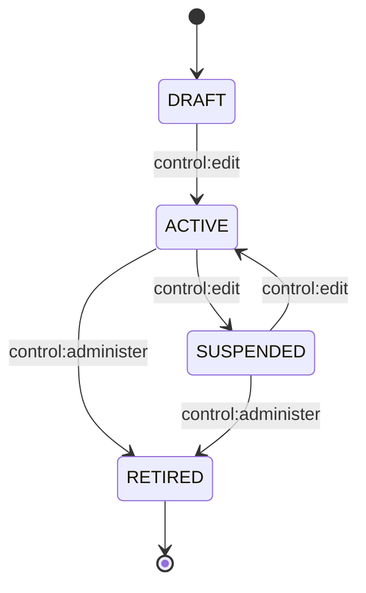
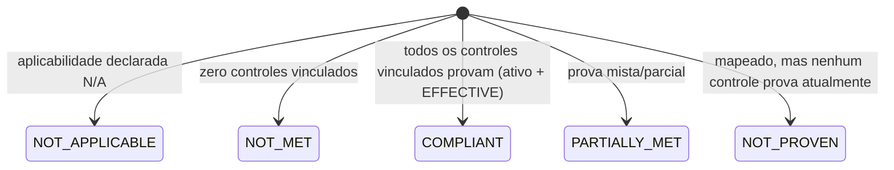

# Controles e Compliance

## Status

**IMPLEMENTADO** (backend, permissões, contrato e telas). Controles: `specs/003-controls-management/`
(CLAUDE.md §17 item 9, commit `9912968`). Compliance: `specs/004-compliance-management/` (item 10,
commit `8f0452d`). Nenhum dos dois diretórios de spec tem `STATE.md` — convenção introduzida só a
partir da fase 005.

### Itens em aberto (com evidência)

| Item | Referência | Situação verificada |
|---|---|---|
| Controles e Compliance nunca ganharam E2E/acessibilidade próprios | **F-55** (`docs/deferred-findings.md`, RESOLVIDO 2026-09-19) | Controles já tinha `apps/web/e2e/control-detail.spec.ts` e varredura de acessibilidade do catálogo antes desta rodada. Compliance ganhou `apps/web/e2e/compliance.spec.ts` (1/1 passou, 28.3s) e duas novas varreduras em `accessibility.spec.ts` para o registro de framework (2/2, zero violações WCAG 2.1 AA nos dois temas). Versões, requisitos e mapeamento continuam sem E2E dedicado — deliberadamente enxuto, fila de revisão visual §18.1. |
| `ControlRegistryPort.list()` órfão | **F-44** item 1, RESOLVIDO textualmente (aceito, com portão) | `GET /controls` migrou de Risco para Controles; `.list()` não tem mais chamador (`.findById` continua em uso por `LinkControlUseCase`). Portão: remover na próxima mudança que tocar esse repositório. |
| `SELECT` escopado duplicado (`ControlLookupPort` vs. `ControlRepositoryPort`) | **F-44** item 2 | Duplicação de desenvolvimento paralelo, não divergente hoje; portão: unificar na próxima mudança de escopo de leitura de controle. |
| Controle `RETIRED` ainda aceita edição de campos descritivos | **F-44** item 3 | Deliberado, não esquecimento — decisão adiada para quando Auditoria (item consumidor real) precisar decidir se "aposentado" deve significar "congelado". |
| Corrida entre arquivos no banco de teste de contrato/integração | **F-45**, não é defeito deste módulo | Exposta (não causada) pelo volume de teste de Compliance; afeta `reference-data.spec.ts`/`information-disclosure.spec.ts` contra tabelas nunca truncadas entre arquivos. |
| `Risk→Control` sem checagem de escopo | **F-46**, RESOLVIDO 2026-09-08 | Histórico — `LinkControlUseCase` não comparava `orgUnitId`; corrigido trocando para `ControlDirectoryPort` + `isOrgUnitWithinScope`. |

## Objetivo

**Controles**: registrar as salvaguardas que a organização efetivamente implementa, com dono,
ciclo de vida, verificação de efetividade e vínculo a Risco/Processo/Ativo.

**Compliance**: manter uma biblioteca normativa versionada (framework → versão → requisito) e
mapear requisitos a controles, derivando o estado de conformidade — nunca armazenando-o como campo
editável.

## Entidades principais

### Controles

| Modelo | Papel | Campos-chave |
|---|---|---|
| `Control` (`controls`) | A salvaguarda. **Não tem `frameworkId`** — comentário no próprio schema cita ADR-016/ADR-017: "Control is a business-module domain... does not belong to any framework." | `code`, `orgUnitId?`, `ownerUserId?`, `nature` (`ControlNature`), `type` (`ControlType`, coluna `control_type`), `frequency` (`ControlFrequency`), `status`, `retiredAt?`/`retiredByUserId?`/`retirementReason?`, `version` |
| `ControlLifecycleTransition` | Trilha de transição, append-only. | `fromStatus`, `toStatus`, `performedByUserId`, `justification?` — sem `approvalId` (ciclo de vida do controle não tem transição com portão de aprovação) |
| `ControlAssessment` | Verificação de efetividade — imutável, sem `updatedAt`. | `assessedOn`, `assessorUserId`, `result` (`ControlAssessmentResult`), `conclusion`, `approvalId?` (reaproveita `Approval` genérico via `ApprovableEntityType.CONTROL_ASSESSMENT`), `attestedAt?`/`attestedByUserId?` |
| `ControlProcessLink` / `ControlAssetLink` | Vínculos soft-unlink. | par de IDs + `linkedAt`/`linkedByUserId`/`unlinkedAt?`/`unlinkedByUserId?` |

### Compliance

| Modelo | Papel | Campos-chave |
|---|---|---|
| `Framework` (`frameworks`) | Norma-raiz, catálogo plataforma-inteira (sem `orgUnitId`). | `code`, `name`, `origin` (`FrameworkOrigin`), `version` |
| `FrameworkVersion` (`framework_versions`) | Versão publicável, imutável após `PUBLISHED`. | `label`, `status` (`FrameworkVersionStatus`), `publishedAt?`/`publishedByUserId?` |
| `Requirement` (`requirements`) | Cláusula normativa — pertence a **uma** `FrameworkVersion**. Imutável após publicação da versão (trigger de banco). | `externalRef` (ex. "A.5.16"), `title`, `description` |
| `RequirementControlLink` (`requirement_control_links`) | **A ligação N:M entre Requisito e Controle** — dono: Compliance. | `requirementId`, `controlId`, `linkedAt`/`linkedByUserId`, `unlinkedAt?`/`unlinkedByUserId?` |
| `RequirementControlMappingMigration` / `...MigrationItem` | Migração de mapeamento entre versões de framework — operação de primeira classe, com trilha própria. | evento de execução + item por requisito-alvo com `outcome` (`MappingMigrationOutcome`) |
| `RequirementApplicabilityDeclaration` | Declaração de (in)aplicabilidade — event-sourced. | `declaredAt`/`declaredByUserId`, `revokedAt?`/`revokedByUserId?` |
| `RequirementComplianceAuditMark` | Marca do **último estado observado** — nunca a fonte de verdade do estado atual. | `lastAuditedState`, `lastAuditedAt` |

## Estados / ciclo de vida

### Controle

### Efetividade do controle — calculada, nunca armazenada

`ControlAssessmentResult` (o que um avaliador pode **escrever**): `EFFECTIVE`, `PARTIALLY_EFFECTIVE`,
`INEFFECTIVE`. `ControlEffectiveness` (o que o sistema **deriva**, superconjunto): as três acima mais
`NOT_ASSESSED` e `EXPIRED` — nenhuma coluna do banco guarda esse valor. Calculador único:
`calculateControlEffectiveness()` (`apps/api/src/modules/controls/domain/control-effectiveness.service.ts`),
só conta avaliações **atestadas** (`attestedAt !== null`); janela de vencimento por `frequency`
(CONTINUOUS/DAILY = 1 dia, WEEKLY = 7, MONTHLY = 30, QUARTERLY = 90, SEMIANNUAL = 182, ANNUAL = 365).
`frequency === null` torna `EXPIRED` estruturalmente inalcançável.

### Estado de conformidade do requisito — calculado, nunca armazenado (§19.7 / ADR-017)

Calculador único: `calculateRequirementComplianceState()`
(`apps/api/src/modules/compliance/domain/requirement-compliance.service.ts`), puro, sem I/O.
`NOT_MET` nunca é "requisito conforme por omissão" (FR-018) — zero vínculo é explicitamente
`NOT_MET`, não um estado neutro. `RequirementComplianceAuditMark` só registra o **último valor
observado** para fins de trilha; a resposta de "qual é o estado agora" é sempre recomputada ao
vivo por `RequirementComplianceService`/`RequirementComplianceReaderService`.

## Regras de negócio relevantes

- **Requisito e Controle são conceitos distintos (ADR-017)** — `Requirement` pertence a exatamente
  uma `FrameworkVersion` e duplica-se entre normas (correto); `Control` não pertence a framework
  algum e serve quantas normas satisfizer. Vocabulário GRC convencional, deliberadamente o inverso
  da nomenclatura do Probo (onde "Control" = cláusula) — ver ADR-017 no arquivo de decisões.
- **Ligação N:M explícita e nomeada** — `RequirementControlLink`, nunca duplicação de controle por
  framework.
- **Framework é versionado** — `Framework → FrameworkVersion → Requirement`; migração de mapeamento
  entre versões é operação de primeira classe, auditada, nunca recadastro manual.
- **Estado de conformidade nunca é campo editável em paralelo** — sempre recalculado a partir de
  controle e evidência (§19.7, ADR-017).
- **Sem exclusão física em nenhum dos dois** — não existe `control:delete` nem operação de exclusão
  de requisito/framework; descontinuação é `RETIRED` (Controle) ou nova versão (Compliance).
- **Reaproveitamento de aprovação genérica (§19.4)** — atestação de `ControlAssessment` usa o mesmo
  `Approval`/`ApprovableEntityType` que Risco já usa (`CONTROL_ASSESSMENT`), sem motor de workflow
  novo.
- **Sem segregação de função em Compliance** — diferente de Controles (`control:test` ×
  `control:approve`), Compliance não tem par verificador/executor (decisão registrada em
  research.md D-13 da fase 004).

## Telas

| Rota | Fluxo |
|---|---|
| `/controls`, `/controls/new`, `/controls/[id]` | Catálogo, criação e detalhe de controle |
| `/compliance`, `/compliance/new` | Biblioteca normativa (frameworks) |
| `/compliance/[frameworkId]` | Detalhe do framework |
| `/compliance/[frameworkId]/versions/new`, `.../versions/[versionId]` | Versão do framework |
| `.../versions/[versionId]/requirements/[requirementId]` | Detalhe do requisito, com mapeamento e estado |
| `.../versions/[versionId]/mapping-migrations/[migrationId]` | Migração de mapeamento entre versões |

## Permissões

| Chave | Ação | Cobre |
|---|---|---|
| `control:view` | VIEW | Ver controle |
| `control:create` | CREATE | Criar controle |
| `control:edit` | EDIT | Campos descritivos + transições `DRAFT→ACTIVE`/`ACTIVE↔SUSPENDED` + vínculo processo/ativo |
| `control:test` | ASSESS | Registrar avaliação e submeter para atestação |
| `control:approve` | APPROVE | Decidir (atestar/rejeitar) atestação pendente |
| `control:administer` | ADMINISTER | Só a transição terminal `→RETIRED` |
| `compliance:view` | VIEW | Ler biblioteca normativa, vínculos, aplicabilidade, estado |
| `compliance:administer` | ADMINISTER | Registrar/editar framework, versão, requisito, aplicabilidade |
| `compliance:map` | LINK | Vincular/desvincular requisito↔controle, executar migração de mapeamento |

Nenhum dos dois tem permissão de exclusão.

## API

**Controles** (`apps/api/src/modules/controls/presentation/`):
`GET/POST /controls`, `GET/PATCH /controls/:controlId` — `GET /controls/:controlId/lifecycle`,
`POST /controls/:controlId/transitions` — `GET/POST /controls/:controlId/assessments`,
`GET /controls/:controlId/assessments/:assessmentId`,
`POST .../attestation`, `POST .../attestation/decision` —
`GET /controls/:controlId/risks`, `GET/POST/DELETE /controls/:controlId/processes`,
`GET/POST/DELETE /controls/:controlId/assets`.

**Compliance** (`apps/api/src/modules/compliance/presentation/`):
`GET/POST /frameworks`, `GET/PATCH /frameworks/:frameworkId` —
`GET/POST /frameworks/:frameworkId/versions`, `GET/PATCH .../versions/:versionId`,
`POST .../versions/:versionId/publish` —
`GET/POST .../versions/:versionId/requirements`, `GET/PATCH /requirements/:requirementId` —
`GET/POST/DELETE /requirements/:requirementId/controls` —
`GET/POST/DELETE /requirements/:requirementId/applicability-declarations` —
`GET/POST /frameworks/:frameworkId/versions/:versionId/mapping-migrations`,
`GET .../mapping-migrations/:migrationId` —
`GET .../versions/:versionId/compliance-summary`.

Contratos: `specs/003-controls-management/contracts/`, `specs/004-compliance-management/contracts/`.

## Relações com outros módulos

- `Control` ← `RiskControlLink` (dono: Risco), `ControlProcessLink`/`ControlAssetLink` (dono:
  Controles), `AuditScopeControl` (dono: Auditoria), `FindingControlLink` (dono: `grc/finding`),
  `RequirementControlLink` (dono: Compliance).
- Porta compartilhada `ControlDirectoryPort` (`shared/grc-ports/control-directory.port.ts`),
  fornecida pelo módulo de Controles, consumida por Risco e por Compliance — nenhum dos dois
  importa `modules/controls` diretamente (ADR-020, verificado por
  `test/unit/controls-risk-module-boundary.spec.ts` e
  `test/unit/compliance-controls-risk-module-boundary.spec.ts`).
- `ControlEffectivenessPort` — expõe o veredito de efetividade **derivado**, reaproveitando o único
  calculador de Controles; consumido por `RequirementComplianceReaderService` em Compliance.
- Verificação em código de ADR-020, registrada no próprio ADR (`docs/architecture/decisions.md`,
  seções "Verificação em código — 2026-09-08"): a parte 4 do padrão (porta expõe escopo, vínculo
  verifica antes de gravar) foi implementada em `LinkRequirementToControlUseCase`, recusando
  gravação (422) quando o controle está fora de escopo ou inativo.

## Eventos de auditoria

**Controles**: `control.created`, `control.updated`, `control.activated`/`control.suspended`/
`control.retired` (mapeados por estado-alvo, com fallback `control.transitioned`),
`control.assessment.recorded`, `control.attestation.requested`, `control.attestation.refused`,
`control.attestation.rejected`, `control.assessment.attested`, `control.effectiveness.changed`,
`control.asset_linked`/`control.asset_unlinked`, `control.process_linked`/`control.process_unlinked`.

**Compliance**: `framework.created`, `framework.updated`, `framework_version.created`,
`framework_version.updated` (reaproveitado também para publicação — não existe ação
"published" separada), `requirement.created`, `requirement.updated`, `requirement.update_refused`,
`compliance.requirement_declared_not_applicable`,
`compliance.requirement_applicability_revoked`,
`compliance.requirement_control_linked`/`compliance.requirement_control_unlinked`,
`compliance.requirement_control_mapping_migrated`,
`compliance.requirement_compliance_state_observed`.

## Testes importantes

- **Contrato**: `apps/api/test/contract/control-catalog.spec.ts`, `control-transitions.spec.ts`,
  `compliance-catalog-unscoped.spec.ts`, `compliance-mapping-and-state.spec.ts`,
  `compliance-normative-library.spec.ts`.
- **Integração**: `control-assessment-lifecycle.spec.ts`, `control-assessment-scope.spec.ts`,
  `control-collaboration-registrations.spec.ts`, `control-effectiveness-level-parity.spec.ts`,
  `control-effectiveness-parity.spec.ts`, `control-relationship-links.spec.ts`,
  `finding-control-link.spec.ts`, `requirement-compliance-audit-mark.spec.ts`,
  `requirement-compliance-state-reachability.spec.ts`, `requirement-control-link.spec.ts`,
  `risk-control-link.spec.ts`, `compliance-summary-performance.spec.ts`.
- **E2E/acessibilidade**: `apps/web/e2e/compliance.spec.ts` cobre o cadastro de framework pela
  biblioteca normativa; `accessibility.spec.ts` varre o catálogo `/compliance` em repouso, nos
  temas claro e escuro — o painel de filtros aberto **não** entra em nenhuma das duas varreduras.
  Versões, requisitos e mapeamentos continuam sem E2E dedicado (F-55, resolvido para o catálogo
  em 2026-09-19).

## Onde vive o código

- API: `apps/api/src/modules/controls/` (`domain/`, `application/{assessments,lifecycle,links}/`,
  `infrastructure/`, `presentation/`); `apps/api/src/modules/compliance/`
  (`domain/ports/`, `application/{applicability,framework-versions,frameworks,links,
  mapping-migrations,requirements,compliance-summary}/`, `presentation/dto/`).
- Web: `apps/web/src/app/(app)/controls/`, `apps/web/src/app/(app)/compliance/`,
  `apps/web/src/features/controls/`, `apps/web/src/features/compliance/`.
- Prisma: `Control` (linha ~1485), `ControlStatus`/`ControlNature`/`ControlType`/
  `ControlFrequency`/`ControlAssessmentResult` (linhas ~1421–1468), `ControlLifecycleTransition`,
  `ControlAssessment`, `ControlProcessLink`, `ControlAssetLink` (linhas ~1554–1676); `Framework`
  (linha ~2564), `FrameworkVersion` (~2587), `Requirement` (~2622), `RequirementControlLink`
  (~2670), `RequirementComplianceState` (~2546), `RequirementControlMappingMigration`(`Item`),
  `RequirementApplicabilityDeclaration`, `RequirementComplianceAuditMark` (~2692–2773).

## Refinamento V2 do detalhe de Framework (2026-09-21)

O detalhe do framework passou a usar o `DetailLayout` compartilhado, breadcrumb, navegação compacta com `?section=` e edição em painel lateral. A visão geral separa descrição e contexto normativo usando apenas origem e datas já presentes no payload. A seção de versões, a criação de versão e todas as regras de publicação permanecem inalteradas.
