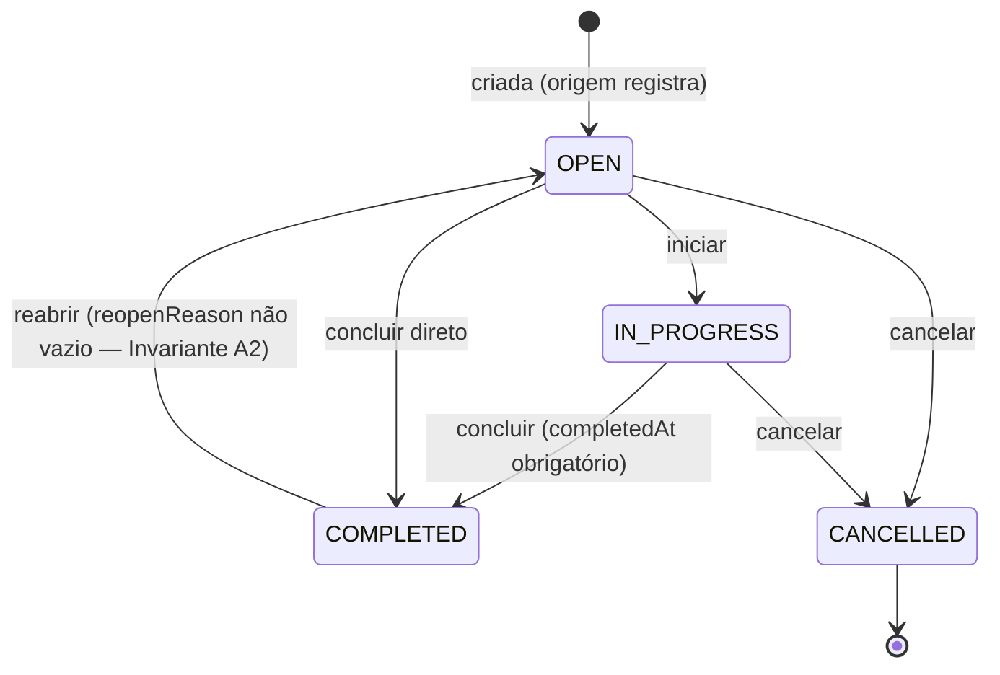
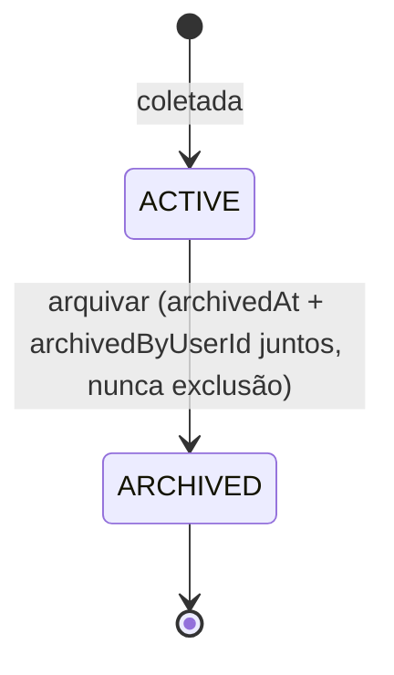
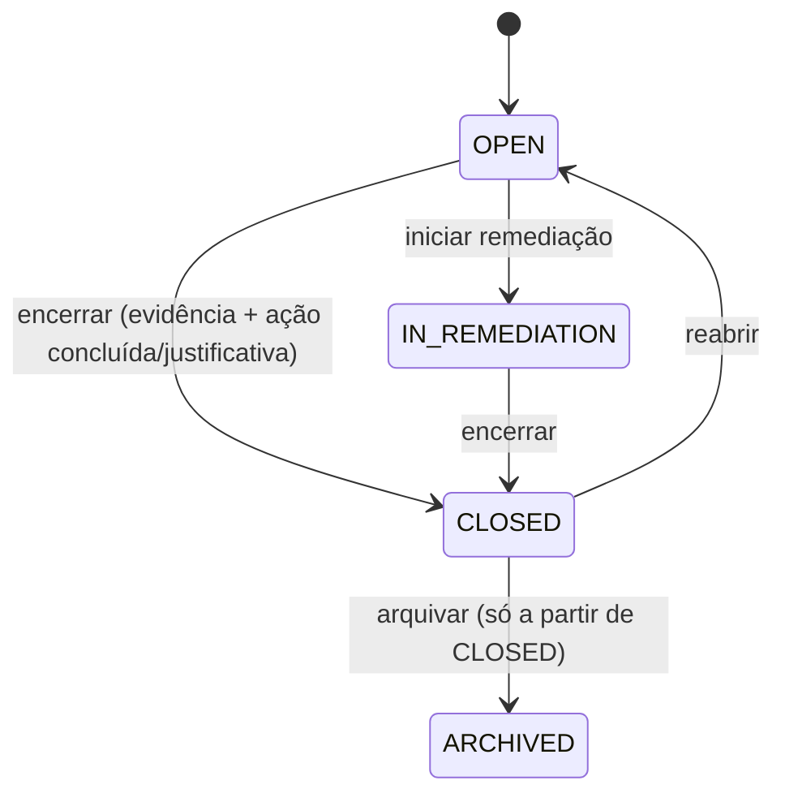
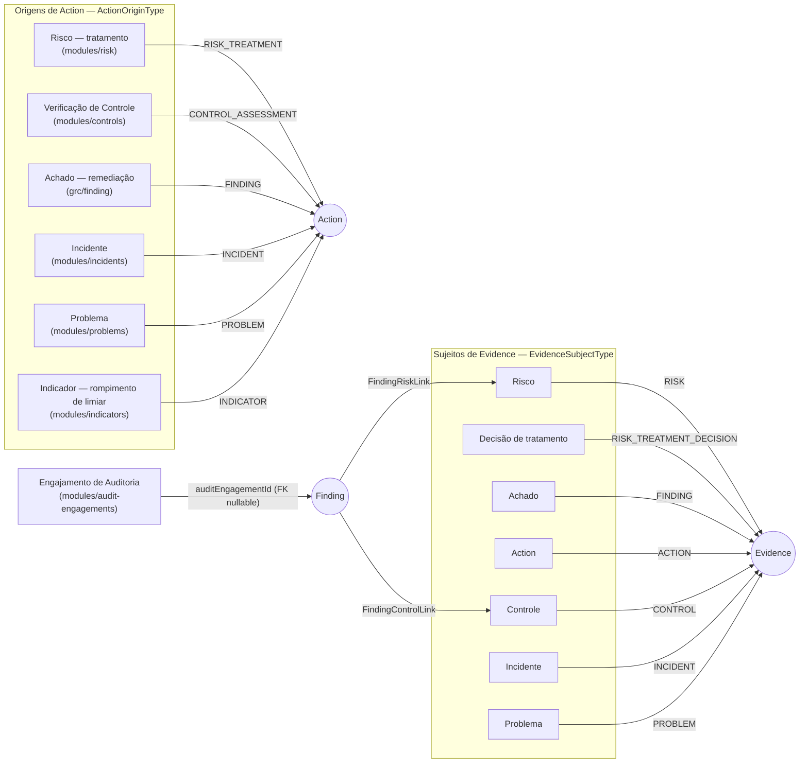

# Núcleo GRC compartilhado — Ação, Evidência, Achado

## Status

**IMPLEMENTADO**, nas duas camadas. As três capacidades nasceram em
`specs/002-shared-grc-foundation/` (ADR-016). A superfície de interface de `Action` — que é o
"Plano de Ação" do produto (CLAUDE.md §1/§4) — ficou incompleta por quatro fases depois disso e foi
corrigida em `specs/010-action-plan-surface/` (commits `940c5e3`, `3b8c90a`). Este documento cobre
as três capacidades já com a correção aplicada.

**Por que "Planos de Ação" não é um módulo de negócio**: `Action` passou no critério de admissão do
núcleo GRC (ADR-016) nos dois testes exigidos — **posse** (nenhum domínio é dono: nasce de
tratamento de risco, achado, verificação de controle, incidente, problema e rompimento de
indicador) e **ciclo de vida** (aberta → em andamento → concluída/cancelada, sobrevive a quem a
originou). Modelá-la como módulo teria recriado, por domínio, o mesmo defeito que o benchmark do
Probo mostrou: cinco sistemas de tarefa independentes. `Evidence` e `Finding` passam pelo mesmo
critério — ver a tabela de validação na própria ADR-016.

### Itens em aberto (com evidência)

| Item | Referência | Situação verificada |
|---|---|---|
| Três cópias quase idênticas do painel de ações por origem | `specs/010-action-plan-surface/STATE.md` §7 | ABERTO, confirmado — `features/incidents/components/incident-corrective-actions.tsx` (489 linhas), `features/problems/components/problem-corrective-actions.tsx` (523 linhas), `features/findings/components/finding-corrective-actions.tsx` (574 linhas) continuam não extraídas; nenhum commit desde 2026-09-12 as toca. A extração foi avaliada e recomendada, não feita, porque três frentes editavam esses diretórios ao mesmo tempo. |
| Criação central de ação a partir de `/actions` | idem | **Deliberadamente ausente** — R-009 decidiu que a criação acontece no contexto de domínio de origem; uma tela central exigiria escolher entre cinco origens que ela não conhece. Não é pendência, é decisão registrada. |
| `specs/010-action-plan-surface` não tem spec.md/plan.md/tasks.md | Verificado por research direta | Só existe `STATE.md` — a frente foi tratada como correção operacional, não como ciclo de especificação completo. |
| E2E de fluxo entre origens — estava "NÃO VERIFICADO" | STATE.md §7 (escrito em 2026-09-12) | **DESATUALIZADO, já fechado** — `apps/web/e2e/action-plan.spec.ts` (264 linhas, commit `5f99063`) prova o fluxo: ação criada no risco, gerida na tela central, e o caso de um ator sem `risk:treat` recebendo plano somente leitura. |
| F-61 (painel de achados disparava duas requisições por achado) | `docs/deferred-findings.md`, marcado **CORRIGIDO (2026-09-13)** | STATE.md §7 (escrito um dia antes) ainda o lista como aberto — tratar `docs/deferred-findings.md` como a fonte viva, `STATE.md` como registro histórico do momento em que foi escrito. |

## Objetivo

Dar casa a três conceitos GRC-específicos demais para o `core/` transversal e compartilhados
demais para pertencer a um único módulo de negócio (ADR-016): **Evidência** (prova que sustenta uma
decisão), **Ação** (unidade única de trabalho rastreável — o Plano de Ação do produto) e
**Achado** (observação de GRC, "Achado" no vocabulário do produto).

## Entidades principais

| Modelo (Prisma) | Papel | Campos-chave |
|---|---|---|
| `Evidence` (`evidence`) | A prova em si — nunca o arquivo (o arquivo chega via `Attachment` genérico, `entityType: EVIDENCE`). | `code` (`EVD-2026-0001`), `type` (`EvidenceType`), `source` (`EvidenceSource`), `collectedOn`, `validUntil?`, `status` (`EvidenceStatus`: `ACTIVE`\|`ARCHIVED` — só dois membros; "expirado" é sempre derivado de `validUntil` na leitura, nunca gravado) |
| `EvidenceLink` (`evidence_links`) | Associação nomeada entre uma Evidência e um sujeito — entidade própria (tem autor, data, histórico e evento de auditoria próprio, não é coluna). | `evidenceId`, `subjectType` (`EvidenceSubjectType`), `subjectId` (sem FK — registro de tipo fechado, R-001), `unlinkedAt?`/`unlinkedByUserId?` |
| `Action` (`actions`) | A unidade única de trabalho rastreável — o Plano de Ação do produto. | `code` (`ACT-2026-0001`), `originType` (`ActionOriginType`), `originId` (sem FK, mesmo mecanismo), `responsibleUserId`, `dueOn`, `status` (`ActionStatus`), `completedAt?`, `reopenedAt?`/`reopenReason?` |
| `Finding` (`findings`) | Achado — observação de GRC, nunca um "problema genérico". Nasce sobretudo de Auditoria, mas sobrevive à origem: o engajamento encerra e o achado continua aberto até remediação. | `code` (`FND-2026-0001`), `category`, `origin`, `severity`, `priority`, `status` (`FindingStatus`), `closedAt?`/`closureJustification?`, `auditEngagementId?` (nullable — null para todo achado manual) |

## O que ENTRA no núcleo e o que NÃO entra (ADR-016)

| Candidato | Posse | Ciclo de vida | Veredito |
|---|---|---|---|
| Evidence | Nenhum domínio é dono | Próprio — coletada, validada, vence, é substituída | **ENTRA** |
| Action | Nenhum domínio é dono | Próprio — sobrevive à origem | **ENTRA** |
| Finding | Nasce sobretudo em Auditoria, mas não só | Próprio — sobrevive ao engajamento que o produziu | **ENTRA** |
| Control | Controles **pode** ser dono exclusivo (cria, testa, declara efetivo, aposenta) | Governado pelo próprio módulo | **NÃO ENTRA** — fica em `modules/controls`, referenciado por porta (ADR-020) |

## Estados / ciclo de vida

### Ação — quatro estados, únicos em toda a plataforma

Enforçado por `assertLegalActionTransition` (`apps/api/src/grc/action/domain/action.entity.ts`).
Invariante A1: `completedAt` preenchido se e somente se `status = COMPLETED`. Invariante A3:
`dueOn` no passado é aceito na criação (uma restrição de banco impediria exatamente o caso que a
remediação já vencida precisa representar).

### Evidência — dois estados

"Expirado" nunca é um terceiro estado gravado — é sempre `validUntil < hoje`, calculado na leitura.

### Achado — quatro estados

Detalhe completo do fechamento (evidência obrigatória, segregação de função) em
`docs/modules/audit-engagements.md`, que é quem produz a maioria dos achados.

## Os dois mecanismos de relacionamento (ADR-018) — e por que Ação/Evidência usam o segundo

CLAUDE.md §19.3 e ADR-018 definem exatamente dois mecanismos, nunca um terceiro genérico:

1. **Tabela de ligação explícita e nomeada** — quando dois domínios GRC se relacionam e o vínculo
   tem significado próprio (ex.: `FindingRiskLink`, `RiskControlLink`).
2. **Registro de tipo fechado** — quando uma capacidade transversal se anexa a muitos tipos de
   sujeito (enum verificado em compilação + registro em tempo de composição).

Evidência e Ação usam o mecanismo 2, seguindo o mesmo padrão já provado por `AttachableEntityType`,
`CommentableEntityType` e `ApprovableEntityType` — nenhum dos dois introduz um relacionamento
genérico `related_entity(type, id)`, que permanece proibido.

### Diagrama — quem consome Action/Evidence/Finding, e por qual registro fechado

Cada valor de enum acima tem um resolvedor de fato **registrado no composition root do módulo
consumidor** (ex.: `risk.module.ts` registra `EvidenceSubjectType.RISK` e
`ActionOriginType.RISK_TREATMENT`; `finding.module.ts` registra `EvidenceSubjectType.FINDING` e
`ActionOriginType.FINDING`), nunca apenas declarado — a exigência de §19.10 (ponto de extensão só
conta depois de executado), verificada por `test/unit/action-model-convergence-guard.spec.ts` (regra
1:1: todo valor de `ActionOriginType` tem exatamente um resolvedor registrado).

Registros fechados **irmãos**, do mesmo mecanismo, mas anteriores a esta fase e usados por
`Attachment`/`Comment`/`Approval`, não por Evidência/Ação:

| Registro | Valores atuais |
|---|---|
| `AttachableEntityType` | `RISK`, `EVIDENCE`, `INCIDENT`, `PROBLEM`, `PROBE_RECORD` (descartável) |
| `CommentableEntityType` | `RISK`, `INCIDENT`, `PROBLEM`, `INDICATOR`, `PROBE_RECORD` (descartável) |
| `ApprovableEntityType` | `RISK`, `CONTROL_ASSESSMENT` |

`EVIDENCE` foi adicionada a `AttachableEntityType` porque um desenho anterior de `Evidence` tinha
`fileId` como FK direta para `Attachment` — impossível de popular, já que `Attachment` exige que o
pai já exista. Corrigido: um arquivo chega à evidência pelo mesmo mecanismo de anexo que o Risco já
usa, nunca por uma coluna em `Evidence`.

## Regras de negócio relevantes

- **Ação é a única fonte de status/prazo de trabalho remediador** — pós-convergência (fase 007),
  `RiskTreatmentAction` é só um vínculo 1:1 para `Action`; não existe mais um segundo
  `TreatmentActionStatus`. Ver `docs/modules/risks.md`.
- **Reabertura exige justificativa (Invariante A2)** — `reopenReason` não vazio, obrigatório no
  domínio (`action.entity.ts`), não apenas na interface.
- **Evidência nunca é soldada a um único tipo de sujeito** (§19.6) — `EvidenceSubjectType` é o
  registro fechado que permite Risco, Decisão de Tratamento, Achado, Ação, Controle, Incidente e
  Problema compartilharem o mesmo mecanismo de prova.
- **`getAction`/`updateAction` têm chamador real agora** — historicamente (CLAUDE.md §17 item 15)
  esses dois clientes HTTP existiam em `features/actions/api.ts` sem nenhum chamador (§19.10, a
  oitava ocorrência do padrão). Corrigido: `getAction` é chamado por
  `action-detail-view.tsx`/`action-lifecycle-actions.tsx`, `updateAction` por
  `action-edit-form.tsx`.
- **Detalhe do risco tem uma única aba funcional de ação, não duas** — a aba "Tratamento" mostra só
  a decisão; a aba "Planos de Ação" mostra a tabela funcional (movida, não copiada), com transição
  legal, edição e link para `/actions/{id}`. Corrige o defeito histórico do item 15.
- **`Finding` é uma entidade só, não duas** — um achado manual e um achado de engajamento de
  auditoria são a mesma linha `Finding`; a diferença é só `auditEngagementId` nulo ou preenchido, e
  só `POST /audits/{auditId}/findings` (não `POST /findings`) o preenche.

## Telas

| Rota | Componente | Fluxo |
|---|---|---|
| `/actions` | `apps/web/src/app/(app)/actions/page.tsx` | Superfície central de Plano de Ação (a tela renomeada de "Minhas ações"; "somente minhas" é filtro, não identidade da tela) |
| `/actions/[id]` | `.../actions/[id]/page.tsx` | Detalhe de ação — trilha de auditoria própria, edição, transição |

`Evidence` e `Finding` **não** têm entrada própria de menu nem rota central dedicada — aparecem nos
contextos de domínio que os consomem (painel de evidência embutido, `FindingsPanel` no detalhe do
risco, `EngagementFindingsSection` no engajamento). Essa é a decisão de R-009
(`specs/002-shared-grc-foundation/research.md`), emendada em 2026-09-12 para deixar explícito que
a decisão era sobre **quantidade de entradas de menu**, nunca sobre profundidade de superfície —
por isso `Action` ganhou detalhe completo sem contradizer R-009.

## Permissões

| Chave | Ação | Observação |
|---|---|---|
| `action:view` / `action:create` / `action:edit` | VIEW/CREATE/EDIT | Sem `action:delete` — cancelamento é transição de status, não exclusão |
| `evidence:view` / `create` / `edit` | VIEW/CREATE/EDIT | — |
| `evidence:administer` | ADMINISTER | Arquivar |
| `evidence:link` | LINK | Vincular/desvincular a um sujeito |
| `finding:view` / `create` / `edit` | VIEW/CREATE/EDIT | — |
| `finding:close` | CLOSE | Fechar **e** reabrir (mesma permissão) |
| `finding:administer` | ADMINISTER | Arquivar |
| `finding:remediate` | TRANSITION | Iniciar remediação |
| `finding:link` | LINK | Vincular/desvincular controle e risco |

## API

- **Ação** — `apps/api/src/grc/action/presentation/action.controller.ts` (`@Controller('actions')`):
  `GET/POST /actions`, `GET /actions/:actionId`, `PATCH /actions/:actionId`,
  `POST /actions/:actionId/transitions`. Controlador separado
  `action-audit.controller.ts`: `GET /actions/:actionId/audit-events` (checa `action:view` e depois
  `audit:view` dentro do caso de uso, não no decorador — para diferenciar 404 de 403).
- **Evidência** — `apps/api/src/grc/evidence/presentation/evidence.controller.ts`
  (`@Controller('evidence')`): `GET/POST /evidence`, `GET/PATCH /evidence/:evidenceId`,
  `POST /evidence/:evidenceId/archive`, `GET/POST /evidence/:evidenceId/links`,
  `POST /evidence/:evidenceId/links/:linkId/unlink`.
- **Achado** — ver `docs/modules/audit-engagements.md` (rotas compartilhadas entre o núcleo e o
  módulo de Auditoria).

Contrato: `specs/002-shared-grc-foundation/contracts/grc-foundation.openapi.yaml`.

## Relações com outros módulos

`Action`/`Evidence` não usam tabela de ligação nomeada para se anexar a um sujeito — usam o
registro de tipo fechado (seção acima). As relações que **são** tabela de ligação nomeada
pertencem aos módulos consumidores, não ao núcleo:

- `FindingControlLink`, `FindingRiskLink` — dono: `grc/finding` (ver
  `docs/modules/audit-engagements.md`).
- `RiskTreatmentAction` — dono: `modules/risk`, vínculo 1:1 para `Action` (ver
  `docs/modules/risks.md`).

## Eventos de auditoria

**Ação**: `action.created`, `action.updated`, `action.started`, `action.completed`,
`action.cancelled`, `action.reopened` (os quatro últimos derivados da transição de status em
`action.entity.ts`).

**Evidência**: `evidence.created`, `evidence.updated`, `evidence.archived`, `evidence.linked`,
`evidence.unlinked`.

**Achado**: ver `docs/modules/audit-engagements.md` (produzido majoritariamente pelo engajamento).

`AuditEntityType` correspondente: `ACTION`, `EVIDENCE`, `EVIDENCE_LINK`, `FINDING`,
`FINDING_CONTROL_LINK`, `FINDING_RISK_LINK`. Lista de campos auditados por tipo em
`apps/api/src/grc/shared/domain/grc-audit-allowlist.ts` (`registerGrcAuditAllowlists()`, chamável
por qualquer um dos três módulos irmãos — idempotente).

## Testes importantes

- **Contrato**: `apps/api/test/contract/action-audit.spec.ts`, `actions.spec.ts`,
  `evidence-links.spec.ts`, `evidence.spec.ts`, `findings.spec.ts`.
- **Integração**: `action-audit-events.spec.ts`, `action-overdue-count-predicate-parity.spec.ts`,
  `audit-transactional.spec.ts`, `finding-control-link.spec.ts`, `finding-risk-link.spec.ts`,
  `incident-problem-action-origin.spec.ts`, `indicator-action-origin.spec.ts`,
  `risk-action-convergence.spec.ts`.
- **Unidade**: `action-model-convergence-guard.spec.ts` (regra 1:1 origem↔resolvedor),
  `action.entity.spec.ts`, `evidence-subject-registry-guard.spec.ts`,
  `evidence-subject-resolver-registry.spec.ts`, `evidence.entity.spec.ts`,
  `finding-grc-ports-boundary.spec.ts`, `finding-link-permission-pairing.spec.ts`,
  `finding-no-delete.spec.ts`, `finding.entity.spec.ts`.
- **E2E**: `apps/web/e2e/action-plan.spec.ts` (fluxo entre origens: ação criada no risco, gerida
  centralmente, e caso de leitura-somente sem `risk:treat`). Não há spec E2E dedicado a Evidência
  ou Achado por nome de arquivo — cobertura, se existir, está embutida em specs de risco/auditoria.

## Onde vive o código

- API: `apps/api/src/grc/action/`, `apps/api/src/grc/evidence/`, `apps/api/src/grc/finding/`,
  `apps/api/src/grc/shared/` (registros fechados e allow-list de auditoria compartilhados).
- Web: `apps/web/src/features/actions/`, `apps/web/src/features/evidence/`,
  `apps/web/src/features/findings/`, rota `apps/web/src/app/(app)/actions/`.
- Prisma: `Action`/`ActionOriginType`/`ActionStatus` (schema.prisma linha ~2273–2352), `Evidence`/
  `EvidenceLink`/`EvidenceSubjectType`/`EvidenceStatus` (~2134–2271), `Finding`/`FindingStatus`
  (~2381–2487), `GrcCodeSequence` (contador compartilhado de código `EVD-`/`ACT-`/`FND-`, ~2499).

## Refinamento V2 do detalhe de Planos de Ação (2026-09-21)

O detalhe de Plano de Ação permanece no `DetailLayout` já adotado, com os mesmos dados, permissões, transições e seções. A composição da visão geral foi compactada: descrição e origem compartilham a primeira faixa em viewport amplo e voltam a empilhar em viewport estreito; detalhes e ciclo de vida permanecem integrais. Nenhum indicador ou capacidade foi acrescentado.
