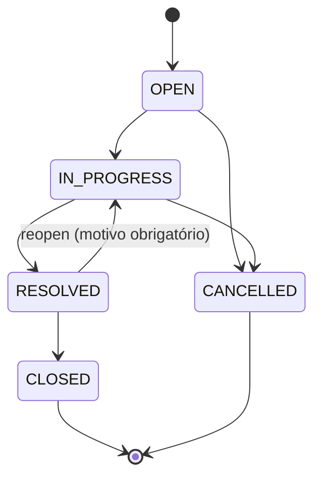
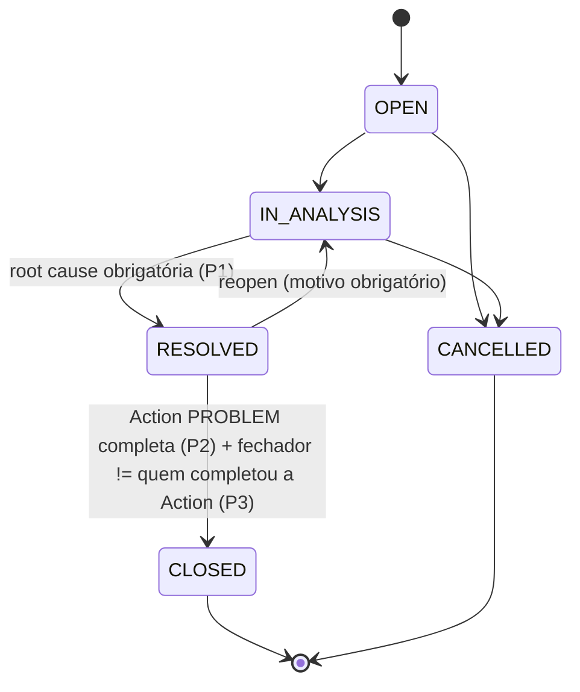

# Incidentes e Problemas

Módulos de negócio 7 e 8 do roadmap (CLAUDE.md §17, item 13). Fonte de verdade funcional é o
código; `specs/008-incidents-problems/` (spec.md, data-model.md, research.md, contracts/, e
principalmente `STATE.md`) descreve a intenção e o histórico. Este documento reconcilia os dois
contra o código em `HEAD` (`5b56eea`, 2026-09-14) — `STATE.md` está datado de 2026-09-11
(commit `795343b`) e alguns itens que ele registrava como abertos já avançaram.

## Status

**IMPLEMENTADO** — CRUD, dois ciclos de vida, os cinco vínculos nas duas direções (leitura e
escrita), ação corretiva via `Action` compartilhada, colaboração (evidência/comentário/anexo),
papéis dedicados, telas de registro/detalhe/formulário, contrato OpenAPI no portão de cobertura.

Itens em aberto, reverificados nesta revisão (2026-09-14) contra o estado do CLAUDE.md §17 item 13:

| Item | Estado em 2026-09-11 (STATE.md) | Estado confirmado agora (2026-09-14) |
|---|---|---|
| E2E de escopo organizacional em navegador para os cinco vínculos | Aberto — só integração de API (`incident-problem-links-source-scope.spec.ts`) | **Ainda ABERTO.** `apps/web/e2e/` não tem `incidents-scope.spec.ts` nem `problems-scope.spec.ts` (listagem atual: `incident-problem-collaboration.spec.ts`, `incidents.spec.ts`, `problems.spec.ts` — nenhum de escopo). Ver §Testes. |
| Flag diagnóstica de worker único do WebKit em `ci.yml` (commit `44e1e04`) | Aberto, não revertida | **Mantida por decisão, não esquecida** (reconciliado 2026-09-19). `.github/workflows/ci.yml` linhas 1196+ carregam hoje duas revisões datadas (2026-09-14 e 2026-09-19) que mantêm `--workers=1` deliberadamente: a pergunta original segue sem resposta, e respondê-la exige um `workflow_dispatch` comparativo contra CI remota — indisponível enquanto F-58 (billing do GitHub) bloquear a CI remota. Revisitar quando F-58 cair. |
| F-56 (`docs/deferred-findings.md`) — `Controller` do formulário compartilhado perde valor digitado antes da hidratação | Aberto | **RESOLVIDO 2026-09-19.** Medição campo a campo achou só dois formulários genuinamente expostos no produto inteiro (`FrameworkForm`/`ReportForm` — nenhum deste módulo), corrigidos com a mesma wiring do login. `IncidentForm`/`ProblemForm` estão entre os sete formulários que desabilitam todo campo até `loadingReferenceData` resolver, então nunca ficaram expostos. |

Outros pontos vivos, confirmados por leitura direta do código nesta revisão:

- Leitura reversa a partir de Risco/Ativo/Processo: **fechada** (commit `2a39b52`, anterior ao
  snapshot do STATE.md) — ver §Relações.
- Acessor Attachable/Commentable e painel de Evidência/Comentário/Anexo nas telas: **fechados**
  (commit `4b18978`) — `EvidencePanel` está importado tanto em
  `apps/web/src/app/(app)/incidents/[id]/incident-detail-view.tsx` quanto em
  `apps/web/src/app/(app)/problems/[id]/problem-detail-view.tsx`.
- Contrato desta fase no portão `contract-coverage.spec.ts`: **fechado** (commit `2a39b52`).
- Um defeito de `@Global()` em quatro dos cinco módulos de leitura reversa (mascarado por ordem de
  import) foi encontrado e corrigido pelo commit `97dc954` (2026-09-12, portanto **depois** do
  snapshot de `STATE.md` lido) — `RiskModule` agora importa explicitamente
  `IncidentRiskLinkReadModule`/`ProblemRiskLinkReadModule`, `AssetsModule` importa
  `IncidentAssetLinkReadModule`, `ProcessesModule` importa `IncidentProcessLinkReadModule`.

Não reavaliados nesta revisão (STATE.md os registra sem confirmação de código mais recente):
cobertura de teste de unidade de exaustividade da tabela de transição (T012/T013), cobertura
esparsa de componente (T030/T043/T062), revínculo unlink+relink comprovado por teste, N:M genuíno
exercitado por teste, busca estrutural automatizada para SC-004, divisão do job cross-browser
(`22021d2`) verificada por `workflow_dispatch` real.

## Objetivo

Registro e ciclo de vida de **Incidentes** (evento que já ocorreu, resposta time-critical) e
**Problemas** (causa raiz subjacente a um ou mais incidentes, investigação), com vínculo aos
domínios GRC existentes e reuso das capacidades compartilhadas do núcleo (`Action`, `Evidence`,
Comentário, Anexo) em vez de sistemas paralelos — CLAUDE.md §19.6.

## Entidades principais

Schema: `apps/api/prisma/schema.prisma` (`model Incident` L3041, `model Problem` L3099).

| Campo-chave | Incident | Problem |
|---|---|---|
| Código | `code` (`INC-2026-0001`, atribuído pelo servidor) | `code` (`PRB-2026-0001`) |
| Severidade | `severity: IncidentSeverity` (`CRITICAL/HIGH/MEDIUM/LOW`) | `severity: ProblemSeverity` (mesmos 4 valores) |
| Status | `status: IncidentStatus`, default `OPEN` | `status: ProblemStatus`, default `OPEN` |
| Escopo | `orgUnitId` (obrigatório, não-nulo) | `orgUnitId` (obrigatório, não-nulo) |
| Responsável | `ownerUserId` + `reportedByUserId` (quem relatou é distinto de quem é dono) | `ownerUserId` (sem relator distinto — problema nasce de análise) |
| Data | `reportedOn` (`@db.Date`) | `identifiedOn` (`@db.Date`) |
| Resolução | `resolutionSummary` (NOT NULL a partir de `RESOLVED`, Invariante I1) | `rootCause` (NOT NULL a partir de `RESOLVED`, Invariante P1) |
| Cancelamento | `cancellationReason` (NOT NULL a partir de `CANCELLED`, Invariante I2) | `cancellationReason` (mesmo padrão) |
| Fechamento gated | não há gate adicional (FR-006: sem segregação de papéis) | Invariante P2 (Action `originType=PROBLEM` `COMPLETED` deve existir) + P3 (quem fecha ≠ quem completou a ação) |

Sem operação de exclusão em nenhuma das duas entidades — um registro incorreto é cancelado, nunca
apagado (FK `onDelete: Restrict` nas tabelas de vínculo).

## Estados / ciclo de vida

Fonte: `LEGAL_TRANSITIONS` em `apps/api/src/modules/incidents/domain/incident.entity.ts` L41-47 e
`PROBLEM_LIFECYCLE_TRANSITIONS` em `apps/api/src/modules/problems/domain/problem-lifecycle.ts`.

### Incidente (5 estados)

Sem segregação de papéis para fechar (FR-006) — o mesmo responsável pode resolver e fechar.

### Problema (5 estados, com P1/P2/P3)

P2/P3 **não** estão na tabela declarativa de transições (que é síncrona) — são verificados por
`TransitionProblemUseCase` via `problem.entity.ts#assertProblemHasCompletedCorrectiveAction`/
`#assertCloserNotSameAsCompleter`, depois do gate de legalidade/permissão da tabela.

## Regras de negócio relevantes

- **Ação corretiva é a `Action` compartilhada, não uma tabela própria.** `ActionOriginType` ganhou
  `INCIDENT`/`PROBLEM` numa migração separada da fundação
  (`20260911030000_action_origin_type_add_incidents_problems`), deliberadamente depois de os
  acessores existirem de verdade (CLAUDE.md §19.10, citado no commit `064c9d1`).
  `IncidentActionOriginAccessor`/`ProblemActionOriginAccessor`
  (`apps/api/src/modules/incidents/application/incident-action-origin-accessor.ts`,
  `.../problems/application/problem-action-origin-accessor.ts`) gateiam criação por
  `incident:edit`/`problem:edit` + `action:create`.
  UI: `apps/web/src/features/incidents/components/incident-corrective-actions.tsx` e o equivalente
  em `problems/`, ambos reusando `features/actions/api.ts` diretamente — sem tabela de tarefa
  paralela.
- **Evidência é compartilhada.** `IncidentEvidenceSubjectAccessor`/`ProblemEvidenceSubjectAccessor`
  registrados via `registerEvidenceSubjectResolver` nos respectivos `*.module.ts`; consumidos por
  `EvidencePanel` (`@/features/evidence/components/evidence-panel`), importado em
  `incident-detail-view.tsx` (L28) e `problem-detail-view.tsx` (L25).
- **Comentário e anexo bruto são compartilhados.** `registerAttachableEntityType('INCIDENT'/…)` e
  `registerCommentableEntityType(...)` em `incidents.module.ts`/`problems.module.ts`, com
  acessores dedicados `incident-parent-record-accessor.ts`/`problem-parent-record-accessor.ts`.
  Sem isso, um `AuditEntityType`/enum válido sem acessor lançaria
  `EntityTypeNotRegisteredError` em runtime — era exatamente o defeito que
  `specs/008-incidents-problems/STATE.md` §2.2/§2.3 registrava como aberto; fechado pelo commit
  `4b18978`.
- **Vínculo Problema↔Incidente é N:M, opcional, propriedade de `Problem`.** Escrita
  (`POST`/`DELETE /problems/{problemId}/incidents`) resolve o alvo via `IncidentDirectoryPort`
  (`shared/grc-ports/`); nenhum módulo importa o outro diretamente (research.md D-13 a D-15). Não
  é consultado por nenhuma precondição de transição de nenhum dos dois domínios.
- **Auditoria por evento semântico nomeado, não `updated` genérico.** Cada transição de Incidente
  mapeia para um nome próprio (`incidentTransitionEventName`); Problema usa
  `AUDIT_ACTION_BY_TRANSITION` (mapa `(from->to)` → nome) com fallback `'problem.transitioned'` —
  ver §Eventos de auditoria.
- **`code` nunca é fornecido pelo cliente** — atribuído pelo servidor com prefixo `INC-`/`PRB-`
  (contratos OpenAPI, seção "Existence is not disclosed").
- **Não há relação de Problema com Ativo/Processo nesta fase** — decisão registrada, não esquecida
  (spec.md, tabela de relações marca "Não nesta fase"); `asset:view`/`process:view`
  deliberadamente fora do papel "Problem Manager".

## Telas

Rotas reais (`apps/web/src/app/(app)/...`):

| Rota | Arquivo | Descrição |
|---|---|---|
| `/incidents` | `incidents/page.tsx` | Registro (lista + filtros) |
| `/incidents/new` | `incidents/new/page.tsx` | Formulário de criação |
| `/incidents/[id]` | `incidents/[id]/page.tsx` + `incident-detail-view.tsx` | Detalhe: abas overview, risks, assets, processes, problems, corrective-actions, + painel de Evidência/Comentário/Anexo |
| `/problems` | `problems/page.tsx` | Registro |
| `/problems/new` | `problems/new/page.tsx` | Formulário de criação |
| `/problems/[id]` | `problems/[id]/page.tsx` + `problem-detail-view.tsx` | Detalhe: abas overview, risks, incidents, corrective-actions, + painel de Evidência/Comentário/Anexo |

Navegação principal: `apps/web/src/components/shell/navigation-registry.ts` L112-131 — entradas
`problems` (`requiredPermission: 'problem:view'`, `href: '/problems'`) e `incidents`
(`requiredPermission: 'incident:view'`, `href: '/incidents'`).

## Permissões

Definidas em `apps/api/src/modules/incidents/domain/incident-permissions.ts` e
`.../problems/domain/problem-permissions.ts`, agregadas em `apps/api/src/permission-catalogue.ts`
L98-99.

| Chave | Recurso | Ação |
|---|---|---|
| `incident:view` / `incident:create` / `incident:edit` / `incident:transition` / `incident:link` | `incident` | `VIEW`/`CREATE`/`EDIT`/`TRANSITION`/`LINK` |
| `problem:view` / `problem:create` / `problem:edit` / `problem:transition` / `problem:link` | `problem` | `VIEW`/`CREATE`/`EDIT`/`TRANSITION`/`LINK` |

Sem `incident:administer`/`incident:delete`/`problem:administer`/`problem:delete` — sem
segregação-de-função no fechamento de Incidente (FR-006) e sem hard delete.

Papéis semeados, verificados em `apps/api/prisma/seed/platform.seed.ts`:

- **"Incident Manager"** (L566) — `incident:view/create/edit/transition/link`, mais
  `risk:view`/`asset:view`/`process:view` (leitura pareada exigida por ADR-020 parte 5 para os
  três vínculos que este papel escreve), `action:view/create/edit`, `evidence:view/create/link`,
  `comment:create`, `attachment:create`.
- **"Problem Manager"** (L627) — `problem:view/create/edit/transition/link`, mais
  `risk:view`/`incident:view` (leitura pareada dos dois vínculos que escreve),
  `action:view/create/edit`, `evidence:view/create/link`, `comment:create`, `attachment:create`.
  Sem `asset:view`/`process:view` — decisão deliberada (§Regras de negócio).

## API

Prefixo global da aplicação via `API_GLOBAL_PREFIX` (`apps/api/src/main.ts` L65) — as rotas abaixo
são relativas a esse prefixo (confirmado como `/api/v1` pelos exemplos de rota em
`STATE.md` §11.6).

| Recurso | Controller | Operações |
|---|---|---|
| `incidents` | `incident.controller.ts` | `GET /incidents`, `POST /incidents`, `GET /incidents/:incidentId`, `PATCH /incidents/:incidentId`, `POST /incidents/:incidentId/transitions` |
| `incidents/:incidentId` (vínculos) | `incident-relationship.controller.ts` | `GET/POST /risks`, `DELETE /risks/:linkId`; `GET/POST /assets`, `DELETE /assets/:linkId`; `GET/POST /processes`, `DELETE /processes/:linkId`; `GET /problems` (leitura, escrita pertence a Problem) |
| `problems` | `problem.controller.ts` | `GET /problems`, `POST /problems`, `GET /problems/:problemId`, `PATCH /problems/:problemId`, `POST /problems/:problemId/transitions` |
| `problems/:problemId` (vínculos) | `problem-relationship.controller.ts` | `GET/POST /risks`, `DELETE /risks/:linkId`; `GET/POST /incidents`, `DELETE /incidents/:linkId` |
| Leitura reversa | `risk-relationship.controller.ts` (`listIncidentLinks`/`listProblemLinks`), `asset.controller.ts` (`listIncidentLinks`, `GET :assetId/incidents`), `process.controller.ts` (`listIncidentLinks`, `GET :processId/incidents`) | atrás de `risk:view`/`asset:view`/`process:view` — sem permissão nova |

`PATCH /incidents/{id}`/`PATCH /problems/{id}` nunca aceitam `status` — só
`POST .../transitions` transiciona.

Contratos OpenAPI: `specs/008-incidents-problems/contracts/incidents.openapi.yaml` e
`problems.openapi.yaml`. Ambos listados em `CONTRACT_SOURCES`
(`apps/api/test/contract/contract-coverage.spec.ts` L236-237, sob o rótulo de trabalho
`013-incidents-problems-reverse-links` — rótulo que não corresponde a nenhum diretório
`specs/013-...` e nunca corresponderá; decisão do coordenador registrada em `STATE.md` §11.3, não
é referência quebrada a corrigir).

## Relações com outros módulos

Os cinco vínculos desta fase, nome exato da tabela/módulo e direção:

| # | Tabela (Prisma) | Propriedade / escrita | Leitura reversa |
|---|---|---|---|
| 1 | `IncidentRiskLink` (`@@map("incident_risk_links")`) | Incidente (`link-incident-risk.usecase.ts`) | `RiskRelationshipController.listIncidentLinks` (`GET /risks/{riskId}/incidents`) |
| 2 | `IncidentAssetLink` (`incident_asset_links`) | Incidente (`link-incident-asset.usecase.ts`) | `AssetController.listIncidentLinks` (`GET /assets/{assetId}/incidents`) |
| 3 | `IncidentProcessLink` (`incident_process_links`) | Incidente (`link-incident-process.usecase.ts`) | `ProcessController.listIncidentLinks` (`GET /processes/{processId}/incidents`) |
| 4 | `ProblemRiskLink` (`problem_risk_links`) | Problema (`link-problem-risk.usecase.ts`) | `RiskRelationshipController.listProblemLinks` (`GET /risks/{riskId}/problems`) |
| 5 | `ProblemIncidentLink` (`problem_incident_links`) | Problema (`link-problem-incident.usecase.ts`), resolve o alvo via `IncidentDirectoryPort` | `IncidentRelationshipController` expõe `GET /incidents/{incidentId}/problems` lendo a mesma tabela |

Módulos de leitura reversa dedicados (thin modules com um único port exportado, para não acoplar
`RiskModule`/`AssetsModule`/`ProcessesModule` aos módulos grossos `IncidentsModule`/
`ProblemsModule` — boundary lint):

- `apps/api/src/modules/incidents/incident-risk-link-read.module.ts` → consumido por `RiskModule`
- `apps/api/src/modules/problems/problem-risk-link-read.module.ts` → consumido por `RiskModule`
- `apps/api/src/modules/incidents/incident-asset-link-read.module.ts` → consumido por `AssetsModule`
- `apps/api/src/modules/incidents/incident-process-link-read.module.ts` → consumido por `ProcessesModule`
- `apps/api/src/modules/incidents/incident-directory.module.ts` → expõe `IncidentDirectoryPort`, consumido por `ProblemsModule` para resolver o alvo do vínculo #5 sem importar `IncidentsModule` inteiro

**Nota de correção pós-`STATE.md`**: o commit `97dc954` (2026-09-12) tirou `@Global()` de quatro
desses cinco módulos finos e fez `RiskModule`/`AssetsModule`/`ProcessesModule` importá-los
explicitamente — o mesmo defeito que os ports de métrica já tinham (resolvia por acaso porque algo
mais no grafo importava primeiro; falso em um teste que monta uma aplicação parcial).

Nenhum vínculo Problema↔Ativo/Processo nesta fase (decisão registrada, §Regras de negócio).
Nenhum mecanismo genérico `related_entity(type,id)` — cada vínculo é tabela nomeada própria,
conforme CLAUDE.md §19.3.

## Eventos de auditoria

`AuditEvent.action` é `String` livre (não enum) — `entityType` usa `AuditEntityType.INCIDENT`/
`PROBLEM`/`INCIDENT_RISK_LINK`/etc. Nomes reais encontrados por grep (excluindo testes):

| Ação | Onde |
|---|---|
| `incident.created` | `create-incident.usecase.ts` L102 |
| `incident.updated` | `update-incident.usecase.ts` L122 |
| `incident.started` / `incident.resolved` / `incident.cancelled` / `incident.closed` / `incident.reopened` | `incidentTransitionEventName()`, `incident.entity.ts` L140-165, usado em `transition-incident.usecase.ts` L210 |
| `incident_risk_link.linked` / `.unlinked` | `link-incident-risk.usecase.ts` L108/175 |
| `incident_asset_link.linked` / `.unlinked` | `link-incident-asset.usecase.ts` L101/166 |
| `incident_process_link.linked` / `.unlinked` | `link-incident-process.usecase.ts` L96/161 |
| `problem.created` | `create-problem.usecase.ts` L103 |
| `problem.updated` | `update-problem.usecase.ts` L122 |
| `problem.analysis_started` / `problem.resolved` / `problem.cancelled` / `problem.closed` / `problem.reopened` (mapa `AUDIT_ACTION_BY_TRANSITION`) / `problem.transitioned` (fallback nunca alcançado pelas 6 linhas mapeadas) | `transition-problem.usecase.ts` L94-101, L197 |
| `problem.close_denied` | `transition-problem.usecase.ts` L271 (tentativa de fechar recusada por P2/P3) |
| `problem_risk_link.linked` / `.unlinked` | `link-problem-risk.usecase.ts` L109/180 |
| `problem_incident_link.linked` / `.unlinked` | `link-problem-incident.usecase.ts` L109/180 |

Allow-lists de campo por tipo de entidade: `incident-audit-allowlist.ts`
(`registerIncidentAuditAllowlists`) e `problem-audit-allowlist.ts` equivalente — registram também
os três tipos de link que cada módulo escreve (`INCIDENT_RISK_LINK`, `INCIDENT_ASSET_LINK`,
`INCIDENT_PROCESS_LINK` do lado de Incidente).

## Testes importantes

| Camada | Arquivo(s) | Observação |
|---|---|---|
| Contrato | `apps/api/test/contract/incidents.spec.ts`, `problems.spec.ts`, `incidents-problems-reverse-links.spec.ts` | Segregação P3 testada diretamente contra a rota HTTP (`problems.spec.ts` L497, 403 esperado) |
| Integração | `apps/api/test/integration/incident-problem-relationship-links.spec.ts`, `incident-problem-action-origin.spec.ts`, `incident-problem-collaboration.spec.ts`, `incident-problem-links-source-scope.spec.ts` | Este último (629 linhas, commit `7674efb`) prova escopo do LADO DE ORIGEM dos 5 pares de vínculo — é integração de API, não navegador |
| E2E | `apps/web/e2e/incidents.spec.ts`, `problems.spec.ts`, `incident-problem-collaboration.spec.ts` | Cobrem as duas jornadas completas + colaboração; P3 (segregação) é exercitada com um segundo usuário real completando a ação, mas **nunca** tenta fechar com o MESMO usuário para confirmar o 403 em navegador (comentário do próprio `problems.spec.ts` L18-52 explica a escolha) |
| E2E de escopo organizacional | **Inexistente** | Confirmado nesta revisão: `apps/web/e2e/` não contém `incidents-scope.spec.ts` nem `problems-scope.spec.ts` (existem apenas os equivalentes de `assets-processes-scope.spec.ts`/`audit-engagement-scope.spec.ts` para outros módulos). Gap ainda aberto. |
| Componente (web unit) | `incident-attachments-section.test.tsx`, `incident-comments-section.test.tsx`, `incident-corrective-actions.test.tsx`, `incident-lifecycle-actions.test.tsx`, `incident-register-empty.test.tsx`, `status.test.ts`; `problem-attachments-section.test.tsx`, `problem-close-dialog.test.tsx`, `problem-comments-section.test.tsx`, `problem-corrective-actions.test.tsx` | Cobertura registrada como esparsa em `STATE.md` (T030/T043/T062) — não reavaliado por execução nesta revisão |

Nenhuma suíte foi executada nesta revisão (trabalho de documentação, somente leitura).

## Onde vive o código

- **API**: `apps/api/src/modules/incidents/` e `apps/api/src/modules/problems/` (domain,
  application, infrastructure, presentation, módulos finos de leitura reversa). Portas de
  fronteira compartilhadas em `apps/api/src/shared/grc-ports/`
  (`incident-risk-link-read.port.ts`, `problem-risk-link-read.port.ts`,
  `incident-asset-link-read.port.ts`, `incident-process-link-read.port.ts`).
- **Web**: `apps/web/src/features/incidents/`, `apps/web/src/features/problems/`,
  `apps/web/src/app/(app)/incidents/`, `apps/web/src/app/(app)/problems/`.
- **Prisma**: `apps/api/prisma/schema.prisma` L2989-3236 aprox. (enums `IncidentSeverity`,
  `IncidentStatus`, `ProblemSeverity`, `ProblemStatus`; models `Incident`, `Problem`,
  `IncidentRiskLink`, `IncidentAssetLink`, `IncidentProcessLink`, `ProblemRiskLink`,
  `ProblemIncidentLink`). Migrações principais:
  `20260911020000_incidents_problems_foundation_baseline`,
  `20260911030000_action_origin_type_add_incidents_problems`.
- **Seed**: `apps/api/prisma/seed/platform.seed.ts` L566-682 (papéis "Incident Manager"/
  "Problem Manager").
- **Especificação**: `specs/008-incidents-problems/` (`spec.md`, `data-model.md`, `research.md`,
  `contracts/incidents.openapi.yaml`, `contracts/problems.openapi.yaml`, `STATE.md`).
