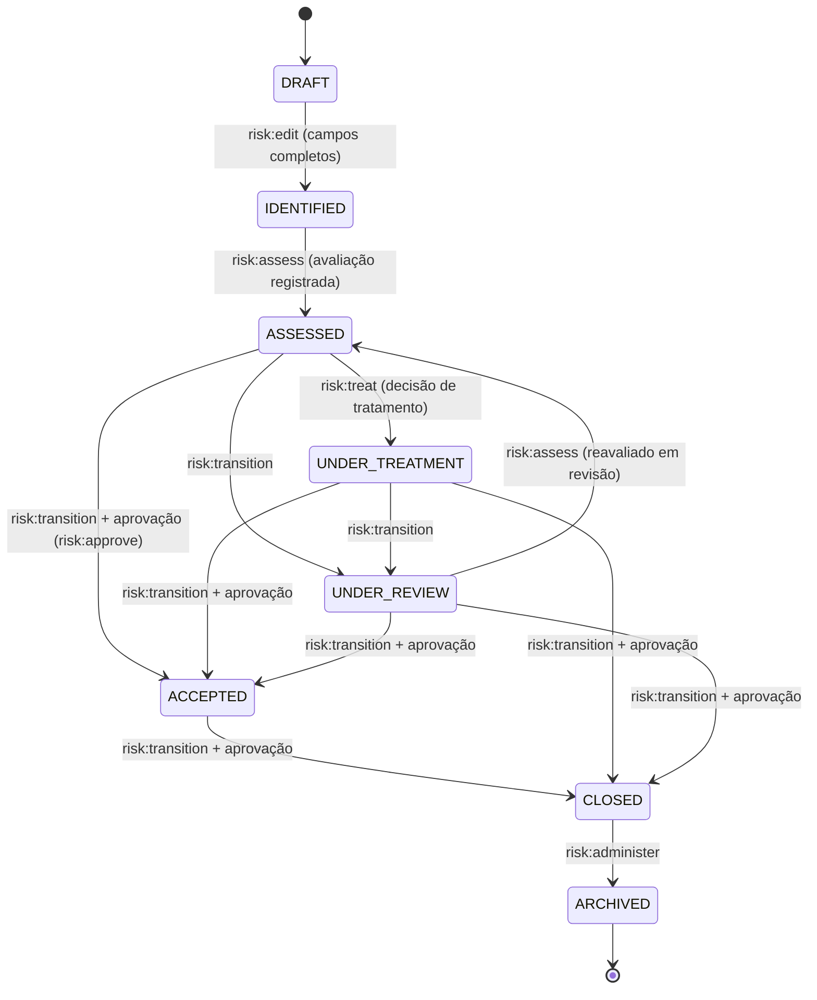

# Gestão de Riscos

## Status

**IMPLEMENTADO.** Primeiro módulo de negócio da plataforma (`specs/001-grc-platform-foundation/`,
CLAUDE.md §17 item 7). Posteriormente ajustado por `specs/007-implementation-remediation/`
("convergência de Ação" — `RiskTreatmentAction` deixou de ser dona de título/descrição/
responsável/prazo/status e virou linha de vínculo puro para a `Action` do núcleo GRC, ADR-016).
Não há um `specs/007-risk-*` dedicado a Risco: 007 é uma fase de remediação transversal que, entre
outras coisas, tocou o módulo de Risco.

### Itens em aberto (com evidência)

| Item | Referência | Situação |
|---|---|---|
| Rótulos de nível/status tipados fracamente | `docs/deferred-findings.md` (linhas ~12-25) | ABERTO — `apps/web/src/lib/messages/risks.ts` declara `RISK_LEVEL_LABELS`/`statusLabels` como `Record<string,string>` com fallback `?? level`; um valor novo em `RiskStatus`/`RiskLevel` compila e não quebra teste, mas mostra o valor bruto do enum ao usuário. |
| Tipos do frontend divergem do contrato em nulidade | idem (linhas ~465-479) | ABERTO — o contrato tipa `RiskSummary`/`RiskAssessment` corretamente como `nullable`, mas `apps/web/src/features/risks/types.ts` declara alguns campos como sempre presentes; risco concreto citado: uma checagem `!== null` pode classificar erroneamente um risco não avaliado como avaliado. |
| Fixture de SoD do E2E usa Administrador como substituto | idem (linhas ~397-415) | ABERTO — "Risk Analyst" e "Risk Approver" semeados em unidades organizacionais irmãs, sem unidade comum onde os dois enxerguem o mesmo risco; o E2E usa o Administrador da Plataforma (escopo global) como segundo ator, não um "Risk Approver" real no escopo. |
| Flakiness cruzada entre specs | idem (linha ~428) | ABERTO — `risk-history.spec.ts` e `risk-treatment.spec.ts` falham juntas sob 2 workers, sem causa raiz totalmente diagnosticada; ligado à fragilidade de fixture compartilhada já registrada em `specs/007-implementation-remediation/STATE.md`. |
| Possível interação Radix/Firefox no seletor de unidade organizacional | idem (linha ~453) | ABERTO, não investigado a fundo. |

## Objetivo

Identificar, avaliar (com histórico), tratar e revisar riscos corporativos, com aprovação
segregada para transições sensíveis e ligação explícita a Controle, Processo, Ativo, Incidente,
Problema e Achado.

## Entidades principais

| Modelo (Prisma) | Papel | Campos-chave |
|---|---|---|
| `Risk` (`risks`, tabela) | O risco. | `code` (`RSK-2026-0001`), `categoryId?`/`typeId?`/`originId?`, `orgUnitId`, `ownerUserId`, `responsibleUserId?`, `status`, `currentAssessmentId?`/`currentTreatmentId?`/`pendingApprovalId?`, `inherentScore?`/`inherentLevel?`, `residualScore?`/`residualLevel?`, `identifiedOn`, `lastAssessedOn?`, `nextReviewOn?`, `version` (lock otimista), `archivedAt?` (só via `CLOSED → ARCHIVED`) |
| `RiskCause` / `RiskConsequence` | Causas e consequências, linhas individuais (não texto livre). | `riskId`, `description`, `sortOrder` |
| `RiskMethodology` / `RiskMethodologyVersion` | Metodologia de avaliação — exatamente uma ativa; versão é **append-only** (sem caminho de edição). | `probabilityScale`/`impactScale`/`matrix`/`levelBands` (JSONB — a forma da escala varia por organização) |
| `RiskAssessment` | **Avaliação histórica, append-only.** | `methodologyVersionId`, `assessedByUserId`, `assessedOn`, probabilidade/impacto/score/nível inerentes e residuais, `controlsConsidered` (snapshot de IDs no momento, não FK), `previousAssessmentId` (encadeamento) |
| `RiskTreatmentDecision` | Decisão de tratamento — append-only, com superação (nunca edição). | `strategy` (`TreatmentStrategy`), `description`, `deadline?`, `supersededAt?`/`supersededById?` |
| `RiskTreatmentAction` | **Só um vínculo** Risco↔`Action` (pós-convergência 007). Não guarda mais título/status próprios. | `riskId`, `treatmentDecisionId?`, `actionId` (FK única 1:1) |
| `RiskControlLink` / `RiskProcessLink` / `RiskAssetLink` | Vínculos explícitos, soft-unlink. | `riskId`, alvo, `linkedAt`/`linkedByUserId`, `unlinkedAt?`/`unlinkedByUserId?` |
| `RiskLifecycleTransition` | Trilha de transição — append-only, sem mutação legítima nenhuma. | `fromStatus`, `toStatus`, `performedByUserId`, `justification?`, `approvalId?` |
| `Approval` (núcleo, `ApprovableEntityType.RISK`) | Aprovação de transição sensível. | `requestedTransition`, `status` (`PENDING`/`APPROVED`/`REJECTED`), CHECK de banco impedindo aprovador = solicitante |

## Estados / ciclo de vida

Tabela declarativa única de transições: `apps/api/src/modules/risk/domain/risk-lifecycle.ts`
(`RISK_LIFECYCLE_TRANSITIONS`). Qualquer par (origem, destino) fora da tabela é recusado (422); uma
linha com `requiresApproval: true` só é alcançável via `POST /risks/{riskId}/approvals`, nunca via
transição direta.

## Regras de negócio relevantes

- **Classificação por um único calculador (§19.7)** — `RiskScoringService.score()`
  (`apps/api/src/modules/risk/domain/risk-scoring.service.ts`), serviço de domínio puro, sem I/O.
  Nível é **sempre** derivado de `levelBands`, nunca do campo `level` de uma célula da matriz.
- **Aprovação exige solicitante ≠ aprovador** — `assertApproverDiffersFromRequester()`
  (`apps/api/src/modules/risk/domain/approval.ts`), chamada antes de qualquer escrita em
  `decide-approval.usecase.ts`, reforçada por CHECK de banco
  (`approvals_decided_by_requester_check`) — duas camadas, deliberadamente. Solicitar (`risk:transition`)
  e decidir (`risk:approve`) são permissões distintas, propositalmente.
- **Avaliações nunca são sobrescritas** — `RiskAssessment` é append-only; nova avaliação sempre
  insere linha, encadeia via `previousAssessmentId` e reaponta `Risk.currentAssessmentId` numa
  única transação. `RiskTreatmentDecision` e `RiskLifecycleTransition` seguem o mesmo padrão
  (superação ou imutabilidade, nunca UPDATE).
- **Vencimento de revisão** — `isOverdueReview()` (`apps/api/src/modules/risk/domain/risk-overdue.ts`):
  `nextReviewOn < dataDeReferência`. A lógica de vencimento de ação de tratamento foi removida
  daqui na convergência 007 e vive agora em `grc/shared/domain/overdue.service.ts` (`isActionOverdue`),
  já que `Action` é a autoridade única de status/prazo.
- **Bloqueio otimista** — `Risk.version`, cabeçalho `If-Match`; toda mutação é
  `WHERE id=? AND version=?`, descasamento lança erro 409.
- **Sem exclusão física (FR-102)** — `archivedAt` só é gravado pela transição `CLOSED → ARCHIVED`
  (`risk:administer`); não existe `risk:delete`.
- **Janela de coexistência com `Action` (F-36, histórico registrado)**: durante a fase 007, a
  escrita de status de `RiskTreatmentAction` passava por `MirrorActionStatusFromOriginUseCase`,
  um "espelho não verificado" que não usava o portão de transição legal do próprio `Action`. O
  agente de pesquisa **não encontrou** esse mecanismo mais ativo no código atual — a tela de
  "Planos de Ação" do risco hoje delega a `TransitionActionUseCase` (mesma tabela de legalidade,
  mesmos eventos de auditoria) e apenas confere adicionalmente que a origem da ação é o risco da
  URL. Ver `docs/modules/grc-core.md` para o estado atual completo da convergência.

## Telas

| Rota | Componente | Fluxo |
|---|---|---|
| `/risks` | `apps/web/src/app/(app)/risks/page.tsx` | Registro (lista) de riscos |
| `/risks/new` | `.../risks/new/page.tsx` | Criação |
| `/risks/[id]` | `.../risks/[id]/risk-detail-view.tsx` | Detalhe, com abas |

Abas do detalhe (`EntityTabs`): visão geral, causas e consequências, avaliação, controles,
incidentes, problemas, **tratamento** (decisão de tratamento), **planos de ação** (tabela funcional
de ações vinculadas — consolidada em uma só aba, corrigindo o defeito histórico do item 15 do
CLAUDE.md §17 em que havia duas abas e a chamada "Planos de Ação" mostrava indisponibilidade),
histórico, trilha de auditoria, anexos, comentários, evidência, achados.

## Permissões

| Chave | Ação | Cobre |
|---|---|---|
| `risk:view` | VIEW | Ver risco no escopo do ator |
| `risk:create` | CREATE | Criar risco |
| `risk:edit` | EDIT | Campos descritivos/classificação, causas, consequências |
| `risk:assess` | ASSESS | Registrar avaliação |
| `risk:treat` | TREAT | Decisão de tratamento, ação de tratamento, vínculo de controle |
| `risk:transition` | TRANSITION | Solicitar transição, inclusive as que exigem aprovação |
| `risk:approve` | APPROVE | Decidir aprovação pendente solicitada por outro usuário |
| `risk:administer` | ADMINISTER | Administrar, inclusive arquivar risco encerrado |

Sem `risk:delete` — a exclusão física não existe como operação. `methodology:administer` (fora
deste catálogo) controla a publicação de nova versão de metodologia.

## API

Controladores em `apps/api/src/modules/risk/presentation/`:

- `risk.controller.ts` — `GET/POST /risks`, `GET/PATCH /risks/:riskId`, `PUT /risks/:riskId/causes`,
  `PUT /risks/:riskId/consequences`.
- `assessment.controller.ts` — `GET/POST /risks/:riskId/assessments`.
- `treatment.controller.ts` — `GET/POST /risks/:riskId/treatments`,
  `GET/POST /risks/:riskId/treatment-actions`, `PATCH /risks/:riskId/treatment-actions/:actionId`.
- `risk-relationship.controller.ts` — `GET/POST/DELETE /risks/:riskId/controls`,
  `POST/DELETE /risks/:riskId/processes`, `POST/DELETE /risks/:riskId/assets`,
  `GET /risks/:riskId/incidents`, `GET /risks/:riskId/problems`.
- `lifecycle.controller.ts` — `GET /risks/:riskId/lifecycle`, `POST /risks/:riskId/transitions`,
  `GET/POST /risks/:riskId/approvals`, `POST /risks/:riskId/approvals/:approvalId/decision`.
- `methodology.controller.ts` — `GET /risk-methodology`, `GET /risk-methodology/versions`,
  `POST /risk-methodology/versions` (`methodology:administer`).
- `risk-reference-data.controller.ts` — `GET /risk-categories`, `/risk-types`, `/risk-origins`.
- `history.controller.ts` — `GET /risks/:riskId/history`.
- `audit.controller.ts` — `GET /risks/:riskId/audit-events`.

Contrato: `specs/001-grc-platform-foundation/contracts/risks.openapi.yaml`.

## Relações com outros módulos

Risco é o módulo onde o padrão de vínculo ADR-020 nasceu e foi provado pela primeira vez:

- `RiskControlLink` (Risco → Controle) — dono: Risco.
- `RiskProcessLink` (Risco → Processo) — dono: Risco.
- `RiskAssetLink` (Risco → Ativo) — dono: Risco.
- `IncidentRiskLink` / `ProblemRiskLink` — dono: Incidentes/Problemas; Risco só carrega a relação
  reversa do Prisma.
- `FindingRiskLink` — dono: `grc/finding`; Risco só carrega a FK reversa.
- `RiskTreatmentAction` — vínculo Risco → `Action` (núcleo GRC), 1:1.

Todos atravessam porta declarada em `shared/`, nunca importação direta entre módulos (ADR-020,
`docs/architecture/decisions.md` linha 251).

## Eventos de auditoria

`risk.created`, `risk.updated`, `risk.assessed`, `risk.treatment_decided`,
`risk.treatment_action_created`, `risk.treatment_action_updated`, `risk.control_linked` /
`risk.control_unlinked`, `risk.process_linked` / `risk.process_unlinked`, `risk.asset_linked` /
`risk.asset_unlinked`, `risk.transitioned`, `risk.approval_requested`, `risk.approval_approved`,
`risk.approval_rejected`, `risk_methodology_version.published`.

Lista de campos auditados por tipo de entidade em
`apps/api/src/modules/risk/domain/risk-audit-allowlist.ts` — deliberadamente exclui `status` e
campos derivados (score/nível), que pertencem a outros eventos, não ao conteúdo de negócio editado.

## Testes importantes

- **Unidade**: `risk-lifecycle.spec.ts`, `risk-overdue.spec.ts`, `risk-scoring.spec.ts`,
  `risk-scoring-validation.spec.ts`, `controls-risk-module-boundary.spec.ts`,
  `compliance-controls-risk-module-boundary.spec.ts` (fronteira de módulo, ADR-011/ADR-020).
- **Contrato**: `apps/api/test/contract/risk-*.spec.ts` (assessment, audit, detail, history,
  immutability, lifecycle, methodology, permissions, register, register-overdue-treatment,
  relationships, scope, statements, treatment, update).
- **Integração**: `finding-risk-link.spec.ts`, `risk-action-convergence.spec.ts`,
  `risk-approval.spec.ts`, `risk-assessment-history.spec.ts`, `risk-concurrency.spec.ts`,
  `risk-control-link.spec.ts`, `risk-crud.spec.ts`, `risk-history.spec.ts`, `risk-query.spec.ts`,
  `risk-transition-concurrency.spec.ts`, `risk-treatment-history.spec.ts`.
- **E2E**: `apps/web/e2e/risk-approval.spec.ts`, `risk-assessment.spec.ts`,
  `risk-collaboration.spec.ts`, `risk-create.spec.ts`, `risk-history.spec.ts`,
  `risk-register.spec.ts`, `risk-treatment.spec.ts`.

## Onde vive o código

- API: `apps/api/src/modules/risk/` (`domain/`, `application/`, `infrastructure/`,
  `presentation/`).
- Web: `apps/web/src/app/(app)/risks/`, `apps/web/src/features/risks/`.
- Prisma: `Risk`, `RiskCategory`, `RiskType`, `RiskOrigin`, `RiskCodeSequence`, `RiskCause`,
  `RiskConsequence`, `RiskMethodology`, `RiskMethodologyVersion`, `RiskAssessment`,
  `RiskTreatmentDecision`, `RiskTreatmentAction`, `RiskControlLink`, `RiskProcessLink`,
  `RiskAssetLink`, `RiskLifecycleTransition` (`apps/api/prisma/schema.prisma`, linhas ~919–1829).

## Detalhe Riscos V2 — refinamento visual de 20/09/2026

O header mantém `EntityHeader`, badges, metadados e edição existentes, com um
wrapper local e montanhas decorativas SVG (`risk-detail-artwork.tsx`). O resumo
apresenta os mesmos cinco fatos de `RiskDetail` em três agrupamentos visuais:
Exposição ao risco (inerente e residual), Resposta (tratamento e planos de ação)
e Governança (revisão). Datas, indicadores de atraso, contagens e ausências vêm
dos mesmos campos; os títulos não introduzem conceitos de domínio.

As abas e `?section=`, sidebar responsiva, lifecycle, aprovação e permission gates
permanecem nos componentes existentes. O CSS é local ao detalhe; nenhuma mudança
no Design System, API ou cálculo.
O trilho horizontal do ciclo de vida recebe foco visível e permite rolagem pelo
teclado no celular; a máquina de estados e os controles não foram alterados.

## Listagem Riscos V2 — 2026-09-20

A rota `/risks` preserva os contratos e o estado de URL de `useRegisterState`.
A composição visual usa `PageHeader` com montanhas em três planos e rosa dos ventos
editorial (`risk-register-artwork.tsx`, SVG inline decorativo). A arte tem paletas
light/dark e desaparece progressivamente junto ao texto; a rosa é omitida no mobile.

Os quatro indicadores continuam lendo as mesmas métricas de `GET /dashboard` e
mantêm seus links: total, críticos residuais, em tratamento e revisão vencida.
`SummaryStatCard` recebe apenas superfícies locais discretas; os indicadores passam
de uma a duas e quatro colunas conforme a largura disponível.

Busca, filtros, Base, ordenação e Cards/Tabela compartilham a faixa de exploração,
com controles reais e chips removíveis preservados. O único seletor de itens por
página fica junto à contagem dos resultados: opções **25/50/100**, padrão **50**.
A paginação inferior continua compartilhada entre cards e tabela. Nenhum estado
foi espelhado em estado local ou recalculado pelo cliente.

Os cards mantêm código como link para detalhe e título/área como abertura da visão
rápida; a seleção e o retorno de foco continuam intactos. A faixa superior e o tint
seguem o nível da Base selecionada; flags de tratamento/revisão vencidos dão o tom
de atenção dominante. Os badges continuam identificando cada condição por texto e
ícone. Metadados usam uma linha compacta com rótulos de definição acessíveis.

A frase motivacional, a saudação do mockup, o menu de três pontos e a opção de 12
itens não foram introduzidos: não correspondem a funcionalidades existentes.
A tela de detalhe e demais módulos não fazem parte desta mudança.

Captura reproduzível: `ui-capture.mjs --surface=risk-register` (ver cabeçalho do
script para o diretório de saída e parâmetros). Usa registros existentes, captura
cards/tabela e filtros abertos, e registra axe/overflow em JSON. O parâmetro opcional
`--verify-pagination=true` verifica quantidade/página, preservação entre modos e
teclado sobre um registro existente com mais de 50 itens, sem criar dados.
